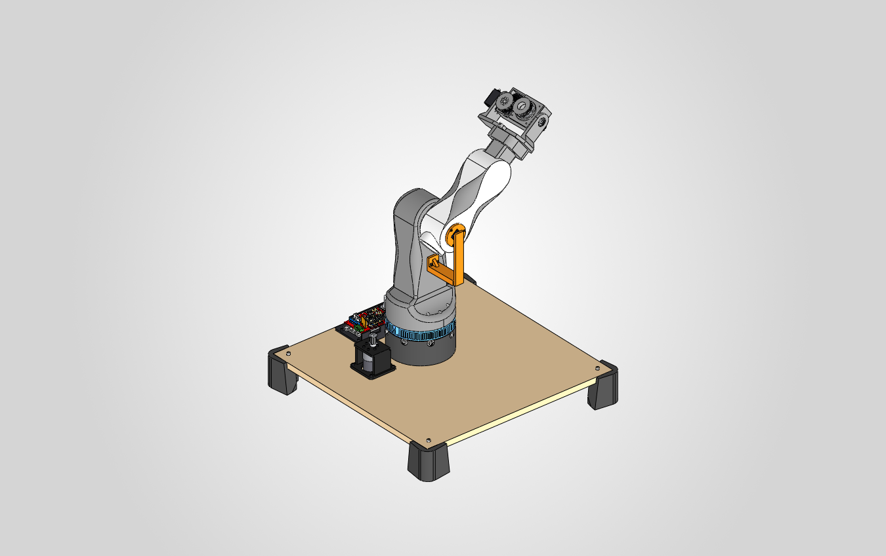

# CitriBot – Robot recolector de naranjas

Trabajo Práctico Final de **Robótica 1** – FIUNA, 2026 (2.º semestre). Grupo 4.



CitriBot es un robot de 6 grados de libertad: un **riel lineal de 1,2 m**, un **brazo RRP** y una **herramienta de succión con torsión**. Localiza las naranjas con **visión estéreo**, las toma con una ventosa, las arranca girándolas y las deja en dos cajones según su tamaño.

Este repositorio guarda **la versión final de cada cosa**: diseño 3D, BOM, código, electrónica y documentación. Lo que está en `main` es la versión oficial del grupo.

---

## Estado

Actualizado: 2026-10-20.

| Parte | Estado |
|---|---|
| Diseño 3D del brazo (J1–J3) | Ensamblaje SolidWorks v5 completo, ver [cad/solidworks](cad/solidworks/README.md) |
| Herramienta (J4–J5) | Diseñada (OpenSCAD + SolidWorks). Todavía fija, sin articular en el ensamblaje |
| Riel (J0) | Sin diseñar |
| BOM | Completa, con préstamos del laboratorio y compras: [bom/BOM.md](bom/BOM.md) |
| Firmware (Arduino MEGA) | Esqueleto PlatformIO, sin código |
| Visión | Scripts para probar las cámaras y capturar fotos de calibración |
| Control y cinemática | Sin código |
| Electrónica | Sin diagrama de conexiones |

---

## Articulaciones

| Art. | Tipo | Actuador | Driver | Sensor |
|---|---|---|---|---|
| J0 riel | P | NEMA 17 (17HS2408) | TB6600 | final de carrera |
| J1 cintura | R | motorreductor 37D 90:1, correa T5 ≈ 10:1 | Sabertooth canal 1 | encoder 64 CPR del motor |
| J2 hombro | R | motorreductor sinfín 5840-36ZY, directo | Sabertooth canal 2 | AS5600 en el eje |
| J3 brazo | P | NEMA 14 + tornillo TSF-E3 | A4988 en la RAMPS | final de carrera |
| J4 muñeca | R | servo MG996R | PWM del MEGA | – |
| J5 torsión | R | servo MG996R + correa GT2 66:66 | PWM del MEGA | – |
| Vacío | – | bomba 12 V + electroválvula | MOSFET | sensor de presión MPS20N0040D |

Detalle y puntos abiertos: [docs/arquitectura.md](docs/arquitectura.md).

---

## Estructura

```
CitriBot/
├─ bom/            BOM completa (CSV editable, Excel y Markdown generados)
├─ cad/
│  ├─ solidworks/  ensamblaje completo del brazo + herramienta (abrir CB-000)
│  ├─ herramienta/ fuente OpenSCAD de la herramienta y sus STL
│  └─ imprimir/    STL/3MF finales listos para imprimir
├─ electronica/    diagrama de conexiones y pines
├─ firmware/       Arduino MEGA + RAMPS 1.4 (PlatformIO)
├─ vision/         PC: cámaras estéreo, calibración, detección de naranjas
├─ control/        PC: cinemática, trayectorias, enlace serial con el MEGA
├─ docs/           arquitectura, protocolo serial, diagramas e imágenes
└─ entregas/       entregas parciales del curso (solo historial, no se editan)
```

Flujo del software:

```
2 cámaras -> vision (OpenCV) -> XYZ de la naranja
          -> control (cinemática inversa) -> posiciones de cada articulación
          -> serial -> firmware (MEGA) -> motores
```

---

## Cómo trabajar con el repo

### Clonar

El CAD (SolidWorks, STEP, STL) se guarda con **Git LFS**. Instalá Git LFS una vez antes de clonar:

```
git lfs install
git clone https://github.com/<usuario>/CitriBot.git
```

### Reglas del grupo

1. **Una sola versión de cada archivo.** No subir copias como `pieza_v2_final.SLDPRT`: Git guarda el historial. Para volver a una versión vieja, usá el historial.
2. **Los archivos de SolidWorks no se pueden fusionar.** Si dos personas editan la misma pieza a la vez, se pierde el trabajo de una. Avisá al grupo antes de editar una pieza, o bloqueala con `git lfs lock <archivo>` (y `git lfs unlock <archivo>` al terminar).
3. **La BOM se edita solo en** `bom/BOM_CitriBot.csv`. Después corré `python bom/generar_bom.py` para regenerar `BOM.md` y el Excel.
4. Antes de empezar a trabajar: `git pull`. Al terminar: `git add`, `git commit -m "qué cambiaste"` y `git push`.

### Software

- Firmware: [firmware/README.md](firmware/README.md)
- Visión: [vision/README.md](vision/README.md)
- Control: [control/README.md](control/README.md)

---

## Créditos

- **BCN3D Moveo** (BCN3D Technologies, licencia MIT): tablero, patas, lazy susan, plato dentado `1M1B` y tornillería de la base. Licencia en [cad/solidworks/LICENSE_BCN3D_Moveo.txt](cad/solidworks/LICENSE_BCN3D_Moveo.txt).
- **Rx-rcp-003**: eslabones `E2`, `E3` y tornillo `TSF-E3`, usados como base del hombro y del prismático.
- Componentes electrónicos y motores prestados por el **Laboratorio de Robótica de la FIUNA** (lista en [bom/BOM.md](bom/BOM.md#préstamos-del-laboratorio-a-devolver)).
