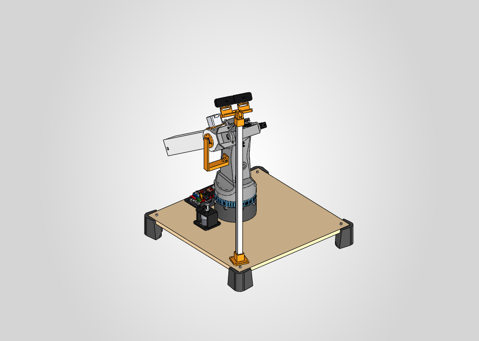
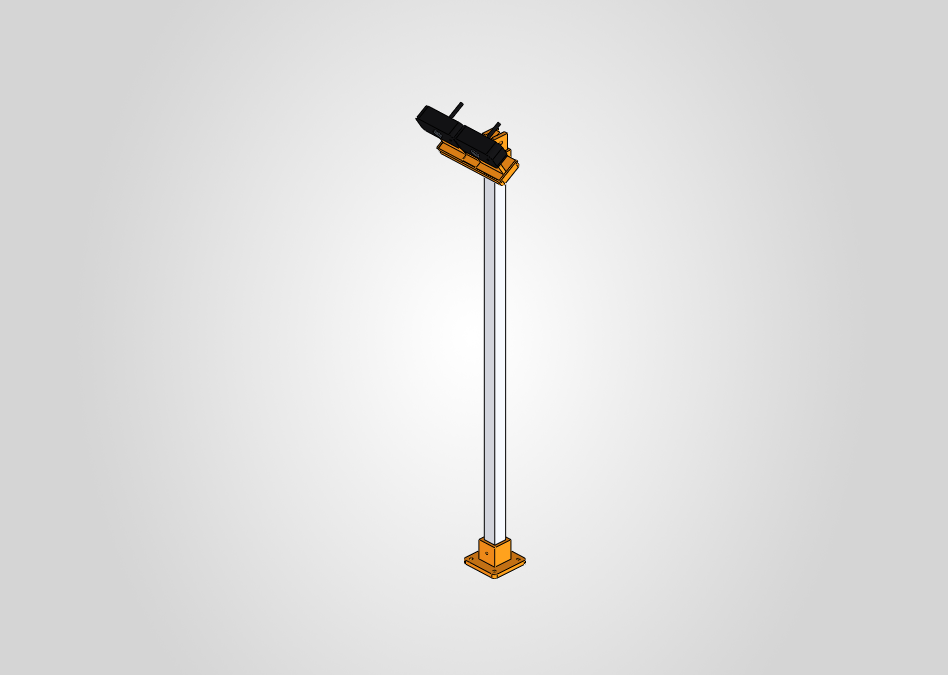

# CitriBot – Ensamblaje mecánico (SolidWorks)

> **En el repo**: esta carpeta es la copia de `Desktop\CitriBot_Ensamblaje`. Las rutas a `Desktop\...` de abajo son de dónde salieron los modelos originales. No se incluyen `Cambios\` (modelos originales de electrónica), `Ensamblaje1.glb` ni el STEP duplicado `Ensemblaje1.step`. La lista de materiales está en [bom/BOM.md](../../bom/BOM.md).

Ensamblaje completo del brazo **CitriBot** (Robótica 1, FIUNA 2026-S2), **con la herramienta** (muñeca + torsión + ventosa) montada en el extremo de E3.
Combina cuatro fuentes:

| Tramo | Origen | Qué se usa |
|---|---|---|
| Base y articulación 1 (cintura, J1) | **BCN3D Moveo** (`Desktop\BCN3D-Moveo-master`) | tablero y patas, lazy susan (`Rotary Plate`), plato dentado `1M1B`, eje M8, tornillería |
| Eslabón de cintura (torre) | **Diseño del usuario** `Desktop\2M1D.STEP` | Torre `2M1D` (derivada de `E1` del Rx-rcp-003), adaptada al motor 5840 |
| Hombro (J2) | **Rx-rcp-003** (`Proyecto\3D\Rx-rcp-003`) | cubo de `E2` |
| Prismático (J3), v7 | **Diseño nuevo** (`08_Scripts_API_SolidWorks\V7.cs`) | cola corta de E2, tubo de aluminio de E3, brida, tapón con pinza, NEMA 17 + correa GT2 |
| Herramienta | **Diseño del usuario** (`09_Herramienta\Ensamblaje.step`) | horquilla U, porta-servo, caja de torsión, 2 × MG996R, polea, eje hueco, rodamientos, ventosa |
| Electrónica | **Modelos del usuario** (`Cambios\`) | Arduino Mega 2560, RAMPS 1.4, A4988, Sabertooth 2x60, AS5600 |

Motores:
- **Cintura J1**: motorreductor **37D 90:1 con encoder 64 CPR** (37Dx70.1L), con la correa T5 del BCN3D.
- **Hombro J2**: motorreductor sinfín-corona **5840** (12 V, 12 rpm) en *direct drive*, con un **AS5600** que mide el ángulo real de E2. Modelado según el plano del vendedor (§6.2).
- **Prismático J3** (v7): **NEMA 17** vertical sobre el cubo de E2 (placa CB-306) con **correa GT2** (polea de 20 dientes: 40 mm por vuelta) y driver A4988. Carrera **340 mm**: con la ventosa alineada con el brazo, el labio va de 227.8 a 567.8 mm del eje J2 y cubre la esfera de trabajo ([docs/espacio_de_trabajo.md](../../docs/espacio_de_trabajo.md)).

Todo está hecho en **SolidWorks 2026** (plantillas Z-arriba). Archivo principal:
**`CB-000_CitriBot_Ensamblaje_General.SLDASM`**.



---

## Historial de cambios

| Versión | Cambios |
|---|---|
| v1 (2026-10-17) | Primer ensamblaje: base BCN3D + torre 2M1D + brazo Rx-rcp-003. AS5600 en un soporte fijo e imán en TE2. |
| **v2 (2026-10-17)** | **La tapa de E2 es ahora el soporte del AS5600** (CB-303) y los cables van por dentro de E2. **El imán pasa al soporte fijo** (CB-232). **Bandeja de electrónica abierta** (CB-140/141) con Mega + RAMPS + A4988 y Sabertooth, en lugar de la caja del BCN3D. **NEMA 14 del BCN3D** en lugar del motor DC del prismático. Se usa el modelo real del AS5600. |
| **v3 (2026-10-17)** | **Sin errores ni advertencias** en el ensamblaje: venían de los modelos de electrónica. Arduino Mega reconvertido a sólido sin historial; Sabertooth importado desde su STEP. **RAMPS reemplazada por el STEP** `Shield Ramps 1.4.stp` (en lugar del STL) y A4988 en su zócalo real. El soporte CB-232 y el AS5600 quedan como en v2. |
| **v4 (2026-10-17)** | **Herramienta agregada** (CB-600, desde `09_Herramienta\Ensamblaje.step`) en el extremo de E3, como un bloque rígido dentro de CB-400. |
| **v5 (2026-10-17)** | **Colores realistas en los componentes comprados** (las piezas impresas no se tocaron): tornillos Allen pavonados, tuercas y arandelas cincadas, rodamientos de acero, polea de aluminio, imán niquelado, Sabertooth con PCB verde, disipador de aluminio y condensadores negros, AS5600 azul, ventosa de goma negra con racor metálico, MG996R negros, horns de aluminio. La RAMPS, el Mega, el A4988, el NEMA 14 y los motores 37D/5840 ya tenían colores realistas. |
| **v7.2 (2026-10-28)** | **Ventosa JXD Ø40 × 22 (medida) en el eje hueco, la torsión gira la ventosa**: la parte de arriba de la ventosa (Ø19 con dos planos a 17) entra en un alojamiento doble D en la punta de CB-606. El racor de 6 mm × G1/4 baja por dentro del eje, apoya en un fondo de 3 mm y aprieta la ventosa contra el fondo (llave de montaje CB-620). En CB-600 la McMaster CB-617 se cambió por **CB-618** (ventosa) + **CB-619** (racor). Labio a 63.5 mm del eje de cabeceo. Ver §6.12. |
| **v7.1 (2026-10-27)** | **Cámaras estéreo**: módulo **CB-150** dentro de CB-100 (fijo a la base, se mueve con el riel): pie CB-151 atornillado en la esquina trasera del tablero del lado opuesto al brazo, mástil de aluminio 20 × 20 × 1.5 (CB-152), cabezal con pivote de cabeceo M5 (CB-153), adaptador (CB-154) y el **soporte StereoVision_03 del usuario** (base CB-156 + 2 tapas CB-157), donde cada **Logitech C270** (CB-515) se cuelga con su propia pinza: **71 mm entre lentes**. Lentes a 676 mm del tablero, mirando al centro de la esfera (765 mm, rumbo −18°, 32° hacia abajo). **J1 queda limitado a −40° … +120°** respecto del árbol (barrido `SweepJ1.cs`). Scripts: `Vision.cs`, `SweepJ1.cs`, `OccSweep.cs`. |
| **v7 (2026-10-27)** | **Prismático J3 con correa GT2, más corto.** Pasa al ensamblaje principal la variante A de [docs/v7_prismatico.md](../../docs/v7_prismatico.md): E3 = tubo 30 × 30 × 2 de **440 mm** movido por un lazo de **correa GT2** (polea 20T en el NEMA 17, polea loca 20T en la punta de la cola). El **NEMA 17 va vertical arriba del cubo de E2**, sobre la placa **CB-306**, y la cola de E2 queda en **377 mm** detrás de J2 (antes 451.5 mm con el motor). Carrera **340 mm**. Salen el husillo T8, la tuerca, el acople y el portatuerca (CB-511/512/513/403 v6, en el historial de git); entran el tapón con pinza **CB-403**, la correa **CB-514** y las poleas `HW_Polea_*`. El hombro (5840 + AS5600), la cintura y la herramienta no cambian. Brida y tubo con **pasadores al ras** en vez de M3 pasantes. La variante B (telescópica) queda como alternativa en `11_v7B_Prismatico_Telescopico\` (`CB-000B_CitriBot_v7B_Telescopico.SLDASM`). Scripts: `V7.cs`, `Promote.cs`, `Sweep7.cs`. |
| **v6 (2026-10-22)** | **Prismático J3 de carrera larga para cubrir la esfera de trabajo** (con E3 v2 + TSF-E3 la ventosa quedaba entre 357 y 411 mm del eje J2; hace falta de 254 a 554 mm). E2 cortado a 93 mm por delante del eje J2 y con una **cola de 55 × 55** hacia atrás. **E3 = tubo de aluminio 30 × 30 × 2 de 460 mm** que se retrae por detrás del hombro. **NEMA 17 + husillo T8 de 400 mm** en el extremo de la cola. Carrera **350 mm**. Herramienta en la brida nueva CB-402. Se sacaron del ensamblaje E3 v2, TSF-E3 y NEMA 14. Script: `J3Largo.cs`; verificación: `Alcance.cs`. **Motor del hombro según el plano del vendedor** (`Hombro5840.cs`): rosca **M4** (no M6), resaltes de apoyo de 2 mm, buje Ø18.5 × 5, eje a 20 mm del borde; torre con agujeros M4 y tornillos M4x10. Verificación de torques: `control/torques.py`. |

---

## 1. Cómo abrirlo

1. Copiá o mové **siempre la carpeta `CitriBot_Ensamblaje` completa**. Las referencias son internas: ningún archivo apunta a las carpetas originales del BCN3D, del Rx-rcp-003 ni a `Cambios\`.
2. Abrí `CB-000_CitriBot_Ensamblaje_General.SLDASM`. Si SolidWorks pregunta por referencias, elegí la carpeta `CitriBot_Ensamblaje`.
3. Los eslabones son subensamblajes **rígidos**; las articulaciones son relaciones de posición en el ensamblaje general. Para mover el brazo, arrastrá la torre (J1), el eslabón E2 (J2) o el eslabón E3 (J3).
4. Para Fusion 360 u otros CAD: `07_STEP\CB-000_CitriBot_Ensamblaje_General.step`.

> La RAMPS (`CB-508`) viene del STEP `Shield Ramps 1.4.stp`. El cuerpo principal de ese STEP no forma un sólido válido, así que SolidWorks lo importa como **superficie**: se ve bien, pero no entra en el cálculo de interferencias ni de masa.

---

## 2. Estructura de carpetas

```
CitriBot_Ensamblaje\
├─ CB-000_CitriBot_Ensamblaje_General.SLDASM   ← ensamblaje general (abrir este)
├─ README.md
├─ 01_Base_J0\              eslabón 0 (fijo): tablero y patas, lazy susan fija, motor J1, electrónica, mástil de las cámaras
├─ 02_Cintura_J1\           eslabón 1: plato 1M1B + torre 2M1D mod + motor del hombro + soporte del imán
├─ 03_Hombro_E2_J2\         eslabón 2: E2 con cola corta + tapa-soporte del AS5600 + placa del NEMA 17 (+ NEMA 17, poleas y correa GT2 de 05_Comerciales)
├─ 04_Prismatico_E3_J3\     eslabón 3: tubo de aluminio + brida + tapón con pinza de correa (+ herramienta)
├─ 05_Comerciales\          motores, imán, rodamientos, polea
│   ├─ Electronica\         Arduino Mega, RAMPS 1.4, A4988, Sabertooth 2x60, AS5600 (modelos del usuario)
│   └─ Tornilleria\         tornillos, tuercas, arandelas, separadores (prefijo HW_)
├─ 06_Imagenes\             capturas de cada ensamblaje
├─ 07_STEP\                 STEP del conjunto + 2M1D.STEP original del usuario
├─ 08_Scripts_API_SolidWorks\  código C# (API SolidWorks) con el que se generó todo
├─ 09_Herramienta\          herramienta (CB-600) + STEP original del usuario
├─ 12_Pruebas\               piezas que no van en el robot: CB-158 adaptador con bola para la rótula del trípode + CB-159 cámaras en el trípode
├─ 11_v7B_Prismatico_Telescopico\  variante B (telescópica), alternativa que no se eligió: CB-000B_CitriBot_v7B_Telescopico.SLDASM
└─ Cambios\                 archivos originales de electrónica que pasó el usuario (no se usan directo)
```

### Convención de nombres

`CB-XYZ_Descripcion` (CB = CitriBot). La centena indica el eslabón:
`1xx` base/J0 · `2xx` cintura/J1 · `3xx` hombro-E2/J2 · `4xx` prismático-E3/J3 · `5xx` comerciales.
`HW_` = tornillería y piezas normalizadas. Los ensamblajes terminan en `00`, `10`, `30` o `40` (`CB-100`, `CB-110`, …).

---

## 3. Árbol del ensamblaje

```
CB-000_CitriBot_Ensamblaje_General
├─ CB-100_Base_J0                         (FIJO)
│   ├─ CB-110_Base_Tablero_Patas          tablero 550x550 + 4 patas
│   ├─ CB-120_LazySusan_Fija_J1           1M2A + 8 rodillos 625ZZ + 2 x 608ZZ
│   ├─ CB-130_Modulo_Motor_J1             soporte nuevo + motor 37D + polea T5 + 6 x M3x8
│   ├─ CB-140_Modulo_Electronica          bandeja + Mega + RAMPS + A4988 + Sabertooth + tornillería
│   ├─ CB-150_Modulo_Camaras              pie + mástil 20x20 + cabezal + adaptador + soporte StereoVision_03 + 2 C270
│   └─ tornillería de base (M4x40, M4x30, M5x30, arandelas, tuercas, tuercas de rodillos)
├─ CB-200_Cintura_J1                      (gira en J1)
│   ├─ CB-201 plato dentado 1M1B, CB-210 torre 2M1D mod
│   ├─ CB-502 motor 5840 (caja+motor) + 2 x M4x10
│   ├─ CB-232 soporte del imán + CB-504 imán + 2 x M4x30 + 2 x tuerca M4
│   └─ 6 x M4x45 + 6 x tuerca M4 autoblocante, M8x65 + separador + tuerca M8
├─ CB-300_Hombro_E2_J2                    (gira en J2)
│   ├─ CB-301 E2 mod (cubo + cola corta), CB-305 buje D8, CB-506 eje de salida del 5840
│   ├─ CB-306 placa del NEMA 17, CB-505 NEMA 17, polea GT2 20T, polea loca GT2 20T, CB-514 correa GT2
│   └─ CB-303 tapa-soporte del AS5600 + CB-503 AS5600 + 4 x M3x6 + 3 x M3x10
└─ CB-400_Prismatico_E3_J3                (desliza en J3; home = retraído)
    ├─ CB-401 tubo 30x30x2 L440, CB-402 brida de la herramienta, CB-403 tapón con pinza de correa
    └─ CB-600_Herramienta                 (fija a la brida; muñeca y torsión todavía sin articular)
        ├─ CB-601 horquilla U, CB-602 porta-servo, CB-603 caja de torsión, CB-604 tapa
        ├─ CB-605 polea servo GT2, CB-606 eje hueco con polea, CB-607 separador
        ├─ CB-610 / CB-611 servos MG996R (muñeca / torsión), con CB-612 cuerpo y CB-613
        └─ 2 × CB-614 horn D20, 2 × CB-615 + CB-616 rodamientos, CB-618 ventosa JXD Ø40, CB-619 racor 6 mm × G1/4
```

### Relaciones de posición (articulaciones) en `CB-000`

| Articulación | Relación | Entidades | Resultado |
|---|---|---|---|
| J1 cintura | `J1_plano_base` (coincidente) | plano horizontal de CB-200 ↔ plano horizontal de CB-100 | fija la altura |
| | `J1_eje_cintura` (concéntrica) | agujero central Ø11 del 1M1B ↔ agujero Ø8 del 608ZZ | **revoluta vertical** |
| J2 hombro | `J2_eje_hombro` (concéntrica) | buje Ø18.5 de la caja 5840 ↔ eje de salida Ø8 (CB-506) | eje del hombro |
| | `J2_cara_hombro` (coincidente) | cara del aro Ø56 de la torre ↔ cara anular de E2 | **revoluta horizontal** |
| J3 prismático | `J3_plano_medio` (coincidente) | plano Z de la brida CB-402 ↔ plano Z de E2 (plano medio) | eje del prismático, |
| | `J3_plano_eje` (coincidente) | plano Y de la brida CB-402 ↔ plano Y de E2 | … sin giro |
| | `J3_limite_carrera` (límite de distancia) | cara interior de la brida ↔ frente de E2: **2 – 342 mm** (inicial 2) | **carrera 340 mm** (q3 = distancia − 2) |

Las piezas de E2 y E3 están modeladas en las mismas coordenadas (las de E2, con J3 retraído). Por eso las dos primeras relaciones son entre planos de referencia.

Verificado con la API: 0 errores de relaciones. Barrido de J2 con J3 retraído y extendido: ver los rangos más abajo.

---

## 4. Sistema de referencia y geometría útil (para cinemática)

- **Origen** del ensamblaje general: sobre el eje J1, en la **cara superior del tablero**. **Z hacia arriba**.
- Suelo (pie de las patas, sin riel): **z = −80 mm**. Eje J1 a **194.8 / 275.0 / 275.0 / 355.2 mm** de los bordes del tablero. El árbol va del lado de 194.8 mm, donde está la bandeja de electrónica.
- Cara superior del plato 1M1B (apoyo de la torre): **z = 91.5 mm**.
- **Eje J2**: horizontal, a **z = 355.5 mm**, y **corta al eje J1** (sin desplazamiento en planta).
- El plano medio de E2 (y el eje del prismático J3) está desplazado **83.0 mm** del eje J1, medido a lo largo del eje J2 (offset lateral del hombro).
- El eje del prismático (canal de E2) **corta al eje J2**.
- Cara exterior de la brida de E3: **105 mm + q3** del eje J2 (q3 = 0 … 340).
- Herramienta (CAD), con la cara de la brida como referencia: eje de cabeceo y torsión a **65.4 mm**. La ventosa del CAD (CB-618, medida: Ø40 × 22) entra 6.8 mm en la punta del eje hueco: labio a **63.5 mm** del eje de cabeceo. La `.scad` v4.2 da 55.2 mm con la SAB40 (28.8 de alto) porque su caja es 21.9 mm más corta que la del STEP.
- Coordenadas de E2 (todas las piezas de CB-300 y CB-400): eje J2 = eje Z en (x = −80, y = 0), eje del prismático = eje X. Frente de E2 en x = 13, extremo trasero en x = −457 (377 mm detrás de J2). NEMA 17 vertical sobre el cubo: eje en x = −58, cara a y = 47.
- Pose guardada: **E2 a +32.3° sobre la horizontal**, J3 retraído (q3 = 0).

### Rangos de movimiento (verificados por interferencias)

| Articulación | Rango libre | Limita |
|---|---|---|
| J1 | **−40° a +120°** respecto del árbol (barrido de `SweepJ1.cs` cada 5°). Límite por software recomendado: −35° … +115° | a −45° el cubo de E2 toca el mástil de las cámaras; a +125° (J3 extendido, J2 arriba) la herramienta toca las cámaras; además, los cables |
| J2 | con el brazo apuntando al árbol (borde de 194.8 mm): **−45° a +45°** libre con J3 retraído y extendido (barrido de `Sweep7.cs` cada 15°). No se probó más allá de ±45° | en la v6: abajo, horquilla contra la torre; arriba, el NEMA de la cola contra el tablero (en la v7 el NEMA ya no está en la cola) |
| J3 | 340 mm (relación de límite) | 98 mm de guía mínima del tubo dentro de E2; con J3 extendido la pinza queda a 6 mm de la polea del motor |

La esfera de trabajo necesita J2 entre −34° y +10° (sin carro de riel). Con el brazo apuntando a otro lado, la cola de 38 cm puede tocar la bandeja de electrónica o el tablero antes: revisar con `Sweep7.cs` si hace falta.

---

## 5. Lista de archivos

### 01_Base_J0 (eslabón fijo)

| Archivo | Origen | Tipo | Cant. | Notas |
|---|---|---|---|---|
| CB-100_Base_J0.SLDASM | nuevo | ensamblaje | – | eslabón 0 |
| CB-110_Base_Tablero_Patas.SLDASM | nuevo (con piezas BCN3D) | ensamblaje | 1 | tablero + patas en la posición del `Base assembly` del BCN3D |
| CB-111_Tablero_Madera_550x550x16 | BCN3D `Base fusta` | madera | 1 | **modificado**: agujero Ø42 bajo el motor 37D y 4 × Ø4.5 para la bandeja |
| CB-112_Pata_Base | BCN3D `Potes base B` | impreso | 4 | |
| CB-120_LazySusan_Fija_J1.SLDASM | BCN3D `Rotary Plate` | ensamblaje | 1 | |
| CB-121_Placa_Fija_J1_1M2A | BCN3D `1M2A` | impreso | 1 | |
| CB-122_Rodillo_LazySusan.SLDASM | BCN3D `Sistema rodaments` | ensamblaje | 8 | 625ZZ + M5x20 + separador M5x10 |
| CB-130_Modulo_Motor_J1.SLDASM | **nuevo** | ensamblaje | 1 | |
| CB-131_Soporte_Motor_J1_37D | **nuevo** | impreso PETG | 1 | reemplaza a `1M3A` |
| CB-140_Modulo_Electronica.SLDASM | **nuevo** | ensamblaje | 1 | |
| CB-141_Bandeja_Electronica | **nuevo** | impreso PETG | 1 | 210 × 100 mm, reemplaza la caja del BCN3D (ver §6.9) |
| CB-150_Modulo_Camaras.SLDASM | **nuevo** (v7.1) | ensamblaje | 1 | marco: origen en el eje J1 sobre el tablero, x hacia el árbol (ver §6.11) |
| CB-151_Pie_Mastil_Camaras | **nuevo** | impreso PETG 100 % | 1 | 60 × 60 × 6 + encastre del tubo; 4 tirafondos 4 × 12 al tablero, prisionero M4 |
| CB-152_Mastil_Camaras_20x20x1.5 | **nuevo** | aluminio | 1 | tubo cuadrado 20 × 20 × 1.5, 627 mm |
| CB-153_Cabezal_Mastil | **nuevo** | impreso PETG 100 % | 1 | encastre del tubo + orejas del pivote de cabeceo (M5 × 30 + tuerca autoblocante) |
| CB-154_Adaptador_Soporte_Estereo | **nuevo** | impreso PETG 100 % | 1 | placa 121 × 37 × 8 con lengüeta del pivote; la base del soporte va encima con 4 × M3x12 + tuerca (alojamientos hexagonales) |
| CB-156_Soporte_Estereo_C270_Base | **usuario** (StereoVision_03) | impreso PETG | 1 | remodelada con las cotas del STL (sin los redondeos de 1 mm) + **4 agujeros Ø3.2 para el adaptador**: pared de 5.3 mm para las pinzas de las C270, 71 mm entre centros de tramo. Imprimir `cad/imprimir/01_Base_J0/CB-156_Soporte_Estereo_C270_Base.stl` (exportado de este modelo) |
| CB-157_Soporte_Estereo_C270_Tapa | **usuario** (StereoVision_03) | impreso PETG | 2 | importada del STL; traba la pinza de cada cámara (2 tornillos autorroscantes Ø3.5 × 10 a los postes) |

### 02_Cintura_J1 (eslabón 1)

| Archivo | Origen | Tipo | Cant. | Notas |
|---|---|---|---|---|
| CB-200_Cintura_J1.SLDASM | nuevo | ensamblaje | – | |
| CB-201_Plato_Giratorio_Polea_J1_1M1B | BCN3D `1M1B` | impreso | 1 | plato con dientes T5 |
| CB-210_Torre_Cintura_2M1D_mod | **usuario** `2M1D.STEP` | impreso PETG | 1 | **modificado** (ver §6.3) |
| CB-232_Soporte_Iman_J2 | **nuevo** | impreso PETG | 1 | sostiene el imán del AS5600 (ver §6.6) |

### 03_Hombro_E2_J2 (eslabón 2)

| Archivo | Origen | Tipo | Cant. | Notas |
|---|---|---|---|---|
| CB-300_Hombro_E2_J2.SLDASM | nuevo | ensamblaje | – | |
| CB-301_Eslabon_E2_mod5840 | Rx `E2` | impreso | 1 | **modificado**: cubo del Rx + cola corta de la v7, 470 mm de largo (ver §6.4 y §6.8) |
| CB-303_Tapa_E2_Soporte_AS5600 | **nuevo** | impreso PETG | 1 | reemplaza a `TE2` (ver §6.6) |
| CB-304_Tapa_TE1_no_ubicada | Rx `TE1` | impreso | – | no estaba ubicada en el ensamblaje del Rx-rcp-003; se deja como referencia |
| CB-305_Buje_D8_Hombro | **nuevo** | impreso o aluminio | 1 | acople eje D8 ↔ cubo de E2 |
| CB-306_Placa_Soporte_NEMA17_Prismatico | **nuevo** (v7) | impreso PETG 100 % | 1 | placa 62 × 62 × 5: el NEMA 17 se atornilla en la mesa (4 × M3x6) y la placa va a E2 con 4 × M3x10 en insertos |

### 04_Prismatico_E3_J3 (eslabón 3)

| Archivo | Origen | Tipo | Cant. | Notas |
|---|---|---|---|---|
| CB-400_Prismatico_E3_J3.SLDASM | nuevo | ensamblaje | – | home = J3 retraído |
| CB-401_Tubo_E3_Aluminio_30x30x2 | **nuevo** (v7) | aluminio | 1 | tubo cuadrado 30 × 30 × 2, largo 440 mm, 2 agujeros Ø3.2 para los pasadores (ver §6.5) |
| CB-402_Brida_E3_Herramienta | **nuevo** (v6) | impreso PETG | 1 | placa 80 × 80 × 10 con 4 × Ø5.4 en rombo r = 28.5 + tapón 25.8 × 20 dentro del tubo |
| CB-403_Tapon_Trasero_Pinza_Correa | **nuevo** (v7) | impreso PETG 100 % | 1 | tapón trasero del tubo con la pinza de los dos extremos de la correa GT2 |

### 09_Herramienta

| Archivo | Pieza del STEP | Notas |
|---|---|---|
| CB-600_Herramienta.SLDASM | `Ensamblaje` | ensamblaje de la herramienta (importado, piezas separadas) |
| CB-601_Horquilla_U | HorquillaU | placa de 8 mm con 4 × Ø5.4 en rombo de radio 28.5 (mismo patrón que la brida CB-402) |
| CB-602_Porta_Servo | PortaServo | |
| CB-603_Caja_Torsion / CB-604_Tapa_Caja | Caja / Tapa | |
| CB-605_Polea_Servo_GT2 / CB-606_Eje_Hueco_Polea | PoleaServo / EjeHueco_Polea | transmisión de la torsión |
| CB-607_Separador | Separador | |
| CB-610_Servo_MG996R_Muneca / CB-611_Servo_MG996R_Torsion | MG996R_1-0 / MG996R | subensamblajes; comparten CB-612_MG996R_Cuerpo y CB-613_MG996R_Componente1 |
| CB-614_Horn_Servo_D20 | servo_Horn_round_20mm | 2 |
| CB-615_Rodamiento_5972K217 / CB-616_Rodamiento_5972K91 | rodamientos McMaster | 2 + 1 |
| CB-617_Ventosa_5427A638 | 5427A638_Vacuum Cup | ya no está en CB-600 (v7.2): reemplazada por CB-618 |
| CB-618_Ventosa_JXD_40 | (nuevo, v7.2) | ventosa medida por el usuario: goma con labio Ø40 y cuello Ø25 (15) + inserto de 7, Ø19 con planos a 17 y rosca hembra G1/4 |
| CB-619_Racor_6mm_G1-4 | (nuevo, v7.2) | racor recto push-in 6 mm × 1/4" BSP con junta, alto 22.9; hexágono 14 y anillo Ø16.5 estimados de la foto |
| CB-620_Llave_Montaje_Racor | (nuevo, v7.2) | herramienta impresa, no va en el robot: tubo Ø19.8 con hexágono de 14.4 en la punta para apretar el racor desde el lado de la polea |

### 05_Comerciales

| Archivo | Descripción | Cant. |
|---|---|---|
| CB-501_Motor_37D_90-1_Encoder64CPR | motorreductor 37D 90:1, 6/12 V, encoder 64 CPR (modelo según plano Pololu 37D) | 1 |
| CB-502_Motor_Sinfin_5840-36ZY | motorreductor sinfín 5840 (caja + motor), según el plano del vendedor (§6.2) | 1 |
| CB-506_Eje_Salida_5840_D8 | eje de salida del 5840 (Ø8, plano a 7, 15 mm desde el buje), modelado aparte porque gira con E2 (es parte del mismo motor) | (1) |
| CB-504_Iman_Diametral_D6x2.5 | imán de neodimio diametral Ø6 × 2.5 mm | 1 |
| CB-505_Motor_NEMA17_Prismatico | NEMA 17 de 40 mm (tipo 17HS4401); en la v7 va vertical sobre el cubo de E2 | 1 |
| CB-514_Correa_GT2_6mm_J3 | correa GT2 de 6 mm, lazo de 810 mm (dibujo sin dientes) | 1 |
| HW_Polea_GT2_20T_D5 | polea GT2 20 dientes, agujero 5 mm (eje del NEMA 17 de J3) | 1 |
| HW_Polea_Loca_GT2_20T_D5 | polea loca GT2 20 dientes, agujero 5 mm, con rodamientos (punta de la cola) | 1 |
| HW_Polea_Loca_GT2_16T_D3 | polea loca GT2 16 dientes, agujero 3 mm (solo variante B) | – |
| HW_Polea_T5_10T_eje6 | polea T5 10 dientes, ancho 17, **agujero 6 mm** | 1 |
| HW_Rodamiento_608ZZ_8x22x7 | rodamiento 608ZZ | 2 |
| HW_Rodamiento_625ZZ_5x16x5 | rodamiento 625ZZ (rodillos de la lazy susan) | 8 |
| Correa T5 de 16 mm (no modelada) | según BOM del BCN3D | 1 |

### 05_Comerciales\Electronica (modelos que pasó el usuario en `Cambios\`)

| Archivo | Origen | Notas |
|---|---|---|
| CB-503_Modulo_AS5600 | `as5600-5\AS5600.stp` | convertido a pieza multicuerpo; **se quitó el imán** que traía el modelo |
| CB-507_Arduino_Mega_2560 | `arduino-mega-19\Adruino Mega.SLDPRT` | reconvertido a sólido sin historial: el original tenía errores en `Body-Move/Copy1..3` |
| CB-508_RAMPS_1.4 | `shield-ramps-1-4-1\Shield Ramps 1.4.stp` | trae solo la RAMPS (sin Mega); cuerpo principal como superficie (ver §1). Encastrada sobre los conectores del Mega |
| CB-509_Driver_A4988 | `a4988-8\A4988.stp` | convertido a pieza multicuerpo; ubicado en un zócalo de la RAMPS (el del prismático) |
| CB-515_Camara_Logitech_C270 | **nuevo** (modelo simplificado) | cuerpo 73 × 32 × 22, lente Ø14 centrada (en la real está algo corrida); la pinza de monitor no está modelada y la altura de la cámara sobre el soporte es aproximada |
| CB-510_Sabertooth_2x60 | `sabertooth-dual-60a…\sabertooth.STEP` | importado del STEP: el SLDPRT original tenía un chaflán fallido (`Chamfer4`) y una referencia externa rota (`Sketch49`) |

### Tornillería (05_Comerciales\Tornilleria)

| Pieza | Cant. | Uso |
|---|---|---|
| HW_M3x6_Allen_DIN912 | 4 (+ 4 no modelados) | 4 AS5600 → tapa-soporte; los 4 del NEMA 17 → placa CB-306 no están modelados |
| HW_M3x8 | 11 | 6 motor 37D → soporte CB-131 (máx. 3 mm de rosca en la caja); 5 Arduino Mega → bandeja |
| HW_M3x10 | 7 (+ 4 no modelados) | 3 tapa-soporte → E2; 4 Sabertooth → bandeja; los 4 de la placa CB-306 → insertos de E2 no están modelados |
| (no modelados, v7) | – | 1 M5x70 + tuerca autoblocante + 2 arandelas (eje de la polea loca); 4 insertos térmicos M3; 2 pasadores Ø3 × 30 (tubo → brida y tapón) |
| HW_M4x30 | 10 | 4 soporte motor J1 → tablero; 2 soporte del imán → torre; 4 bandeja → tablero |
| HW_M4x40 | 4 | placa 1M2A → tablero |
| HW_M4x45 | 6 | torre → plato 1M1B |
| HW_M5x20 + HW_Separador_M5x10 | 8 + 8 | ejes de los rodillos |
| HW_M5x30 | 4 | patas → tablero |
| HW_M4x10_Allen_DIN912 | 2 | motor 5840 → torre (5.5 mm de pared + 4.5 mm en la rosca M4 del motor, que tiene 6) |
| HW_M8x65 + HW_Separador_M8x20 (2) + HW_Tuerca_M8_Autoblocante | 1 + 2 + 1 | eje central de J1 |
| HW_Tuerca_M4_Autoblocante | 18 | 6 torre/plato, 4 placa 1M2A, 4 soporte J1, 4 bandeja |
| HW_Tuerca_M4 | 2 | soporte del imán (dentro de la torre) |
| HW_Tuerca_M5_Autoblocante | 12 | 8 rodillos, 4 patas |
| HW_Arandela_M4 / HW_Arandela_M5 | 12 / 4 | bajo el tablero |

---

## 6. Qué se cambió y por qué

### 6.1 Motor de la cintura: 37D en lugar del NEMA 17 (CB-130 / CB-131 / tablero)

- El 37D tiene la caja Ø36.8 con el **eje descentrado 7 mm**. Con el eje en la misma posición que el NEMA (para no tocar la correa ni el plato 1M1B), la caja no entra en la cavidad de 44.3 mm del `1M3A`. Se diseñó **CB-131**: mismo patrón de 4 × M4 (64.8 × 64.8 mm, mismos agujeros del tablero), placa superior con 6 × M3 en círculo Ø31 (patrón Pololu) y paso Ø13 para el buje del motor.
- La polea tiene que quedar a la altura de los dientes del 1M1B, y el motor mide 70.1 mm + 6 mm de buje. Por eso el motor **sobresale 15.1 mm por debajo de la cara del tablero**: se agregó un **agujero pasante Ø42** en `CB-111`.
- Polea: T5 de 10 dientes como el BCN3D pero con **agujero de 6 mm**, en la misma posición. Correa T5 de 16 mm del BOM del BCN3D. Relación ≈ 10:1.

### 6.2 Motor del hombro: el Rx-rcp-003 **no** usaba un 5840

El ensamblaje del Rx-rcp-003 usa un **JGY-370** en el hombro, no un 5840. El 5840 se modeló desde cero. En la v6 se rehízo con el **plano del vendedor** ("Product size"):

| Cota | Plano (modelo v6) | Modelo anterior (v1–v5) |
|---|---|---|
| Caja | 40 × 58 × 27; eje a 20 mm del borde superior y 38 del lado motor | 40 × 58 × 26.8; eje a 19 / 39 |
| Fijación | **4 × M4 prof. 6** en resaltes Ø7.6 que sobresalen **2 mm** de la caja; pares a 11.05 y 29 mm del eje, separación 27.5 (el inferior izquierdo es colisa) | 4 × M6 a 27.7 × 39.7, caja plana |
| Buje frontal | Ø18.5 × 5 desde la caja | Ø18.6 × 4 |
| Eje | Ø8, plano a 7 mm de 13 mm, punta a 20 mm de la caja | Ø8, punta a 19 mm |
| Atrás | buje Ø18.5 × 4.45 | tapa Ø17 × 4 |
| Motor | Ø36 × 62, corrido 2 mm hacia un costado | Ø36 × 63 centrado |

- El plano de apoyo contra la torre son los **resaltes de 2 mm**, no la caja. El origen del modelo está en ese plano, así que la posición del motor en CB-200 no cambió.
- Datos de catálogo del 5840 de 12 V y 12 rpm: ≈ 70 kg·cm (un vendedor; no aclara si es nominal o de bloqueo), 9 rpm con carga, 0.3 A en vacío y 6.5 A en bloqueo. El Sabertooth 2x25 alcanza.

> ⚠️ Medir con calibre el motor comprado antes de imprimir CB-210: posición del eje (20 mm del borde) y alto del buje (5 mm). Si difieren, mover la feature `CB_v6_Agujeros_M4_motor5840` de la torre.

### 6.3 Torre 2M1D (CB-210)

Tu 2M1D trae la base Ø160 con los 6 × M4 en Ø136 que coinciden con el plato 1M1B del BCN3D (se monta con los mismos M4x45). El alojamiento del motor del hombro es el del E1 original del Rx y **no coincide con el 5840**. Se agregó:

- `CB_Avellanado_M6_D11x6.5` + `CB_v6_Agujeros_M4_motor5840`: 2 × Ø4.5 para el **par de agujeros del lado motor** del 5840 (M4, a 29 mm bajo el eje y ±13.75), con la cabeza Allen M4 hundida 2.5 mm en el avellanado Ø11 (el faldón de E2 pasa a 1 mm). Los pasos Ø6.4 de la versión M6 se rellenaron (`CB_v6_Relleno_pasos_M6`).
- El **otro par** del 5840 cae dentro del alojamiento Ø44 donde gira el anillo de E2: **no se usa**.
- Los 2 agujeros originales (Ø6.4 + Ø10) quedan libres para una abrazadera que sujete la lata del motor.
- `CB_Agujeros_M4_soporte_AS5600`: 2 × Ø4.4 para el soporte del imán (tuercas por dentro de la torre, debajo del motor).

### 6.4 E2 (CB-301) y buje (CB-305)

- Cubo recortado **4.5 mm** (`CB_Recorte_cubo_4.5mm`) para no chocar con el buje del 5840. Con el motor del plano quedan **1.5 mm** entre el buje Ø18.5 y el cubo, y el eje entra 13.5 mm en el buje CB-305.
- El cubo de E2 tiene agujero en **D (Ø12.4 con plano a 5.12 mm)**. El buje **CB-305** tiene el exterior en D (calza en E2) y el interior en D para el eje D8 del 5840. Pegar con epoxi; si se imprime, PETG al 100 % o mejor en aluminio.
- El eje Ø8 del 5840 está modelado aparte (**CB-506**) para que gire con E2 al mover J2.
- **v6**: del E2 del Rx solo queda el cubo del hombro, con el anillo, el agujero en D, la ventana Ø40 y los pilotos de la tapa. Features `CB_v6_*`:
  - se corta el frente a 93 mm del eje J2 (x = 13) y el boss trasero;
  - se rellenan el alojamiento del NEMA 14 y el canal viejo;
  - cola 55 × 55 hasta x = −491.5 (411.5 mm detrás del eje J2);
  - canal 31 × 31 para el tubo, abierto adelante;
  - placa trasera de 6 mm con paso Ø23 para el buje del NEMA 17 y 4 × M3 con alojamiento de cabeza desde el canal;
  - túnel de 10 × 5 para los cables del AS5600, desde la ventana hasta la salida lateral del extremo trasero.
- **v7** (features `CB_v7A_*` y `CB_v7_*`):
  - cola cortada a x = −457 (**377 mm** detrás del eje J2) con pared trasera de 5 mm;
  - techo de la cola subido de y = 27.5 a **y = 36** y **ranura de 22 × 15.5 mm** sobre el canal, donde corre el lazo de la correa;
  - base de la placa CB-306 sobre el cubo (y = 42, el cubo del Rx se rebaja ahí), 4 agujeros Ø4.2 para insertos M3, paso Ø8 del eje del motor y bolsillo de 36 × 36 × 10 para la polea;
  - agujero vertical Ø5.3 del eje de la polea loca, 362 mm detrás de J2;
  - salida del túnel de cables del AS5600 movida al nuevo extremo trasero.

### 6.5 E3 y J3 (v7: tubo de aluminio de 440 mm)

- **CB-401**: tubo cuadrado de aluminio 30 × 30 × 2, largo **440 mm**. Desliza en el canal 31 × 31 de E2 (0.5 mm de juego por lado; cinta de PTFE o patines si baila). Con J3 retraído va de x = −425 a 15. El tubo pasa por debajo de la ventana del AS5600, y la espiga de la tapa CB-303 queda 7 mm por encima.
- **CB-402** (brida): placa 80 × 80 × 10 con los 4 × Ø5.4 de la horquilla y tapón 25.8 × 20 que entra en el tubo. Cara exterior a 105 mm del eje J2 con J3 retraído.
- **CB-403** (tapón trasero con pinza): tapa el extremo trasero del tubo y sujeta los dos extremos de la correa en una ranura de 1.8 mm (dientes enfrentados + precinto).
- Brida y tapón van con **epoxi + pasador de acero Ø3 × 30 al ras**: una cabeza de tornillo rozaría el canal.
- Con J3 extendido al máximo (340 mm) quedan **98 mm de tubo dentro de E2**.
- Antes: v1–v5, el `E3__v2` del Rx-rcp-003 con 53.5 mm de carrera; v6, tubo de 460 mm con husillo T8 y portatuerca.

### 6.6 AS5600 del hombro: la tapa de E2 es el soporte (v2)

Con *direct drive*, el eje del 5840 gira junto con E2. Por eso el sensor y el imán tienen que estar en eslabones distintos: uno en E2 y el otro fijo a la torre. Como pediste que la tapa de E2 sea el soporte del sensor:

- **CB-303 (tapa-soporte, gira con E2)**: reemplaza a `TE2`. Brida Ø56 × 6 sobre la cara exterior de E2, con espiga hueca Ø39.6 que entra en la ventana Ø40 de E2. Al estilo del *AS5600 testing jig*, el **AS5600 va en un alojamiento con la placa al ras** y el **chip hacia afuera, sobre el eje J2**. Se fija con 4 × M3x6 y la tapa va a E2 con 3 × M3x10 avellanados.
- **Cables por dentro**: los pines del header bajan por **dos ranuras** de la brida a la **espiga hueca Ø30**. Desde la v6 siguen por el **túnel de 10 × 5** de la cola de E2 (no por el canal del tubo) y salen al costado del extremo trasero. En la v7 el NEMA 17 está arriba del cubo, así que su cable cruza J2 cerca del eje: juntarlo con el del AS5600 en un mismo mazo con lazo de servicio.
- **CB-232 (soporte del imán, fijo a la torre)**: el mismo pie y brazo que antes (2 × M4x30 + tuerca a la torre). La placa ahora solo tiene un **boss Ø12 con el imán Ø6 × 2.5 pegado**, frente al chip y **a 1.5 mm** (recomendado 0.5–3 mm). **Este soporte no lleva cables.**
- Se usa el **modelo real del AS5600** que pasaste: placa 22.96 × 23.03, agujeros ovalados a 16.2 × 16.2 mm.
- Igual que antes, el soporte pasa por debajo del eje J2: **E2 no puede apuntar más de ≈ 55° hacia abajo**.

### 6.7 Por qué no se puede eliminar el soporte fijo

Si el sensor va en la tapa (que gira con E2), el imán tiene que quedar quieto respecto de la torre y sobre el eje J2, del lado de afuera de E2. El eje del 5840 no sale por atrás de la caja y no es hueco, así que la única forma de llegar al eje J2 desde la torre es rodeando E2 por afuera (CB-232). La alternativa que evita el soporte es medir J2 con otro sensor (ver la nota sobre la IMU en §9).

### 6.8 Prismático (v7): NEMA 17 + correa GT2 (CB-306, CB-505, CB-514, poleas GT2)

- **Por qué**: la ventosa tiene que llegar de 254 a 554 mm del eje J2 para cubrir la esfera de trabajo ([docs/espacio_de_trabajo.md](../../docs/espacio_de_trabajo.md)), con ≥ 300 mm de carrera y el brazo retraído de menos de ≈ 25 cm. En la v6 eso dejaba 451.5 mm de brazo detrás del hombro (cola + NEMA en la punta). Con la correa, el motor sube al cubo y la cola se acorta a 377 mm. Comparación con la variante telescópica: [docs/v7_prismatico.md](../../docs/v7_prismatico.md).
- **Cadena de cotas** (x de E2, J3 retraído; u = x + 80 es la distancia al eje J2):

  | x | Pieza |
  |---|---|
  | −457 … −452 | pared trasera de E2 |
  | −442 | eje de la polea loca GT2 20T (M5 vertical) |
  | −430 … −412 | pinza de la correa (tapón CB-403) |
  | −425 … 15 | tubo |
  | −58 | eje del NEMA 17 y de la polea GT2 20T (cara del motor a y = 47, placa CB-306 de y = 42 a 47) |
  | 13 | frente de E2 |
  | 15 … 25 | brida |

  Correa: lazo de 810 mm entre las dos poleas, en y = 22.5 … 28.5, por encima del tubo. Con J3 = 340 la pinza llega a x = −72, a 6 mm de la polea del motor.
- **Ventosa** alineada con el brazo: de **227.8 a 567.8 mm** del eje J2 con la SAB40 de la BOM, o de 233.9 a 573.9 mm con la ventosa medida del CAD (CB-618).
- **Motor**: 40 mm por vuelta → **80 pasos/mm** con el A4988 a 1/16. Con J3 extendido y J2 a 45° pide ≈ 18 N = 1.2 kg·cm (`control/torques.py`), contra 4.5 kg·cm de retención. La correa **no es autobloqueante**: dejar el driver habilitado para que el brazo inclinado no deslice.
- El A4988 del prismático va en la RAMPS (CB-140). Con un NEMA 17 de 1.7 A, regular a ≈ 1.2 A con disipador.
- **Antes**: v2–v5, NEMA 14 del BCN3D dentro de E2 con el tornillo impreso TSF-E3 (53.5 mm de carrera); v6, NEMA 17 en la punta de la cola con husillo T8 de 400 mm, acople 5 × 8 y portatuerca. Esas piezas están en el historial de git.

### 6.9 Electrónica: bandeja abierta (CB-140 / CB-141)

- Reemplaza la caja de electrónica del BCN3D (6 × TB6560), en el mismo lugar del tablero, detrás del robot.
- **CB-141** mide 210 × 100 × 4 mm (entra en la Ender 3 V2). Tiene:
  - separadores para el **Arduino Mega** (5 × M3 autorroscante, h = 6) y para el **Sabertooth 2x60** (4 × M3, h = 5);
  - pared trasera y lateral de 30 mm con ranuras para cables, y pared frontal baja de 12 mm;
  - el lado del USB y el jack del Mega abierto, y ranuras de ventilación bajo el Sabertooth.
- La **RAMPS 1.4** va montada sobre el Mega: la base de la placa apoya sobre el plástico de los pines macho, sobre los conectores hembra del Mega. El **A4988** va en el zócalo que usa el prismático.
- Se fija al tablero con 4 × M4x30 + arandela + tuerca; los agujeros Ø4.5 ya están en `CB-111`.
- No se cerró la parte superior, como pediste. Más adelante se puede agregar una tapa calada.

### 6.10 Herramienta (CB-600) – v4

- Importada desde tu `09_Herramienta\Ensamblaje.step` **conservando las piezas separadas**, con nombres CB-6xx (el STEP original queda en la carpeta).
- **Montaje**: la cara de la placa de la horquilla U apoya sobre la cara exterior de la brida de E3 (CB-402 desde la v6). Los **4 agujeros Ø5.4 en rombo (r = 28.5)** coinciden con los de la brida. En la v6 la herramienta se corrió 153.5 mm hacia el hombro junto con la brida (J3 retraído en el home de CB-400).
- **Orientación**: eje de cabeceo de la muñeca **paralelo a J2**. Con la muñeca a 0°, la **ventosa queda perpendicular al prismático y hacia abajo** (pose natural). En el STEP la muñeca venía girada ≈ 1.9°; se respetó tal cual.
- Por ahora la herramienta es un **bloque rígido fijo dentro de CB-400**: se mueve con J3. Las articulaciones de cabeceo y torsión todavía no tienen relaciones de posición.
- Los 4 tornillos M5 de la horquilla a la brida (M5 × 25 + tuerca) no están modelados.
- En la pose inicial no hay interferencias entre la herramienta y el resto del robot.

---

### 6.11 Cámaras estéreo (CB-150) – v7.1



- **Dónde**: fijas a la base (se mueven con el riel, no con J1), en un mástil en la **esquina trasera del tablero del lado opuesto al brazo**. Con J1 apuntando al árbol el brazo trabaja en y = −82 mm; el pie está en (x, y) = (−290, 222) en el marco del árbol, a 6 mm del perno de la pata.
- **Geometría** (marco del árbol: origen en el eje J1 sobre el tablero, x hacia el árbol):

  | | Valor |
  |---|---|
  | Soporte | StereoVision_03 del usuario: cada C270 colgada de su pinza (CB-156 + 2 × CB-157), sobre el adaptador CB-154 |
  | Lente izquierda / derecha | (−210.4, 233.5, 676.2) / (−232.3, 166.0, 676.2) mm (aprox.: falta medir dónde queda la C270 en su pinza) |
  | Línea de base | 71 mm, cámaras paralelas |
  | Eje óptico | (0.8059, −0.2612, −0.5313): rumbo −18°, 32° hacia abajo, al centro de la esfera |
  | Distancia al centro de la esfera | 765 mm |

- **Campo de visión** (C270 nominal, 55° diagonal → 49° × 29° en 720p): la esfera entra entera en las dos cámaras con 10.6° de margen horizontal y 3.2° vertical (≈ 43 mm). 1.8 px/mm sobre la esfera (naranja de 75 mm ≈ 135 px); disparidad ≈ 130 px y error de profundidad ≈ ±3 mm con medio píxel (con 120 mm de base eran ±1.8 mm).
- **Ancho de las C270**: con 71 mm entre centros, si el cuerpo mide 72.9 mm (ficha de Logitech, que incluye la pinza) las cámaras quedan pegadas; en el modelo se pisan ≈ 2 mm. Si al armar no entran, separar los dos tramos del soporte. **Medir el campo real** con el damero: en 720p la C270 puede recortar el sensor.
- **Oclusión** (`OccSweep.cs`: un cono por cámara desde la lente hasta la esfera, J1 al árbol, J3 retraído): con **J2 = −45° o −40° la vista está libre** (verificado también con el soporte StereoVision_03); de −30° a +45° la herramienta tapa parte de la esfera. E2, el tubo, la torre y la base nunca la tapan. **Pose de observación: J3 retraído y J2 = −45°.**
- **Choques** (`SweepJ1.cs` y `Sweep7.cs`): con J1 al árbol, J2 libre de −45° a +45° con J3 retraído y extendido. **J1 libre de −40° a +120°**: a −45° … −55° el cubo de E2 toca el tubo del mástil (J2 = 0); a +125° … +175° la herramienta toca las cámaras (J3 extendido, J2 = +45°) y a +155° el tubo de E3 toca el mástil. Los cajones de descarga tienen que quedar dentro de −35° … +115°.
- **Ajuste**: el cabeceo se regula con el M5 del pivote; el rumbo, girando el tubo en el pie y en el cabezal (prisioneros M4).

### 6.12 Ventosa JXD Ø40 en el eje hueco: la torsión gira la ventosa (CB-606, CB-618, CB-619, CB-620) – v7.2

- La punta de CB-606 traía un hexágono abierto de 17.6 entre caras para la ventosa McMaster 5427A638. Se rellenó y la punta quedó así, de afuera hacia adentro:
  - **Alojamiento doble D** (Ø19.4 con dos planos a 17.4, 6.8 de hondo) para la parte de arriba de la ventosa JXD (inserto de 7 mm, Ø19 con planos a 17). **El eje gira la ventosa por los planos**: el giro no pasa por la rosca.
  - **Fondo de 3 mm** con un paso de Ø14.2 para la rosca y la junta del racor.
  - **Asiento de Ø17.2 × 1.8** para el anillo del racor y, arriba, el paso de Ø20.5 de siempre.
  - El resto del eje (polea de 66 dientes, cubo, Ø30 para los rodamientos) no cambió.
- El racor (6 mm × 1/4" BSP con junta tórica) baja por dentro del eje, apoya el anillo en el fondo y se enrosca en la ventosa. Al apretarlo, el fondo queda entre el anillo del racor y el inserto de la ventosa: eso retiene la ventosa. El alojamiento es 0.2 mm más corto que el inserto, así que el apriete es contra el fondo y no contra la goma.
- **Montaje**, en este orden:
  1. Poner teflón en la rosca del racor y bajarlo por el lado de la polea, con la rosca hacia la punta, hasta que la junta entre en el paso del fondo.
  2. Meter la ventosa desde afuera, con los planos alineados con el alojamiento, y sostenerla.
  3. Por el lado de la polea, meter la **llave de montaje CB-620** (tubo de Ø19.8 con hexágono de 14.4 en la punta) y girar el racor hasta apretarlo contra la ventosa. La llave no queda en el robot.
  4. Meter la manguera de 6 mm por el lado de la polea hasta el racor.
- **Imprimir CB-606 con la polea abajo** (la punta arriba), PETG al 100 %: no lleva soportes. CB-620 de pie, con el mango arriba. STL en `cad/imprimir/00_Herramienta/`. El STL original (`cad/herramienta/stl/EjeHueco_Polea.stl`) no se tocó.
- **Ventosa CB-618** (medidas del usuario): goma de 15 de alto (labio Ø40 con 3 mm a 45°, cono hasta Ø25 a 10 mm del labio, cuello Ø25) + inserto de 7 (Ø19 con planos a 17, rosca hembra G1/4). El ángulo y el labio son aproximados.
- **Medidas del racor a confirmar con calibre antes de imprimir** (estimadas de la foto, 0.9" de alto total): hexágono (14 entre caras, para la llave), anillo (Ø16.5 × 1.8), cuello con la junta (3 = espesor del fondo) y rosca (4.5; tiene que entrar en el inserto de 7). Si cambian, se corrigen las constantes de `Ventosa3.cs` y se vuelve a correr.
- Interferencias en CB-600 y en CB-000: ninguna con las piezas nuevas.
- El labio queda **15.2 mm afuera de la punta del eje y a 63.5 mm del eje de cabeceo** (con la McMaster eran 77.2): ρ = 233.9 … 573.9 mm, la esfera entra con 20 mm de margen de cada lado.
- Corte del conjunto: `06_Imagenes/CB-600_Herramienta_Ventosa_corte_front.png`.

## 7. Interferencias (resultado del análisis en la pose inicial)

No quedan choques entre piezas nuevas o adaptadas. Lo que reporta SolidWorks viene de los modelos originales o de roscas y ajustes modelados:

| Volumen | Entre | Explicación |
|---|---|---|
| 359 mm³ | 1M1B ↔ separador M8x20 | igual que en el BCN3D original (ajuste del eje central) |
| 172 mm³ × 4 | 1M2A ↔ M5x20 | roscas de los ejes de rodillos (BCN3D) |
| 68 mm³ | 1M1B ↔ M8x65 | BCN3D |
| 45 mm³ × 4 | tablero ↔ M5x30 | agujeros de patas no modelados en el tablero (BCN3D) |
| 5–18 mm³ | tornillos M3 ↔ E2, tapa, bandeja, Mega; M4x10 ↔ 5840 | **autorroscantes en agujero piloto** o rosca modelada (intencional) |
| 0 mm³ (contacto) | 5840 ↔ torre | los 6 resaltes de 2 mm apoyan contra la pared; el resto del motor no toca |
| hasta 32 000 mm³ | piezas internas de la herramienta (MG996R, horns, rodamientos) | vienen del STEP de la herramienta (modelos de servo superpuestos); no tocan al resto del robot |
| 0.3–0.6 mm³ | E2 ↔ buje, rodillos 625ZZ ↔ 1M1B | ajuste a presión / contacto de la lazy susan |

---

## 8. Secuencia de montaje sugerida

1. **Base**: patas al tablero (4 × M5x30 + arandela + tuerca). Perforar el **Ø42** y los **4 × Ø4.5** de la bandeja (posiciones en `CB-111`).
2. **Lazy susan fija**: armar los 8 rodillos (M5x20 + 625ZZ + separador M5x10) en la 1M2A, colocar los 2 × 608ZZ y atornillar la 1M2A al tablero (4 × M4x40 + arandela + tuerca autoblocante).
3. **Módulo motor J1**: motor 37D bajo la placa de CB-131 (6 × M3x8), polea T5 en el eje (prisionero sobre el plano D), módulo al tablero (4 × M4x30).
4. **Electrónica**: bandeja al tablero (4 × M4x30). Sabertooth (4 × M3x10) y Mega (5 × M3x8) a los separadores; RAMPS sobre el Mega y A4988 en su zócalo.
5. **Plato 1M1B**: separador M8x20 en el cubo, apoyar sobre los rodillos, eje M8x65 desde arriba y tuerca M8 autoblocante abajo. Correa T5 de 16 mm, tensar.
6. **Motor del hombro**: meter el 5840 por el lado abierto de la torre, buje Ø18.5 en el agujero Ø32, resaltes contra la pared y 2 × M4x10 desde afuera.
7. **Torre**: sobre el plato 1M1B con 6 × M4x45 + tuerca M4 autoblocante.
8. **E2**: pegar los 2 tramos impresos de E2 y colocar los 4 insertos M3 de la base del motor (soldador a ≈ 220 °C). Pegar la cinta de PTFE en el canal. NEMA 17 a la placa CB-306 con 4 × M3x6 desde abajo (en la mesa). Meter la polea GT2 20T por el frente del canal, subirla a la ranura y llevarla bajo el agujero del motor; bajar el motor con la placa pasando el eje por la polea y atornillar la placa con 4 × M3x10. Polea a 26 mm de la cara del motor, prisioneros sobre el plano del eje. Polea loca en la punta de la cola con el M5x70 vertical, una arandela de cada lado y tuerca autoblocante abajo. Pegar el buje CB-305 en el cubo de E2 y montar E2 sobre el eje D8 del 5840.
9. **AS5600**: soldar el header con los pines hacia la tapa y atornillar el AS5600 a CB-303 (4 × M3x6). Pasar los cables por las ranuras y la espiga, y después por el túnel de la cola hasta la salida trasera. Atornillar la tapa a E2 (3 × M3x10).
10. **Imán**: pegar el imán en el boss de CB-232 y atornillar el soporte a la torre (2 × M4x30 + tuerca por dentro). Verificar 1–2 mm entre el chip y el imán.
11. **E3**: brida CB-402 y tapón CB-403 en el tubo, con epoxi y un pasador Ø3 × 30 al ras cada uno. Meter el tubo por el frente de E2 hasta el fondo. Pasar la correa por la ranura alrededor de las dos poleas, meter los dos extremos en la ranura de la pinza con los dientes enfrentados, tensar y asegurar con 2 precintos. Final de carrera de J3 en la pared trasera de E2.
12. **Herramienta**: horquilla CB-601 a la brida con 4 × M5 × 25 + tuerca.
13. **Cámaras**: pie CB-151 al tablero (4 tirafondos), tubo en el pie y cabezal arriba (prisioneros M4). Atornillar la base CB-156 al adaptador CB-154 por sus 4 agujeros de la placa del centro (4 × M3x12 desde arriba + tuerca en los alojamientos hexagonales del adaptador). Colgar cada C270 de la pared con su pinza y trabarla con su tapa CB-157 (2 autorroscantes Ø3.5 × 10). Adaptador al cabezal con el M5 × 30 y apretar a ≈ 32° hacia abajo, apuntando al centro de la esfera. Cables USB por el mástil con precintos. Después, calibración estéreo y cámara → robot (`vision/`).

---

## 9. Pendientes / a revisar

- **Medir el 5840 comprado** con calibre (eje a 20 mm del borde, buje de 5 mm, M4) antes de imprimir CB-210: el modelo sigue el plano del vendedor.
- **Tamaño de impresión**: CB-210 mide 318 mm de alto y E2 470 mm, así que no entran en la Ender 3 V2 (220 × 220 × 250) y hay que partirlos. E2 va en 2 tramos (cubo del hombro hasta x ≈ −100 + cola de ~357 mm, impresa en diagonal o en 2 partes), con uniones a media madera + tornillos. La bandeja CB-141 (210 × 100) sí entra.
- **Torque del hombro**: pico ≈ 39 kg·cm (v7, sin el contrapeso del NEMA en la cola; ver `control/torques.py` y [docs/arquitectura.md](../../docs/arquitectura.md#8-verificación-de-motores)). Medir el 5840 colgando 1 kg a 40 cm del eje antes de imprimir. Imprimir el cubo de E2 macizo y la cola liviana, y hacer el buje CB-305 en aluminio.
- **J3**: medir el juego del tubo en el canal impreso (31 × 31). Si baila, agregar patines de PTFE en el frente de E2. La correa no es autobloqueante: driver siempre habilitado. Modelar la placa de apriete de la pinza y el final de carrera.
- **Carro del riel**: sube todo el robot; con la carrera de 340 mm el brazo cubre la esfera mientras el carro mida hasta **51 mm** (con la v6 eran 79). Si el carro tiene que ser más alto, alargar el tubo y la cola 10 mm recupera 350 mm de carrera.
- **Cables**: mazo AS5600 + NEMA 17 que cruza J2 cerca del eje y después J1; dejar lazo de servicio.
- **IMU en vez del AS5600 (opcional)**: una IMU sobre E2 mide la inclinación de E2 respecto de la gravedad, que es directamente el ángulo de J2 porque J1 es vertical. Eliminaría el soporte CB-232 y la restricción de rango. Ver la respuesta en el chat.
- **TE1**: no estaba ubicada en el Rx-rcp-003 (`CB-304`).
- **Herramienta**: articular cabeceo (servo MG996R de la muñeca) y torsión (MG996R + polea GT2) con relaciones; agregar los 4 × M5 horquilla–brida. La caja de la herramienta del STEP deja la punta del eje hueco 21.9 mm más lejos del eje de cabeceo que la `.scad` v4.2: definir cuál de las dos se imprime. Medir el racor (hexágono, anillo, cuello y rosca) antes de imprimir CB-606 y CB-620.

---

## 10. Regenerar / modificar con la API

`08_Scripts_API_SolidWorks` tiene el código C# (API de SolidWorks 2026) que generó todo:

| Archivo | Qué hace |
|---|---|
| `Parts.cs` | piezas nuevas |
| `Mods.cs` | modificaciones a piezas copiadas |
| `Pack.cs` | Pack and Go con renombre |
| `ImportStep.cs` / `Stl.cs` / `Imp2.cs` / `Knit.cs` | importación de STEP y STL, reparación de superficies |
| `Wrong.cs` | lista de errores y advertencias (What's Wrong) del ensamblaje y de cada pieza |
| `Colorize.cs` | colores de los componentes comprados |
| `Build.cs` | subensamblajes de eslabones con transformaciones exactas |
| `Top.cs` | ensamblaje general y relaciones |
| `Check.cs` / `Pose.cs` / `Sweep.cs` | relaciones, interferencias y rango de J2 |
| `J3Largo.cs` | v6: piezas del prismático largo, cambios `CB_v6_*` en E2, CB-300/CB-400 y relaciones de J3 en CB-000 (reemplazado por la v7) |
| `Alcance.cs` | v6: mide los bordes del tablero y el suelo, apunta J1 al árbol y barre J2 con J3 fijo, informando choques |
| `Hombro5840.cs` | v6: rehace CB-502 y CB-506 con el plano del vendedor, agujeros M4 en la torre, tornillos M4x10 en CB-200 y la relación `J2_eje_hombro` |
| `V7.cs` | v7: piezas, E2 modificados, subensamblajes y ensamblajes generales de las variantes A (correa) y B (telescópica), en `10_v7A_…` y `11_v7B_…` |
| `Promote.cs` | v7: pasa la variante A a los nombres oficiales (CB-000/300/301/400/401/403/514) con `ReplaceReferencedDocument` |
| `Sweep7.cs` | v7: como `Alcance.cs`, pero parte de la pose guardada y mueve también el tramo intermedio de B (a q3/2) |
| `PropFix.cs` | v7: corrige la propiedad "Notas" de las piezas (fijaciones al ras) |
| `Intf.cs` | v7: lista las interferencias de uno o varios ensamblajes, sin guardar |
| `MechShot.cs` | v7: capturas con J3 extendido o con E2, base y torre ocultos, sin guardar |
| `Vision.cs` | v7.1: piezas del mástil de las cámaras, CB-150 y su inserción en CB-100 |
| `SweepJ1.cs` | v7.1: gira J1 con J2 y J3 fijos e informa choques (rango de J1 con el mástil) |
| `Bola.cs` | pieza de pruebas CB-158 (soporte estéreo con bola Ø11.8 para la rótula del trípode) y el conjunto CB-159 |
| `ExportStl.cs` | exporta un STL por pieza impresa a `cad/imprimir/<carpeta>/` (la herramienta a `00_Herramienta`) e informa si entra en la Ender 3 V2 |
| `Ventosa3.cs` | v7.2: punta de CB-606 (alojamiento doble D de la ventosa, fondo de 3 mm, asiento del racor), ventosa CB-618, llave CB-620, cambio en CB-600 y STL; medidas como constantes al principio |
| `Corte.cs` | v7.2: vista en corte por un plano paralelo al plano derecho y captura PNG, sin guardar |
| `Agujeros156.cs` | v7.1: agrega a la base CB-156 los 4 agujeros del adaptador y exporta su STL |
| `Explode.cs` | v7.1: vista explotada del cabezal con el soporte estéreo (sin guardar) |
| `Vision2.cs` | v7.1: cambia la barra propia por el soporte StereoVision_03 (base remodelada, tapa importada del STL, adaptador CB-154) y rearma CB-150 |
| `OccSweep.cs` | v7.1: agrega sin guardar un cono de visión por cámara hasta la esfera y lista qué lo tapa en cada pose de J2 |

`Common.cs` cierra solo los documentos de las carpetas listadas en `SW.Mine` (incluye la copia del repo).

Compilar con `build.sh` (usa `csc` de .NET Framework y los `SolidWorks.Interop.*.dll` de la instalación).
