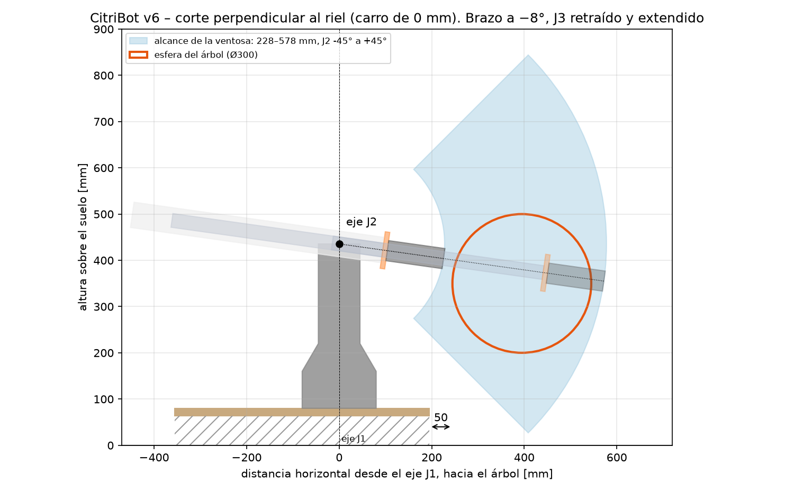

# Espacio de trabajo

Cómo se verifica que CitriBot alcanza toda la esfera del árbol, y con qué números quedó la v6 del CAD.
Para recalcular: `python control/espacio_trabajo.py` (con `--carro 50` si el carro del riel levanta el robot 50 mm, y `--figura` para regenerar la imagen).



## 1. Qué hay que alcanzar

El TPF pide una **esfera de 30 cm de diámetro elevada del suelo**. El boceto del grupo la ubica así:

- a **5 cm del borde de la base**, del lado del árbol;
- con el **centro a 35 cm del suelo**.

En el CAD la base es el tablero de 550 × 550 del BCN3D, y el eje J1 no está centrado. Las distancias del eje J1 a los bordes son 194,8 / 275,0 / 275,0 / 355,2 mm. El árbol va del lado más cercano, **194,8 mm**, que es el lado de la bandeja de electrónica. Así la esfera queda lo más cerca posible.

| Dato | Valor | De dónde sale |
|---|---|---|
| Eje J1 → borde del tablero (lado del árbol) | 194,8 mm | CAD (`Alcance.cs`) |
| Separación borde → esfera | 50 mm | boceto |
| Radio de la esfera | 150 mm | TPF |
| **Eje J1 → centro de la esfera (horizontal)** | 194,8 + 50 + 150 = **394,8 mm** | |
| **Suelo → centro de la esfera** | **350 mm** | boceto |
| Suelo → cara del tablero | 80 mm (patas + tablero, sin riel) | CAD |
| Cara del tablero → eje J2 | 355,5 mm | CAD |
| **Suelo → eje J2** | **435,5 mm** + alto del carro del riel | |

## 2. Qué alcanza el brazo

CitriBot es P-RRP-RR. Para la posición de la ventosa importan cuatro articulaciones:

- **J0 (riel)** lleva el robot a lo largo del árbol. Por eso cualquier punto del árbol se puede mirar "de frente", y alcanza con estudiar **un corte vertical perpendicular al riel**.
- **J1 (cintura)** apunta el brazo hacia el árbol. El plano del brazo está corrido 83 mm del eje J1, y el riel compensa ese corrimiento.
- **J2 (hombro)** fija el ángulo θ del brazo respecto de la horizontal.
- **J3 (prismático)** fija la distancia ρ entre el eje J2 y la ventosa.

Con la ventosa alineada con el brazo (muñeca a −90°), la distancia es:

```
ρ = 105 mm (eje J2 → cara de la brida de E3, J3 retraído) + q3 + 122,8 mm (brida → labio de la ventosa SAB40)
q3 = 0 … 350 mm   →   ρ = 227,8 … 577,8 mm
```

Entonces, en el corte perpendicular al riel, la ventosa barre un **sector de corona circular** con centro en el eje J2:

- radios de 227,8 a 577,8 mm;
- ángulos entre los límites de J2 sin choques: **−45° a +45°** con el brazo apuntando al árbol, en toda la carrera de J3. A −50° con J3 retraído la horquilla toca la torre; a +50° el NEMA 17 de la cola toca el tablero.

Ese sector es la zona celeste de la figura. Al girar J1 se forma un casquete esférico grueso alrededor de la torre, y al mover el riel ese casquete se estira a lo largo del árbol. Eso es el espacio de trabajo del robot.

## 3. La condición

La esfera entra si todos sus puntos caen dentro del sector. Si **d** es la distancia del eje J2 al centro de la esfera y R = 150 mm, se calcula así:

```
d   = √( 394,8² + (350 − 435,5)² ) = 404,0 mm
ρ   necesario: d − R … d + R             = 254,0 … 554,0 mm
θ   necesario: atan2(−85,5, 394,8) ± asin(R/d) = −12,2° ± 21,8° = −34,0° … +9,6°
```

| | Necesita | Tiene el brazo (v6) | Margen |
|---|---|---|---|
| ρ mínimo (lado cercano de la esfera) | 254,0 mm | 227,8 mm | 26 mm |
| ρ máximo (lado lejano) | 554,0 mm | 577,8 mm | 24 mm |
| Ángulo de J2 | −34,0° … +9,6° | −45° … +45° | 11° abajo, 35° arriba |

El script revisa uno por uno los puntos del corte central de la esfera, porque los demás cortes son discos más chicos. Con estos datos alcanza el **100 %** de los puntos.

**Carro del riel.** Todavía no está diseñado, y si sube el robot, el lado lejano se aleja. El brazo cubre toda la esfera mientras el carro mida **hasta 79 mm** de alto. Con 50 mm, por ejemplo, el margen lejano baja a 10,5 mm y J2 necesita llegar a −40°.

## 4. Por qué hubo que cambiar el CAD (v5 → v6)

En la v5 la ventosa quedaba entre 357 y 411 mm del eje J2: solo 5,35 cm de carrera, con E3 y el tornillo TSF del Rx-rcp-003. Eso no llegaba ni al lado cercano (254 mm) ni al lejano (554 mm). Hacía falta una carrera de al menos 300 mm.

Además, el brazo tenía que poder **acortarse** hasta ≈ 23 cm. Con un prismático que solo sale hacia adelante, el largo retraído ya es mayor que eso. Por eso en la v6:

- **E2** se cortó a 93 mm por delante del eje J2 y se le agregó una cola de 55 × 55 hacia atrás. El **tubo de E3** (aluminio 30 × 30 × 2, 460 mm) se retrae dentro de la cola, por detrás del hombro.
- J3 lo mueve un **NEMA 17 con husillo T8 de 400 mm** (avance 8 mm), como en el cálculo del grupo. El motor queda al final de la cola, a 41 cm detrás del eje J2. Además funciona de contrapeso del brazo.
- La carrera es de **350 mm**. Con extensión máxima siguen guiados 108 mm de tubo dentro de E2.

Detalle de piezas y montaje: [cad/solidworks/README.md](../cad/solidworks/README.md).

## 5. Cuidados

- La ventosa del CAD (`CB-617`, McMaster) es 20 mm más larga que la SAB40 de la BOM. Con ella ρ va de 247,6 a 597,6 mm: también cubre la esfera, con 6 mm de margen del lado cercano.
- El cálculo usa la **ventosa alineada con el brazo** (acercamiento de frente). Con la muñeca en otra posición la punta queda más cerca del eje J2.
- Los límites de J2 son con el brazo **apuntando al árbol**. Si J1 apunta para otro lado, la cola o la herramienta pueden tocar la bandeja de electrónica o el tablero antes: ver los rangos en el README del CAD.
- J1 se gira para que el brazo apunte de frente al árbol. Si el riel no se puede mover para compensar los 83 mm de corrimiento lateral, el brazo entra un poco en diagonal. Eso cambia ρ en menos de 1 cm.
