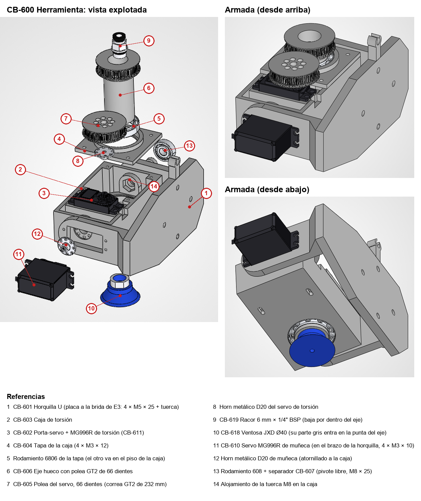

# Montaje de la herramienta (CB-600)

Muñeca (cabeceo) + torsión + ventosa, como está en el CAD (`cad/solidworks/09_Herramienta`). Los números entre corchetes son los de la lámina.

## Qué hace falta

| Cosa | Cant. | Dónde va |
|---|---|---|
| Piezas impresas de `cad/imprimir/00_Herramienta/` (CB-601 … CB-607) | 1 c/u | eje hueco CB-606 al 100 % |
| Servo MG996R | 2 | muñeca [11] y torsión [3] |
| Horn metálico redondo D20 | 2 | muñeca [12] y torsión [8] |
| Rodamiento 6806 (30 × 42 × 7) | 2 | tapa [5] y piso de la caja |
| Rodamiento 608 (8 × 22 × 7) | 1 | pivote libre [13] |
| Correa GT2 cerrada, 6 mm, 232 mm (116 dientes) | 1 | polea del servo [7] ↔ polea del eje [6] |
| Racor recto 6 mm × 1/4" BSP con junta | 1 | dentro del eje [9] |
| Ventosa JXD Ø40 | 1 | punta del eje [10] |
| M3 × 8 | 9 | 4 polea → horn de torsión, 4 horn de muñeca → caja, 1 porta-servo (lado del cable) |
| M3 × 10 | 9 | 8 orejas de los dos servos, 1 porta-servo (otro lado) |
| M3 × 12 | 4 | tapa → caja |
| M8 × 25 + tuerca M8 | 1 | pivote libre |
| M5 × 25 + tuerca autoblocante | 4 | horquilla → brida de E3 |
| Teflón, manguera PU 6 × 4 | — | rosca del racor, aire |
| CB-620 llave de montaje (impresa) | 1 | solo para apretar el racor; no queda en el robot |

Antes de imprimir CB-606 y CB-620, medir el racor con calibre: hexágono (≈ 14), anillo (≈ Ø16,5 × 1,8), cuello con la junta (≈ 3) y rosca (≈ 4,5). Ver el README del CAD, §6.12.

## Orden de armado

El orden importa: después de cerrar la caja algunas cosas ya no se alcanzan.

### Caja de torsión

1. **Rodamientos 6806**: uno a presión en el asiento del piso de la caja [2] y otro en la tapa [4].
2. **Caja vacía**: poner la tuerca M8 en su alojamiento hexagonal de la pared de adentro [14]. Atornillar el horn de muñeca [12] por fuera, en la pared opuesta, con 4 × M3 × 8.
3. **Servo de torsión en el porta-servo** [3]: bajarlo con el pasacables dentro de la ranura de la pared y atornillar las orejas con 4 × M3 × 10.
4. **Porta-servo en la caja**: el cable sube por la ranura y sale por la muesca de arriba de la pared de la caja. Fijarlo desde abajo por las dos ranuras del piso: M3 × 8 del lado del cable (ese agujero tiene 5,5 mm) y M3 × 10 del otro. Dejarlos flojos.
5. **Tapa** [4] con su rodamiento: 4 × M3 × 12. El eje de salida del servo queda asomando por la tapa.
6. **Eje hueco** [6]: meterlo desde arriba, con la punta primero, por el rodamiento de la tapa y después por el del piso, hasta que el cubo apoye en el rodamiento de la tapa.
7. **Correa y polea del servo**: pasar la correa por la polea del eje. Atornillar la polea del servo [7] al horn [8] con 4 × M3 × 8, meter la polea dentro de la correa y encajar el horn en el estriado del servo con su tornillo central.
8. **Tensar**: desde abajo, correr el porta-servo en sus ranuras hasta que la correa quede tensa y apretar los dos tornillos. El eje tiene que girar con el servo sin saltar dientes.

### Ventosa

9. Poner teflón en la rosca del racor [9] y bajarlo por el lado de la polea, con la rosca hacia la punta, hasta que la junta entre en el agujero del fondo del eje.
10. Meter la ventosa [10] desde abajo, con los dos planos de su parte gris alineados con el alojamiento de la punta, y sostenerla.
11. Por el lado de la polea, bajar la llave CB-620 hasta que calce en el hexágono del racor y girarla hasta apretar el racor contra la ventosa. Sacar la llave.
12. Meter la manguera de 6 mm en el racor por el lado de la polea.

### Muñeca y montaje al brazo

13. **Servo de muñeca** [11] en la ventana del brazo de la horquilla [1], con 4 × M3 × 10. Con el controlador, llevarlo al centro de su recorrido (90°).
14. **Horquilla a la brida de E3** con 4 × M5 × 25 + tuerca autoblocante. El eje de cabeceo queda paralelo a J2 y la pestaña guía de la manguera hacia arriba.
15. **Caja entre los brazos**: meterla corrida hacia el lado del pivote libre y deslizar el horn de muñeca sobre el estriado del servo, con la ventosa hacia abajo (posición natural, perpendicular al prismático).
16. **Pivote libre** [13]: rodamiento 608 en el brazo, separador CB-607 entre el brazo y la caja, y el M8 × 25 hasta la tuerca de la caja. Apretar sin trabar: la caja tiene que cabecear libre.
17. **Manguera y cables**: la manguera pasa por la pestaña guía de la placa y baja hasta el eje con una curva holgada. Dejar un lazo en los cables de los dos servos para que la muñeca cabecee sin tirar.

## Cómo tiene que quedar

- La ventosa apunta hacia abajo con la muñeca en el centro y el labio queda a ≈ 63 mm del eje de cabeceo.
- La caja cabecea entre los brazos sin roce. El eje gira suave con la correa tensa.
- Las dos poleas y la correa quedan arriba de la tapa. Los cables salen por la muesca de la caja (torsión) y por el brazo (muñeca).

## Pendientes

- La correa no está dibujada en el CAD.
- En el STEP no hay nada que frene el eje hueco hacia arriba: si al apoyar la ventosa el eje sube, hace falta un anillo debajo del rodamiento del piso, como el de la `.scad` (`cad/herramienta/stl/AnilloDeRetencion.stl`, BOM P20).
