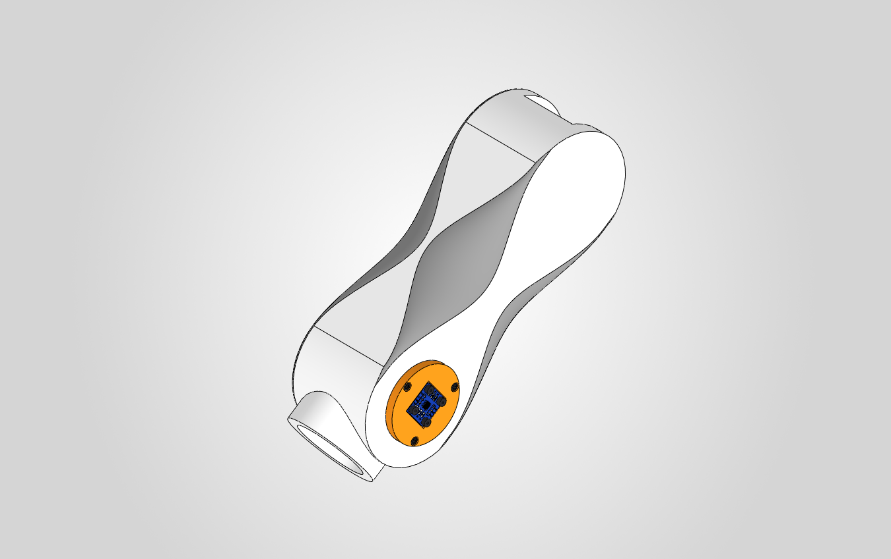
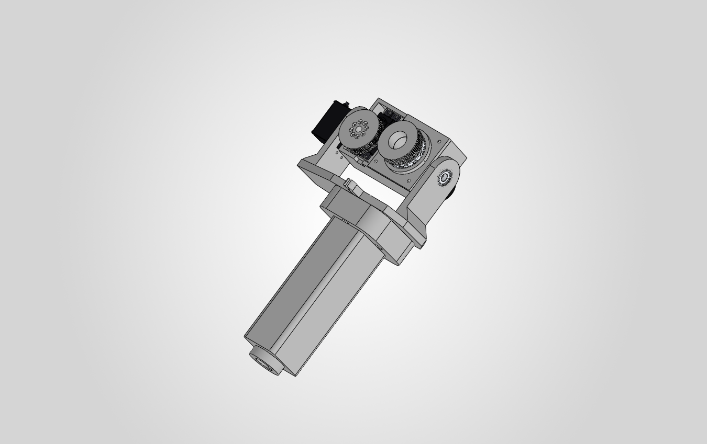
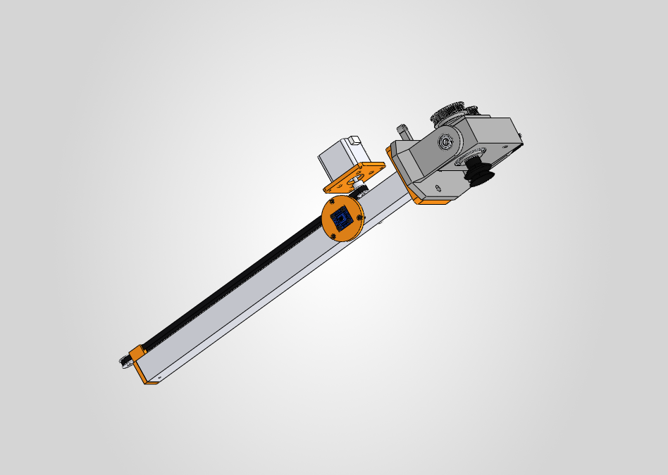
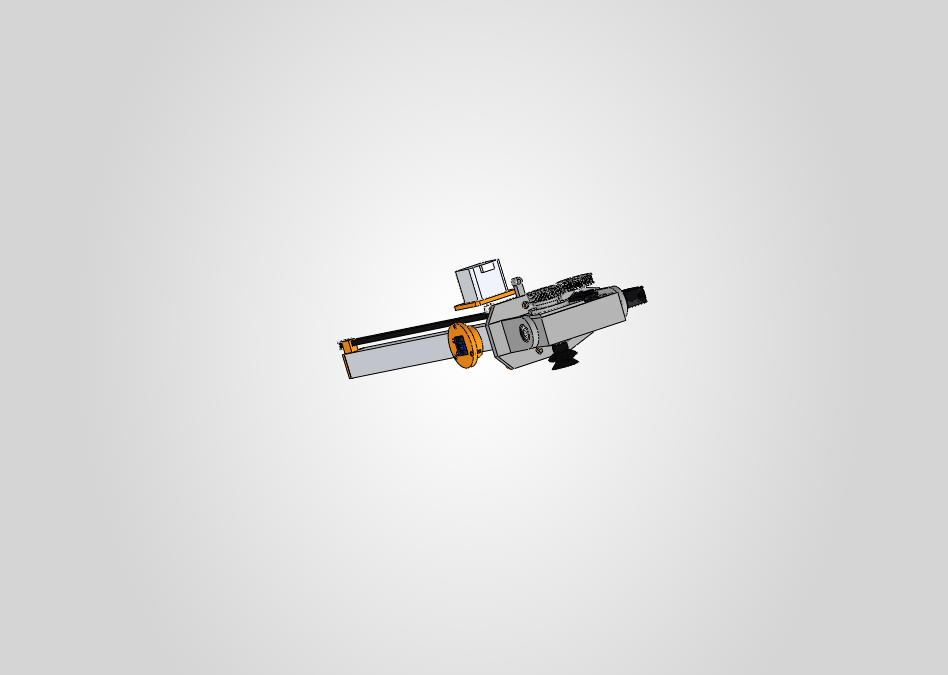

# Guía completa de preparación, montaje y puesta en marcha del prismático $J_3$ (`v7A`)

> **Desde la v7.12 el diseño oficial es el telescópico (variante B).** Esta guía es de la variante A (alternativa, `CB-000A_CitriBot_v7A_Correa`). El montaje del telescópico está en [v7_prismatico.md](v7_prismatico.md) §5.2.

Manual de taller paso a paso para fabricar, ensamblar, ajustar y poner en marcha la articulación prismática $J_3$ de **CitriBot** en su configuración oficial **`v7A`** (transmisión de una etapa por *timing belt* `GT2` con motor `NEMA 17` sobre el cubo del hombro `E2`).

Complementa la descripción general de [v7_prismatico.md](v7_prismatico.md), la lista de materiales de [../bom/BOM.md](../bom/BOM.md) y el armado del efector final en [montaje_herramienta.md](montaje_herramienta.md).

| Subconjunto hombro + guía `CB-300` | Subconjunto móvil `CB-400` (`E3` + herramienta) |
|---|---|
|  |  |

| Vista interna de la transmisión (`E2` oculto, lateral) | Vista interna de la transmisión (`E2` oculto, trimétrica) |
|---|---|
|  |  |

---

## 1. Resumen del sistema y principio de funcionamiento

La articulación $J_3$ desplaza linealmente el tubo cuadrado de aluminio `CB-401` ($30 \times 30 \times 2\text{ mm}$, largo $440\text{ mm}$) una carrera útil $q_3 \in [0, 340]\text{ mm}$ por dentro del canal cuadrado de $31 \times 31\text{ mm}$ impreso en el eslabón `CB-301` (`E2`).

* **Accionamiento:** El motor paso a paso `NEMA 17` (`CB-505`) va montado verticalmente sobre la placa `CB-306` encima del cubo del hombro ($22\text{ mm}$ por delante del eje $J_2$). Su polea `GT2` de $20$ dientes mueve un lazo cerrado de correa `GT2` de $6\text{ mm}$ de ancho que corre por una ranura superior ($22 \times 15.5\text{ mm}$) hasta una polea loca dentada `20T` en el extremo trasero de la cola ($362\text{ mm}$ detrás de $J_2$).
* **Arrastre:** El tapón trasero `CB-403` del tubo lleva una pinza (*belt clamp*) desplazada hacia un lateral que muerde ambos extremos de la correa abierta enfrentando diente contra diente, transformando el giro del motor en avance lineal a razón de $40\text{ mm/vuelta}$ ($80\text{ pasos/mm}$ con *microstepping* a $1/16$).

---

## 2. Lista de piezas, insumos y herramientas necesarias

Antes de empezar a pegar o atornillar, verificar que estén todos los elementos en la mesa de trabajo:

### 2.1 Componentes mecánicos y electrónicos (según BOM)

| Código BOM / CAD | Componente | Especificación | Cant. | Función en $J_3$ |
|---|---|---|---|---|
| `P08` / `CB-301` | Eslabón `E2` (cubo + cola) | `PETG` (cubo $\ge 6$ perímetros $50\,\%$; cola $3$ perímetros $15\,\%$) | $1$ | Carcasa guía del canal $31 \times 31\text{ mm}$ y ranura de correa |
| `P21` / `CB-306` | Placa soporte `NEMA 17` | `PETG` relleno $100\,\%$, $62 \times 62 \times 5\text{ mm}$ | $1$ | Interfaz desmontable entre el motor y `CB-301` |
| `P09` / `CB-402` | Brida delantera de `E3` | `PETG`, tapón a $100\,\%$, placa $80 \times 80 \times 10\text{ mm}$ | $1$ | Acople frontal entre el tubo y la horquilla `CB-601` |
| `P12` / `CB-403` | Tapón trasero con pinza | `PETG` relleno $100\,\%$ | $1$ | Cierre trasero del tubo y anclaje/tensado de la correa `GT2` |
| **Nuevo (ver Sec. 3)** | **Buje separador polea loca** | `PETG`, $\varnothing_{\text{int}} = 5.3\text{ mm}$, $\varnothing_{\text{ext}} = 10\text{ mm}$, $L = 36.5\text{ mm}$ | $1$ | Sostiene en altura la polea loca trasera sobre el tornillo `M5` |
| `X05` / `CB-401` | Tubo cuadrado de aluminio | Aleación $6063$, $30 \times 30 \times 2\text{ mm}$, cortado a $440\text{ mm}$ | $1$ | Eslabón móvil `E3` |
| `M03` / `CB-505` | Motor `NEMA 17` | Cuerpo $40\text{ mm}$ (`17HS4401`), $1.7\text{ A}$, $\approx 0.42\text{ N}\cdot\text{m}$, eje $\varnothing 5\text{ mm}$ con plano `D` | $1$ | Actuador de $J_3$ |
| `E03` / `CB-509` | *Driver* `A4988` + disipador | En zócalo de la `RAMPS 1.4` (`3` *jumpers* puestos = $1/16$) | $1$ | Control de corriente y *microstepping* del `NEMA 17` |
| `T07` | Polea motriz `GT2` | $20$ dientes, agujero $\varnothing 5\text{ mm}$, correa $6\text{ mm}$, $2$ prisioneros `M3` | $1$ | Va en el eje del `NEMA 17` |
| `T08` | Polea loca `GT2` dentada | $20$ dientes, agujero $\varnothing 5\text{ mm}$, ancho $9\text{ mm}$, con rodamientos | $1$ | Retorno del lazo en la punta de la cola |
| `T09` / `CB-514` | Correa `GT2` abierta | Ancho $6\text{ mm}$, paso $2\text{ mm}$, cortar tramo de $900\text{ mm}$ (lazo útil $810\text{ mm}$) | $1$ | Transmisión lineal |
| `S04` | Final de carrera (*endstop*) | *Microswitch* con palanca | $1$ | *Homing* de $J_3$ en posición retraída ($q_3 = 0\text{ mm}$) |
| `H26` | Inserto térmico `M3` | Latón moleteado, $\varnothing_{\text{ext}} \approx 4.6\text{ mm}$, largo $5\text{--}6\text{ mm}$ | $4$ | Roscas metálicas en `CB-301` para fijar `CB-306` |
| `H01` | Tornillo `M3` $\times 6\text{ mm}$ | Cabeza cilíndrica Allen (`DIN 912`) | $4$ | `CB-306` (desde abajo) $\rightarrow$ frente del `NEMA 17` |
| `H03` | Tornillo `M3` $\times 10\text{ mm}$ | Allen | $4$ | `CB-306` (desde arriba) $\rightarrow$ insertos `M3` de `CB-301` |
| `H25` + `H16` + `H20` | Eje de polea loca | $1\times$ `M5` $\times 70\text{ mm}$ + $1\times$ tuerca `M5` *nyloc* + $2\times$ arandelas `M5` ($1\text{ mm}$ esp.) | $1$ jgo. | Eje vertical pasante en $x = -442\text{ mm}$ |
| `H24` | Pasador cilíndrico de acero | $\varnothing 3 \times 30\text{ mm}$ (al ras) | $2$ | Traba mecánica tubo `CB-401` $\leftrightarrow$ `CB-402` y `CB-403` |
| `X06` | Cinta de `PTFE` adhesiva | Ancho $\ge 20\text{ mm}$, espesor $\approx 0.13\text{--}0.18\text{ mm}$ | $0.5\text{ m}$ | Reducción de fricción en el canal $31 \times 31\text{ mm}$ |
| `X03`, `X07` | Consumibles | Epoxi bicomponente + $2$ precintos plásticos de $2.5\text{--}3\text{ mm}$ de ancho | $1$ lote | Pegado estructural y cierre de seguridad de la pinza |

### 2.2 Herramientas requeridas
* Soldador de estaño regulable (a $210\text{--}220\text{ }^\circ\text{C}$) para colocar los insertos `M3`.
* Taladro con mecha de $\varnothing 3.0\text{ mm}$ (para aluminio/plástico) y mecha de $\varnothing 3.5\text{ mm}$.
* Lima plana fina, escofina o *deburring tool* (quitarebabas), lija grano $120$ y $400$, alcohol isopropílico.
* Llaves Allen ($1.5\text{ mm}$, $2.0\text{ mm}$, $2.5\text{ mm}$ y $4.0\text{ mm}$), llave fija o tubo de $8\text{ mm}$ (para tuerca `M5`), pinza de punta fina y alicate de corte al ras.
* Multímetro digital y destornillador cerámico o relojero (para calibrar $V_{\text{ref}}$ en el `A4988`).
* Un trozo de alambre rígido de $\approx 50\text{ cm}$ (para usar como pasacables de la correa).

---

## 3. Tres adaptaciones previas obligatorias antes de imprimir y pegar

En el modelo paramétrico generado por [`V7.cs`](../cad/solidworks/08_Scripts_API_SolidWorks/V7.cs), los subconjuntos se ubican directamente en sus coordenadas finales. Sin embargo, para poder **ensamblar y tensar físicamente** las piezas en el taller sin quedar bloqueado, debés contemplar estas **3 modificaciones simples** antes de cerrar `CB-301`:

### 3.1 Tapa trasera desmontable y ventana superior de servicio en `CB-301`
**⚠️ ADVERTENCIA:** El tapón trasero `CB-403` con su pinza mide **$45\text{ mm}$ de alto total** ($y \in [-15, +30]\text{ mm}$), mientras que la boca delantera de `CB-301` mide solo **$31 \times 31\text{ mm}$** ($y \in [-15.5, +15.5]\text{ mm}$) y el extremo trasero de la cola tiene una pared maciza de $5\text{ mm}$ ($x \in [-457, -452]\text{ mm}$). Si imprimís la cola cerrada atrás y pegás `CB-403` al tubo, **el tubo no puede entrar ni por delante ni por detrás**, y tampoco tendrías acceso para tensar la correa ni colocar los precintos a $430\text{ mm}$ de profundidad.

* **Cómo resolverlo directo en el *slicer* (al dividir `CB-301` para la Ender 3 V2):**
  1. Cortar los últimos **$5\text{ mm}$ traseros** ($x = -457\text{ a }-452\text{ mm}$) como una **tapa trasera independiente**, que luego se fija con $4$ tornillos `M3` $\times 12\text{ mm}$ autorroscantes en las esquinas de la pared de la cola (aprovechando esa misma tapa para atornillar el *endstop* `S04`).
  2. Practicar un corte rectangular (**ventana de acceso**) de **$60\text{ mm}$ de largo por $22\text{ mm}$ de ancho** en el techo superior del tramo final de la cola ($x = -452\text{ a }-392\text{ mm}$, coincidiendo con el ancho de la ranura de la correa), guardando esa tapita recortada para cerrarla al terminar con dos tornillitos o cinta estética.

### 3.2 Buje separador inferior de $36.5\text{ mm}$ para la polea loca trasera
**⚠️ ADVERTENCIA:** En la posición del eje trasero ($x = -442\text{ mm}$), el tubo de aluminio ya terminó ($x = -430\text{ mm}$ con tapa incluida). Debajo de la polea loca `20T` ($y \in [21, 30]\text{ mm}$) queda todo el canal vacío hasta el piso en $y = -15.5\text{ mm}$. Si solo colocás una arandela `M5` debajo, **la polea caerá $36.5\text{ mm}$ hasta el fondo del canal** y se saldrá la correa.

* **Cómo resolverlo:** Imprimir en `PETG` un cilindro hueco (**buje separador**) con diámetro interior $\varnothing_{\text{int}} = 5.3\text{ mm}$, diámetro exterior $\varnothing_{\text{ext}} = 10.0\text{ mm}$ y altura exacta **$h = 36.5\text{ mm}$**. Este separador va enhebrado en el tornillo `M5` $\times 70\text{ mm}$ debajo de la polea loca; arriba de la polea va $1$ arandela `M5` estándar de $1.0\text{ mm}$ de espesor ($y \in [30, 31]\text{ mm}$).

### 3.3 Agujero lateral $\varnothing 3.5\text{ mm}$ para apretar los prisioneros de la polea motriz
El cubo superior de la polea motriz `GT2 20T` donde se alojan los dos tornillos prisioneros (*set screws*) queda entre $y = 30\text{ mm}$ e $y = 37\text{ mm}$, escondido dentro del bolsillo interno `CB_v7A_Bolsillo_polea` ($y \in [31, 41]\text{ mm}$), por encima del techo de la boca frontal ($y = 15.5\text{ mm}$).

* **Cómo resolverlo:** Perforar con mecha de **$\varnothing 3.5\text{ mm}$** un orificio horizontal pasante en una de las paredes laterales del cubo de `CB-301`, alineado con el centro del eje del motor ($22\text{ mm}$ por delante del eje $J_2$, es decir $x = -58\text{ mm}$) y ubicado **$13.5\text{ mm}$ por debajo de la cara inferior del motor** ($8.5\text{ mm}$ por debajo del apoyo de la placa `CB-306`, cota $y = 33.5\text{ mm}$). Esto permite introducir la llave Allen recta desde afuera directamente sobre el prisionero enfrentado al plano `D` del eje.

---

## 4. Geometría interna y cotas críticas de montaje

### 4.1 Corte longitudinal del mecanismo ($J_3$ retraído, $q_3 = 0\text{ mm}$)

```
   <-- Extremo cola (x = -457)                       Frente hacia herramienta (x = +13) -->
                                                       [NEMA 17 (CB-505)] (conector atras)
                                                     =====[Placa CB-306]===== (y = 42..47)
    Tapa trasera                                          | Eje D5  |  <-- Orificio lateral D3.5
    atornillada     Ventana sup. (60 x 22 mm)            [Cubo polea]      en y = 33.5 mm
         |           |              |                    [Polea 20T ]  <-- Base a 26 mm de la
         v           v              v                         |            cara del motor (y = 21)
   +----+-------------------------------+---------------------+-------------+
   |    |  ( Polea )    [Pinza CB-403]=======================               | <-- Techo E2 (y = 36)
   |    |  ( loca  )    [ 2 precintos]   Lazo correa GT2                    |
   |    |     ||        [  en ranura ]   (yc = 25.5 mm)                     | [Brida CB-402]
   |    |  [Buje   ] +------------------------------------------------------+--+---+
   | S04|  [36.5 mm] |        Tubo aluminio 30x30x2 L=440 (CB-401)             |   |--> CB-600
   |    |     ||     +------------------------------------------------------+--+---+
   +----+-----+-------------------------------------------------------------+
              ^^                                           ^                 ^
         Tornillo M5x70                             PTFE arriba       PTFE abajo
       + tuerca nyloc abajo                         (reaccion N_2)    (reaccion N_1)
```

### 4.2 Corte transversal `YZ` mirando desde la cola hacia el hombro

Este corte explica por qué **la orientación del tapón `CB-403` no es simétrica**: la pinza está desplazada hacia $+Z$ (el mismo lado de la tapa naranja `CB-303` del sensor `AS5600`) para morder únicamente una rama de la correa y dejar pasar libre la rama de retorno en $-Z$:

```
                    +Y (Arriba, lado del NEMA 17)
                     ^
       +-------------|-------------+  y = +36.0 mm (techo exterior de la cola)
       |      +------+------+      |  y = +31.0 mm (techo de ranura 22 x 15.5)
       |      | (Rama| [||] |      |  <-- En z = -6.9 pasa libre la correa de vuelta;
       |      | libre| [||] |      |      en z = +6.9 muerde la ranura de 1.8 mm (CB-403)
       |  +---+------+------+---+  |  y = +15.5 mm (techo del canal 31 x 31)
       |  | +-----------------+ |  |
   -Z <---| |                 | |---> +Z (Lado exterior: tapa AS5600 CB-303
          | |  Tubo 30x30x2   | |         y tunel de cables 10 x 5 mm)
       |  | |    (CB-401)     | |  |
       |  | +-----------------+ |  |
       |  +---------------------+  |  y = -15.5 mm (piso del canal 31 x 31)
       +---------------------------+  y = -27.5 mm (piso exterior de la cola)
```

---

## 5. Secuencia paso a paso de montaje en banco

> **Importante:** Respetar estrictamente el orden de las fases. Adelantar el montaje del motor o el pegado del tubo sin prever el paso de la polea o de la correa obliga a desarmar.

### Fase 1: Preparación de la carcasa `E2` (`CB-301`)

1. **Alineación y unión de los tramos impresos de `CB-301`:**
   * Limpiar soportes y rebabas internas del canal $31 \times 31\text{ mm}$ con lima plana. Probar que el tubo de aluminio crudo (`CB-401`) deslice suave en cada tramo por separado.
   * Lijar con grano $120$ las caras de contacto de la unión entre el tramo del cubo y el tramo de la cola ($x \approx -100\text{ mm}$) y limpiar con alcohol isopropílico.
   * Envolver el tubo de aluminio en una sola capa tensa de papel *film* doméstico (para que no se adhiera al pegamento), aplicar epoxi bicomponente (`X03`) en la unión de `CB-301`, **introducir el tubo envuelto adentro del canal actuando como regla rectificadora** y apretar los tornillos de la unión a media madera.
   * Apenas el epoxi gelifique ($15\text{--}20\text{ min}$ según envase), retirar el tubo con el *film* y dejar curar $24\text{ h}$ para máxima resistencia estructural.
2. **Colocación de los $4$ insertos térmicos `M3` (`H26`):**
   * Calentar el soldador a $210\text{--}220\text{ }^\circ\text{C}$. Apoyar cada inserto `M3` sobre los $4$ agujeros $\varnothing 4.2\text{ mm}$ de la base superior del cubo ($51 \times 51\text{ mm}$) y hundirlo recto hasta que quede exactamente al ras (o $0.2\text{ mm}$ por debajo) de la superficie de apoyo. No sobrecalentar para no deformar las paredes vecinas.
3. **Verificación del orificio lateral $\varnothing 3.5\text{ mm}$:**
   * Si no se incluyó en el *slicer*, perforar con mecha de $\varnothing 3.5\text{ mm}$ el acceso lateral hacia el bolsillo de la polea motriz ($22\text{ mm}$ delante del eje $J_2$ y $8.5\text{ mm}$ debajo del plano donde apoya `CB-306`). Limpiar virutas internas.
4. **Aplicación de la cinta de `PTFE` (`X06`):**
   * Desengrasar el canal con alcohol. Pegar tiras longitudinales de cinta de `PTFE` bien adheridas y **sin solapamientos ni arrugas**, doblando $2\text{ mm}$ del extremo delantero sobre el labio frontal de `CB-301` para que el tubo al entrar no levante la punta de la cinta.
   * Prestar especial atención al **piso delantero** (primeros $60\text{ mm}$ desde la boca) y al **techo interno** ($80\text{ a }120\text{ mm}$ hacia adentro desde la boca), que son las dos zonas que reciben las reacciones normales del momento en voladizo (*cantilever*).
5. **Tendido previo del cable del `AS5600`:**
   * Pasar el mazo de $4$ hilos desde la ventana circular $\varnothing 40\text{ mm}$ del hombro a través del túnel interno exclusivo ($10 \times 5\text{ mm}$) hasta que asome por la abertura lateral trasera de la cola. Dejar $10\text{ cm}$ extra de holgura en ambos extremos.

---

### Fase 2: Subconjunto Motor `NEMA 17` + Placa `CB-306` + Polea `20T`

6. **Fijar el motor a la placa `CB-306` afuera en la mesa (obligatorio primero):**
   * Observar la placa `CB-306`: una de sus caras tiene $4$ rebajes cilíndricos (**cajeados de $\varnothing 6.5 \times 4\text{ mm}$**) alrededor de los agujeros centrales ($31 \times 31\text{ mm}$). Esa cara con cajeados es la **cara inferior** (la que apoyará contra `CB-301`).
   * Apoyar `CB-306` sobre el frente del `NEMA 17` (`CB-505`) y atornillarla desde abajo con los **$4$ tornillos `M3` $\times 6\text{ mm}$ Allen (`H01`)**. Verificar que las $4$ cabezas queden completamente embutidas debajo del plano de apoyo; si alguna sobresale, la placa quedará inclinada sobre `E2`.
   * Orientar la ficha blanca del conector del `NEMA 17` apuntando **hacia atrás** (hacia la cola de `E2`).
7. **Introducir la polea motriz `GT2 20T` (`T07`) por el canal:**
   * Aflojar $2$ vueltas los dos prisioneros `M3` de la polea (sin quitarlos).
   * Como la polea tiene pestañas de $\varnothing 16\text{ mm}$ y el agujero del techo de `E2` es de solo $\varnothing 8\text{ mm}$, **introducir la polea suelta por la boca delantera del canal $31 \times 31\text{ mm}$**, deslizarla $\approx 71\text{ mm}$ hacia adentro hasta el bolsillo del motor y subirla con el dedo **con el cubo de los prisioneros apuntando hacia ARRIBA** ($+Y$, mirando al motor) y los dientes abajo.
8. **Montar el motor sobre `E2` y calibrar la altura de $26\text{ mm}$:**
   * Sosteniendo la polea centrada en el bolsillo, bajar verticalmente el conjunto `NEMA 17 + CB-306` haciendo entrar el eje $\varnothing 5\text{ mm}$ en el agujero de la polea.
   * Fijar `CB-306` contra los $4$ insertos térmicos de `E2` usando los **$4$ tornillos `M3` $\times 10\text{ mm}$ (`H03`)** con apriete cruzado parejo.
   * Posicionar verticalmente la polea en el eje: **la cara inferior de la polea debe quedar a $26.0\text{ mm}$ de la cara frontal del motor** (lo que equivale a dejar exactamente **$10.0\text{ mm}$ libres** entre el extremo superior del cubo de la polea y la cara del motor, o $4.0\text{ mm}$ entre el cubo de la polea y el techo plástico del bolsillo). Se puede usar la cola de una mecha de $4.0\text{ mm}$ como galga entre el cubo de la polea y el techo del bolsillo.
   * Girar el eje del motor hasta ver el **plano `D`** a través del orificio lateral de $\varnothing 3.5\text{ mm}$. Apretar firme ese primer prisionero perpendicular al plano `D` (idealmente con media gota de fijador de roscas medio tipo *Loctite 242*), girar el eje $90^\circ$ y apretar el segundo prisionero.

---

### Fase 3: Fabricación del eslabón móvil `E3` (`CB-401` + `CB-402` + `CB-403`)

9. **Corte y biselado del tubo de aluminio:**
   * Cortar el perfil cuadrado $30 \times 30 \times 2\text{ mm}$ (`X05`) a **$440.0\text{ mm}$** a escuadra.
   * Quitar todas las rebabas interiores (para que entren las espigas de $25.8\text{ mm}$) y hacer un **suave redondeo exterior** con lima fina y lija al agua $400$ en las $4$ aristas de ambas puntas, de modo que deslice como un patín sobre la cinta de `PTFE` sin rasparla.
10. **Presentación en seco y orientación crítica de `CB-403`:**
    * Encastrar a tope la brida delantera `CB-402` en un extremo.
    * Encastrar a tope el tapón trasero `CB-403` en el otro extremo verificando **dos veces su orientación** (ver corte `YZ` en la Sección 4.2):
      1. La torre de la pinza debe sobresalir hacia **ARRIBA** ($+Y$, el mismo lado donde quedará el `NEMA 17`).
      2. Mirando el tubo desde atrás hacia adelante, la torre de la pinza debe quedar corrida hacia la **DERECHA** ($+Z$, el lado exterior de `E2` donde va la tapa naranja `CB-303` del `AS5600`).
11. **Perforado solidario en banco y pegado inicial de `CB-402`:**
    * Con `CB-402` y `CB-403` clavados a tope en seco en el tubo, usar sus propios agujeros $\varnothing 3.2\text{ mm}$ (ubicados a **$10\text{ mm}$ de cada borde del aluminio**, de cara superior a cara inferior) como guía para perforar las dos paredes del tubo en **ambos extremos** con mecha de **$\varnothing 3.0\text{ mm}$** en taladro de banco. Marcar con fibrón la cara superior ($+Y$) del tubo.
    * Retirar ambas piezas y limpiar virutas de aluminio.
    * **Pegar afuera únicamente la brida delantera `CB-402`:** como `CB-402` mide $80 \times 80\text{ mm}$ y `CB-403` mide $45\text{ mm}$ de alto, ninguna de las dos pasa a través del canal de $31 \times 31\text{ mm}$. Por eso se pega con epoxi (`X03`) y se clava el primer pasador $\varnothing 3 \times 30\text{ mm}$ (`H24`) **solo en `CB-402`**, dejando el extremo trasero del tubo limpio y ya perforado para colocar `CB-403` en el Paso 13.
    * **⚠️ ADVERTENCIA:** Limpiar inmediatamente con alcohol cualquier exceso de epoxi y verificar al tacto las caras superior e inferior del tubo. Con $0.5\text{ mm}$ de luz por lado en el canal, **ningún pasador puede sobresalir ni $0.2\text{ mm}$**; si se siente rebaba, repasar al ras con lima plana fina.

---

### Fase 4: Enhebrado, polea loca trasera y tensado de la correa `GT2`

12. **Pasar la correa alrededor de la polea del motor:**
    * Cortar un tramo de **$900\text{ mm}$** de correa `GT2` abierta (`T09`).
    * Con el tubo `E3` todavía afuera, meter el alambre guía doblado en gancho desde la abertura trasera de la cola a lo largo de la ranura superior ($22 \times 15.5\text{ mm}$) hasta el bolsillo del motor.
    * Enganchar la mitad de la correa (con los dientes mirando hacia adentro del lazo), tirar suavemente hacia atrás o ayudarse girando a mano el eje del motor para que el lazo rodee la polea motriz `20T` y ambas puntas libres salgan por atrás de la cola. **Verificar visualmente con linterna por la ranura que la correa no tenga media vuelta de torsión (*twist*)** y que esté bien calzada entre las dos pestañas de la polea motriz.
13. **Introducir el tubo `E3` y fijar `CB-403` desde atrás:**
    * Deslizar el extremo trasero desnudo del tubo `CB-401` **desde adelante hacia atrás** por la boca frontal de `E2` (con la marca de cara superior $+Y$ hacia arriba y cuidando que las dos ramas de la correa queden por encima del tubo en su ranura), hasta que la punta trasera del aluminio se asome al fondo de la cola abierta.
    * A través de la abertura trasera y la ventana superior de $60 \times 22\text{ mm}$, aplicar una capa fina de epoxi en la espiga de `CB-403`, encastrarla a tope verificando que **la pinza apunte hacia arriba ($+Y$) y quede del lado de la tapa del `AS5600` ($+Z$)**, y clavar verticalmente al ras el segundo pasador $\varnothing 3 \times 30\text{ mm}$ (`H24`). Dejar curar el epoxi antes de someter la pinza a tensión.
14. **Montar la polea loca trasera (`T08`) con su separador:**
    * Llevar el tubo `E3` hacia adelante unos $5\text{ cm}$ para despejar el fondo de la cola, o dejarlo en *home* ($q_3 = 0\text{ mm}$, donde quedan $12\text{ mm}$ libres detrás de `CB-403`).
    * Pasar el lazo trasero de la correa alrededor de la polea loca dentada `20T`.
    * Introducir el tornillo **`M5` $\times 70\text{ mm}$ (`H25`) de arriba hacia abajo** en $x = -442\text{ mm}$ armando esta pila exacta dentro de la cola:

```
      [Cabeza M5]
   =================  Techo superior de la cola E2 (y = 31..36 mm)
      (Arandela M5)   1 mm de espesor (y = 30..31 mm)
     [ Polea loca  ]  Ancho 9 mm, dientes alineados en yc = 25.5 mm (y = 21..30 mm)
     [   Buje      ]
     [  separador  ]  PETG impreso: D_int 5.3 / D_ext 10 / H = 36.5 mm (y = -15.5..+21 mm)
   =================  Piso inferior del canal de E2 (y = -27.5..-15.5 mm)
      (Arandela M5)
     [Tuerca Nyloc ]  Apretar sin estrangular el giro de la polea
```

15. **Anclaje diente-contra-diente y tensado en `CB-403`:**
    * Llevar el tubo `E3` a su posición retraída ($q_3 = 0\text{ mm}$, brida `CB-402` a $2\text{ mm}$ del frente de `E2`) para que la pinza `CB-403` quede justo debajo de la ventana trasera de servicio.
    * Verificar que la rama $-Z$ de la correa pase recta y libre por el costado izquierdo de `CB-403`, y tomar las dos puntas abiertas de la rama $+Z$.
    * Calzar la primera punta dentro de la ranura vertical de $1.8\text{ mm}$ de la pinza con los dientes mirando hacia el centro y dejando $\approx 25\text{ mm}$ de sobrante.
    * Tirar con fuerza firme de la segunda punta para eliminar toda comba del circuito y **hundirla en la misma ranura enfrentando sus dientes contra los dientes de la primera punta**. Como dos correas `GT2` imbricadas suman $\approx 2.01\text{ mm}$ de espesor dentro de una garganta rígida de $1.8\text{ mm}$, los dientes quedan autotrabados contra el deslizamiento.
    * Colocar y ceñir a fondo con pinza de punta **$2$ precintos plásticos (`X07`)**:
      * **Precinto 1:** rodeando por fuera los dos labios plásticos de la mordaza de `CB-403` para impedir que se abran bajo tracción.
      * **Precinto 2:** apretando entre sí las dos colas sobrantes de correa inmediatamente a la salida de la ranura (cortar el excedente de precinto al ras para que no roce contra el techo).

---

### Fase 5: Cierre mecánico y verificación en seco

16. **Verificación de deslizamiento manual (sin corriente):**
    * Con el cable del `NEMA 17` **desconectado**, empujar y tirar del tubo desde la brida `CB-402` a lo largo de los **$340\text{ mm}$ completos de carrera**.
    * Debe moverse fluido, sin saltos de dientes, sin que ningún precinto toque el techo y deteniéndose limpiamente a $6\text{ mm}$ de la polea del motor en extensión máxima (quedando $98\text{ mm}$ de tubo dentro de `E2`).
17. **Montaje del final de carrera (`S04`) y tapas:**
    * Atornillar el *microswitch* `S04` en la tapa trasera desmontable de modo que, al retraer el tubo a $q_3 = 0\text{ mm}$, la cara trasera de `CB-403` haga *click* en la palanca cuando todavía falten $\approx 1.5\text{--}2.0\text{ mm}$ de recorrido mecánico libre (evita que el motor aplaste el cuerpo del *switch*).
    * Colocar la tapa trasera ($4\times$ `M3` $\times 12\text{ mm}$) y la tapita de la ventana superior.

---

## 6. Calibración eléctrica del `A4988` y puesta en marcha

### 6.1 Cálculo y ajuste de $V_{\text{ref}}$ (protección térmica del `PETG`)

**⚠️ ADVERTENCIA:** El motor `NEMA 17` (`17HS4401`, corriente nominal $1.7\text{ A/fase}$) va montado sobre `CB-306` impresa en `PETG` (temperatura de transición vítrea $T_g \approx 80\text{ }^\circ\text{C}$) y trabajará con el *driver* permanentemente habilitado para sostener el brazo. Si el `A4988` queda mal regulado con corriente excesiva, la carcasa del motor supera los $75\text{ }^\circ\text{C}$, ablanda la placa `CB-306` y se destensa la correa.

Declaramos las variables eléctricas del regulador *chopper* del `A4988`:
* $I_{\max}$: corriente pico por fase deseada en el `NEMA 17`, fijada en $1.20\text{ A}$ ($\approx 70\,\%$ de la nominal, sobrada para el par requerido).
* $R_{\text{sense}}$: resistencia de sensado de corriente soldada en el módulo `A4988` (en $\Omega$).
* $V_{\text{ref}}$: tensión continua de referencia medida entre el cursor metálico del potenciómetro (*trimmer*) del `A4988` y `GND` (en $\text{V}$).

Según la hoja de datos del CI Allegro `A4988`, la relación entre $V_{\text{ref}}$ e $I_{\max}$ es:

$$
\begin{aligned}
(1)\quad I_{\max} &= \frac{V_{\text{ref}}}{8 \cdot R_{\text{sense}}} \\
(2)\quad V_{\text{ref}} &= 8 \cdot I_{\max} \cdot R_{\text{sense}}
\end{aligned}
$$

**Antes de medir**, inspeccionar con lupa o foto macro las dos resistencias SMD grandes (`S1` y `S2`) junto al chip de tu `A4988`: los clones comerciales vienen en tres versiones (`R050` $= 0.05\text{ }\Omega$, `R100` $= 0.10\text{ }\Omega$ o `R200` $= 0.20\text{ }\Omega$). Sustituyendo $I_{\max} = 1.20\text{ A}$ en $(2)$ para los dos casos más habituales en `RAMPS 1.4`:

$$
\begin{aligned}
(3)\quad V_{\text{ref, R100}} &= 8 \cdot (1.20\text{ A}) \cdot (0.10\text{ }\Omega) = \boxed{0.96\text{ V}} \\
(4)\quad V_{\text{ref, R050}} &= 8 \cdot (1.20\text{ A}) \cdot (0.05\text{ }\Omega) = \boxed{0.48\text{ V}}
\end{aligned}
$$

*(Si tu placa marca `R200`, corresponde $V_{\text{ref}} = 1.92\text{ V}$).*

**Procedimiento seguro de ajuste:**
1. Pegar el disipador de aluminio sobre el chip del `A4988` (sin que toque pines laterales).
2. Colocar los **$3$ *jumpers* MS1, MS2 y MS3** debajo del zócalo correspondiente en la `RAMPS 1.4` para activar $1/16$ de *microstepping*.
3. **Con el motor `NEMA 17` desconectado**, alimentar la `RAMPS 1.4` con $12\text{ V}$ y el Arduino `MEGA` por USB, medir entre el tornillito del *trimmer* y `GND`, y girar suavemente hasta clavar el valor de $(3)$ o $(4)$.
4. **⚠️ ADVERTENCIA:** **Apagar totalmente la fuente de $12\text{ V}$ antes de enchufar el cable del `NEMA 17`**. Conectar o desconectar un motor paso a paso en caliente genera un pico inductivo (*flyback*) que destruye instantáneamente la etapa de potencia del `A4988`.

### 6.2 Resolución cinemática y primera prueba de movimiento

Con motor de $N_p = 200\text{ pasos/rev}$ ($1.8^\circ/\text{paso}$), factor de *microstepping* $M = 16$, paso de correa $p_b = 2\text{ mm}$ y polea de $Z = 20\text{ dientes}$:

$$
\begin{aligned}
(5)\quad \Delta x_{\text{rev}} &= Z \cdot p_b = 20 \cdot 2\text{ mm} = 40\text{ mm/rev} \\
(6)\quad K_{\text{pasos}} &= \frac{N_p \cdot M}{\Delta x_{\text{rev}}} = \frac{200 \cdot 16}{40\text{ mm}} = \boxed{80\text{ pasos/mm}}
\end{aligned}
$$

1. Posicionar a mano el tubo a mitad de carrera ($q_3 \approx 170\text{ mm}$) para tener margen de reacción hacia ambos lados.
2. Energizar y comandar un avance corto de $+20\text{ mm}$ a baja velocidad ($v \le 50\text{ mm/s}$, es decir $4000\text{ pasos/s}$) con rampa de aceleración suave ($a \approx 300\text{ mm/s}^2$). Si se mueve hacia atrás, invertir el sentido en *firmware* (o girar $180^\circ$ el conector de $4$ pines **con los $12\text{ V}$ apagados**).
3. Ejecutar la rutina de *homing* hacia $q_3 = 0\text{ mm}$ manteniendo una mano sobre la parada de emergencia `A03` y presionando primero con el dedo el *microswitch* `S04` en el aire para confirmar que el *firmware* lo lee y frena al instante.
4. Recién validado $J_3$, montar la herramienta `CB-600` en la brida `CB-402` ($4\times$ `M5` $\times 25\text{ mm}$ + tuercas *nyloc*, ver [montaje_herramienta.md](montaje_herramienta.md)), dejando un bucle flexible (*service loop*) de $\approx 40\text{ cm}$ en la manguera neumática `PU` y en los cables de los servos `MG996R`.

---

## 7. Soluciones prácticas para retención sin corriente y acabado estético

### 7.1 Cómo evitar que el brazo caiga sin corriente (*anti-drop*)

Dado que una transmisión por correa dentada es reversible (*back-drivable*), la masa móvil $m_3 = 0.953\text{ kg}$ a una inclinación de hombro $\theta_2 = 45^\circ$ genera una componente axial descendente $F_g = m_3 \cdot g \cdot \sin(45^\circ) = 6.61\text{ N}$ ($0.42\text{ kg}\cdot\text{cm}$ sobre la polea motriz):

1. **En operación activa:** Mantener el pin `ENABLE` del `A4988` en estado lógico `LOW` permanente. El par de retención del `NEMA 17` a $1.2\text{ A}$ supera los $3.0\text{ kg}\cdot\text{cm}$ (margen $> 7\times$ sobre $F_g$).
2. **Secuencia de apagado (*parking pose*):** Antes de cortar los $12\text{ V}$, comandar siempre al robot a $\theta_2 = 0^\circ$ (brazo horizontal) y $q_3 = 0\text{ mm}$ (retraído). En horizontal, $F_g = 0\text{ N}$.
3. **Freno pasivo regulable por precarga (opcional, sin rediseñar el CAD):** Hacer un agujero roscado `M4` en un lateral cerca de la boca delantera de `CB-301` y colocar un **tornillo de nylon `M4`** (o un prisionero `M4` empujando una pastillita de `PTFE` o fieltro denso) rozando suavemente la cara lateral del tubo `CB-401`. Ajustándolo a mano para sumar apenas $3\text{--}4\text{ N}$ de fricción estática, el brazo queda **autosostenido incluso desconectado a $45^\circ$**, consumiendo menos del $10\,\%$ del margen de torque disponible del `NEMA 17`.
4. **Pasador de transporte (*parking pin*):** Para trasladar el robot apagado al laboratorio o a la defensa del TPF, un agujero transversal $\varnothing 3.2\text{ mm}$ cerca del frente cuando $q_3 = 0\text{ mm}$ permite cruzar un pasador con chaveta o argolla que inmoviliza mecánicamente $J_3$.

### 7.2 Cuatro detalles para un acabado visual limpio e industrial

1. **Capuchón cubre-motor (*motor shroud*):** Imprimir una carcasa liviana de paredes finas ($1.2\text{ mm}$ de espesor, $\approx 15\text{ g}$, en el mismo `PETG` naranja de las tapas `CB-303` y `CB-306`, dejando rendijas de ventilación laterales) que calce sobre el `NEMA 17` ocultando el laminado metálico y la ficha blanca.
2. **Enfundado de cables en malla trenzada (*braided sleeve*):** Unificar el cable del `NEMA 17` y el del `AS5600` dentro de una funda mallada negra de $6\text{--}8\text{ mm}$ cerrada en las puntas con termocontraíble, cruzando el eje $J_2$ cerca del pivote con un pequeño soporte prensa-cable impreso. Hacer lo mismo con la manguera de vacío y los cables de `CB-600`.
3. **Faja estética cubre-costura en `CB-301`:** Si la unión pegada entre el cubo y la cola de `CB-301` deja una línea visible, imprimir una faja rectangular abierta de $1.5\text{ mm}$ de espesor y $15\text{ mm}$ de ancho en color contraste (naranja o negro mate) y pegarla cubriendo el perímetro de la unión.
4. **Terminación superficial de la cola:** Las caras planas de la cola ($55 \times 63.5\text{ mm}$) admiten una lámina autoadhesiva negro mate texturado o símil fibra de carbono que disimula por completo las líneas de capa (*layer lines*) de impresión FDM sin sumar peso apreciable al hombro $J_2$.

---

## 8. Checklist rápido antes del primer encendido

- [ ] Los dos tramos de `CB-301` se pegaron con el tubo puesto adentro como guía y el tubo desliza de $0$ a $340\text{ mm}$ con dos dedos sin trabarse.
- [ ] Los $2$ pasadores $\varnothing 3 \times 30\text{ mm}$ de `CB-402` y `CB-403` están **totalmente al ras** y no rayan la cinta de `PTFE`.
- [ ] `CB-403` quedó con la pinza hacia arriba ($+Y$) y desplazada hacia el lado de la tapa del `AS5600` ($+Z$).
- [ ] La polea del `NEMA 17` está a **$26\text{ mm}$** de la cara del motor con el cubo arriba y su prisionero apretado sobre el **plano `D`**.
- [ ] La polea loca trasera tiene colocado debajo su **buje separador de $36.5\text{ mm}$** y gira libre al apretar la tuerca *nyloc* `M5`.
- [ ] La correa `GT2` no está retorcida, sus dientes están enfrentados dentro de la ranura de $1.8\text{ mm}$ y asegurados con los $2$ precintos.
- [ ] El *endstop* `S04` hace *click* $1.5\text{--}2\text{ mm}$ antes del tope rígido trasero.
- [ ] El `A4988` tiene los $3$ *jumpers* ($1/16$), disipador pegado y $V_{\text{ref}}$ calibrado según el $R_{\text{sense}}$ medido en su PCB ($0.96\text{ V}$ para `R100` o $0.48\text{ V}$ para `R050`).
