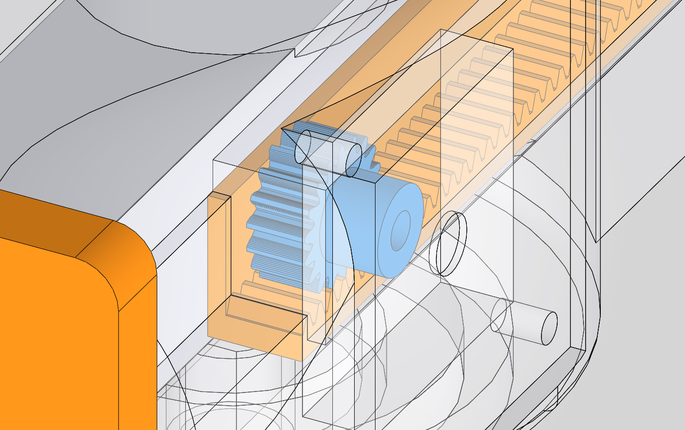
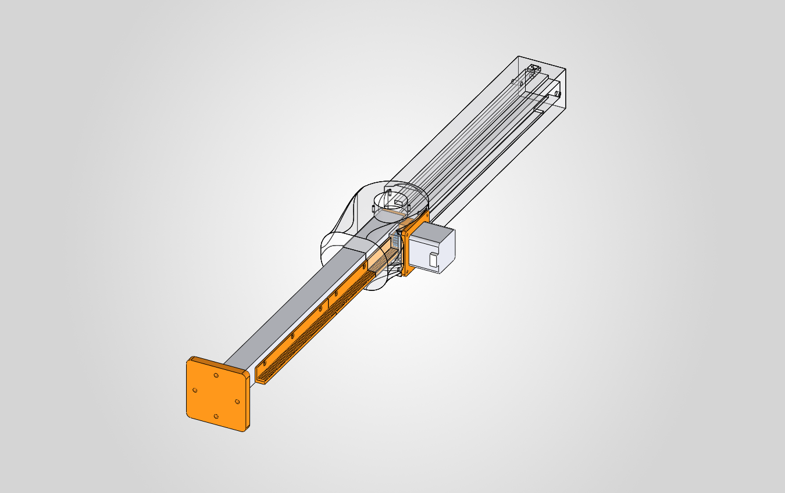
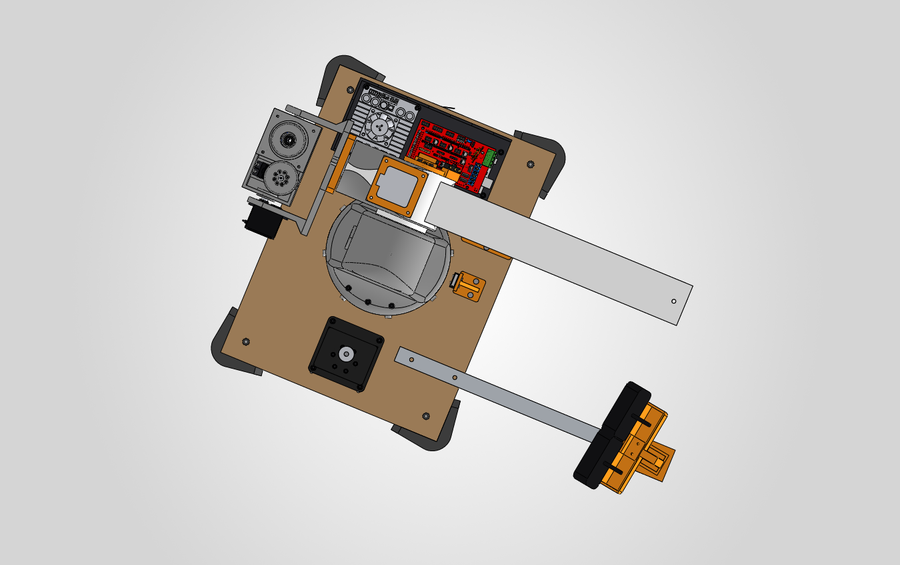

# Prismático J3: todas las alternativas, y dónde poner las cámaras

Los dos diseños que quedaron en el CAD (telescópico y cremallera) se comparan en detalle en [v7_prismatico.md](v7_prismatico.md).

## 1. Mecanismos para el prismático

Ordenados de **más fácil a más difícil de montar**. La dificultad cuenta las piezas que hay que alinear y tensar y cuánto hay que ajustar a mano, no el precio.

| # | Mecanismo | Montaje | Largo detrás de J2 (carrera 340) | Velocidad | ¿Sirve para CitriBot? |
|:-:|:--|:-:|:--|:--|:--|
| 1 | Actuador lineal comprado (12 V) | ●○○○○ | ≈ 450 mm (cuerpo + carrera) | lenta, 10–30 mm/s | Solo si la velocidad no importa |
| 2 | Correa GT2 de una etapa (v7A) | ●●○○○ | 377 mm | 200 mm/s | Sí (estuvo en el CAD hasta la v7.15) |
| 3 | Husillo T8 (v6) | ●●○○○ | 452 mm | 40 mm/s | Sí, pero es la más larga |
| 4 | Cremallera y piñón | ●●●○○ | 377 mm (un tubo) | 100–200 mm/s | Sí: **diseño final alternativo** (`CB-000C`) |
| 5 | Cable con tambor (cabrestante) | ●●●○○ | 377 mm (un tubo) | 200 mm/s | Sí, con cuidado del estiramiento (se modeló y se descartó) |
| 6 | Telescópica 2:1 con correas (v7B) | ●●●●○ | **204 mm** | 400 mm/s | Sí: **diseño oficial** |
| 7 | Tijera | ●●●●○ | muy corta | no lineal | No: poca rigidez para la ventosa |
| 8 | Cadena rígida o cinta enrollable | ●●●●● | mínima | variable | No: casi solo industrial |

### 1 · Actuador lineal comprado
Un motor DC con husillo interno en un tubo, que se compra armado; algunos traen potenciómetro de realimentación. Se atornilla por las dos puntas y listo.
- **A favor**: cero piezas que alinear, fuerza de sobra y autobloqueante (no se cae si se corta la corriente).
- **En contra**: lento; el cuerpo mide la carrera más ≈ 100 mm, así que el brazo queda tan largo como con el husillo; pesa 1–1,5 kg en la cola; necesita un puente H y lectura del potenciómetro, no un driver de pasos.
- Videos: [brazo robótico con actuadores lineales](https://www.youtube.com/watch?v=PBl0y2t8s4s) · [brazo casero con actuadores lineales](https://www.youtube.com/watch?v=slEBuMXNgII) · [actuador de 12 V hecho en casa](https://www.youtube.com/watch?v=ZPkmvMiAtpo)

### 2 · Correa GT2 de una etapa (variante A, borrada en la v7.15)
Un lazo de correa entre la polea del NEMA y una polea loca tira del tubo. Es lo mismo que el eje de una impresora 3D.
- **A favor**: pocas piezas (2 poleas, correa y pinza), rápida, todo comprado salvo la pinza.
- **En contra**: cola de 377 mm; hay que tensar la correa; no es autobloqueante.
- Videos: [guía lineal con correa y carro impreso](https://www.youtube.com/watch?v=Y7jOAhhYEvY) · [riel con correa movido por paso a paso](https://www.youtube.com/watch?v=IySOT4QmRbY) · [NEMA 17 con correa GT2](https://www.youtube.com/watch?v=IHan0WPXAI4)

### 3 · Husillo T8 (v6)
La varilla roscada en el eje del NEMA (acople flexible) empuja una tuerca fija al tubo.
- **A favor**: mucha fuerza y resolución; el motor en la punta de la cola hace de contrapeso; la varilla ya está comprada (BOM T05).
- **En contra**: la más larga (452 mm detrás de J2); lenta; el acople y la varilla de 400 mm se tienen que alinear bien o vibra.
- Videos: [NEMA 17 + T8 + guía MGN7](https://www.youtube.com/watch?v=OZZotumNNRU) · [actuador V-Slot con husillo](https://www.youtube.com/watch?v=FY-kGy3A334) · [montaje de guía con husillo](https://www.youtube.com/watch?v=jVleaaCOFtQ) · Guía escrita: [Instructables, Linear Screw Rail](https://www.instructables.com/Linear-Screw-Rail)

### 4 · Cremallera y piñón
Una cremallera impresa (en tramos) pegada o atornillada al tubo de E3 y un piñón en el NEMA, que puede ir junto al cubo de E2.
- **A favor**: el motor queda en el cubo; sin correa que tensar; el tubo no puede patinar.
- **Ojo**: con un solo tubo la cola mide lo mismo que con la correa (377 mm): el largo detrás del hombro lo fija el tubo, no el mecanismo. Solo la telescópica lo acorta.
- **En contra**: los tramos de cremallera tienen que quedar alineados y a la distancia justa del piñón; juego entre dientes (unos 0,2–0,5 mm) y desgaste del PETG; hay que apretar el piñón contra la cremallera con un rodillo del otro lado.
- Videos: [cremallera y piñón impresos](https://www.youtube.com/watch?v=b-D5uxBwNwI) · [prototipo con NEMA 17](https://www.youtube.com/watch?v=zi9arVCQzZY) · [mecanismo impreso, versión 2](https://www.youtube.com/watch?v=rktnHZdgcIY) · Escrito: [Hackaday, actuador impreso de 2 kg con NEMA 17 y RAMPS](https://hackaday.com/2017/06/20/hackaday-prize-entry-3d-printed-linear-actuator-does-2kg)

**En el CAD**: el robot completo es `CB-000C_CitriBot_v7C_Cremallera` y el mecanismo solo, [`CB-450C_Prismatico_Cremallera_Solo`](../cad/solidworks/14_Prismatico_Alternativas). Detalle, BOM y montaje: [v7_prismatico.md](v7_prismatico.md) §2, §4.1 y §5.1.
- Piñón m1 de 18 dientes (Ø18 primitivo: 56,5 mm por vuelta, 0,018 mm por micropaso a 1/16) en el eje del NEMA, donde iba la polea GT2. Con 0,4 N·m del NEMA empuja ≈ 44 N.
- Cremallera m1 en 2 tramos de 58 dientes (182 mm cada uno, entran en la Ender), atornillados o remachados arriba del tubo con 3 M3 por tramo. Al estirar, la cremallera sale por el frente de E2: E2-C (`CB-301C`) es una copia de CB-301 con esa ranura.
- Estudio de movimiento `Movimiento_cremallera`: el piñón gira con el tubo (relación cremallera-piñón). Sin choques en 0, 170 y 340 mm, salvo 0,01–0,05 mm³ entre dientes (la evolvente está dibujada como una poligonal).
- **A revisar al imprimir**: el tubo tiene 0,5 mm de juego en el canal de E2 y puede alejar la cremallera del piñón; si salta un diente, sumar un patín o rodillo del lado opuesto (+z).

### 5 · Cable con tambor (cabrestante)
Dos tramos de hilo (Dyneema o acero) enrollados en un tambor en el NEMA: uno tira del tubo hacia adelante y el otro hacia atrás, pasando por una polea en la punta de E2.
- **A favor**: el motor va en el cubo; liviano y silencioso; piezas baratas.
- **Ojo**: con un solo tubo la cola mide 377 mm, igual que con la correa.
- **En contra**: el hilo se estira y hay que retensarlo; si se afloja, salta del tambor. Es lo que usan los equipos de robótica FTC/FRC en sus elevadores.
- Referencias: [Game Manual 0, cableado de mecanismos lineales](https://game-manual-0.readthedocs.io/en/stable/docs/linear-motion-guide/rigging.html) · [poleas con hilo para un brazo robótico](https://m.youtube.com/watch?v=uJiauHFUbn8)

**En el CAD**: se modeló en la v7.14 (tambor Ø13 en el NEMA, polea acanalada en la cola y el cable por la pinza del tapón, sin choques) y se borró en la v7.15 al quedarse con la cremallera; está en el historial de git (`CB-450D`).

### 6 · Telescópica 2:1 con correas (variante B, diseño oficial)
Tres tramos de tubo; una correa mueve el intermedio y otra, anclada a E2 y pasando por dos poleas del intermedio, hace que el interior avance el doble.
- **A favor**: la más corta (204 mm detrás de J2) y la más rápida.
- **En contra**: 8 piezas impresas, 2 correas y 4 poleas; dos holguras en serie; la segunda correa corre con 3 mm libres.
- Videos: [mecanismo telescópico impreso con correa](https://www.youtube.com/watch?v=DdeVhykwLcg) · [actuador telescópico impreso](https://www.youtube.com/watch?v=FNrEm1sNmwQ) · Teoría (elevador en cascada, mismo principio): [FRC Design, cascade elevator](https://frcdesign-org.pages.dev/learning-course/stage2/2D/introduction)

### 7 · Tijera
Varias barras en X: al juntar las dos de la base con un husillo, la punta se estira mucho.
- **A favor**: plegada ocupa muy poco.
- **En contra**: muchos pivotes, cada uno con su juego; la punta se dobla con el peso de la naranja; la relación entre el motor y la extensión no es lineal (el control se complica).
- Video: [tijera impresa](https://www.youtube.com/watch?v=2PDjLntR7jU)

### 8 · Cadena rígida, cremallera de cierre o cinta enrollable
Dos cadenas o cintas que se traban como un cierre y forman una columna rígida al salir, o una cinta tipo metro que se desenrolla.
- **A favor**: guardada ocupa casi nada.
- **En contra**: piezas muy precisas; los modelos impresos son demostraciones, no cargan una herramienta en voladizo.
- Videos: [Tsubaki Zip Chain](https://www.youtube.com/watch?v=L2-3XSKvUSw) · [cómo funciona la cadena rígida](https://www.youtube.com/watch?v=r1WmN62M6lo) · [cadena de cierre impresa](https://www.youtube.com/shorts/YpqrGcf-gjg) · [Serapid Rigibelt](https://www.youtube.com/watch?v=E9B8pnXKPD4) · Cinta: [ShapeBots, actuador de cinta enrollable (paper)](https://arxiv.org/pdf/1909.03372)

### Descartado: cilindro neumático
Necesita un compresor (el robot solo tiene bomba de vacío) y no puede parar en cualquier posición sin válvulas proporcionales.

### Recomendación
La única forma de acortar el brazo es la **telescópica (6)**, el diseño oficial. Con un solo tubo (2, 4 y 5) la cola mide 377 mm: entre esas quedó la **cremallera y piñón (4)**, que evita tensar correas (`CB-000C`).

---

## 2. Dónde poner las cámaras sin que estorben al brazo

### Qué pasa hoy
- El mástil está en (−80, 130) mm desde J1 (marco del árbol: x hacia el árbol), a **153 mm** del eje.
- Con el telescópico, la cola de E2 llega a 212 mm detrás de J2 y el brazo trabaja 83 mm al costado de J1: al girar J1, la cola barre un círculo de **≈ 236 mm de radio**. El mástil queda adentro, así que la cola lo choca y J1 queda limitado (−70° … +100° medido con la cola larga de la variante A; con la telescópica no se volvió a medir).
- Ningún punto del tablero de 400 × 300 queda fuera de ese círculo con margen: la esquina trasera está a 250 mm, y el tubo del mástil (20 mm) la deja a ≈ 4 mm de la cola.

### Opciones

| Opción | Choca con el brazo | Vista de la esfera | Contras |
|:--|:--|:--|:--|
| **A · Mástil actual** (−80, 130) | La cola sí: J1 limitado a ≈ 170° | 565 mm, buena | Limita J1 |
| **B · Esquina trasera, salida del tablero** (≈ −185, 190), a 265 mm de J1 ⭐ | La cola no; el frente del brazo solo si J1 apunta a ≈ 134°, que nunca hace falta | 716 mm: la esfera entra con margen (±11,8° contra 14,5° de campo vertical), 2 px/mm, error de profundidad ±2,6 mm | Un pie que sobresale ≈ 35 mm del borde trasero |
| **C · En la cintura** (torre, del lado contrario al brazo) | Nunca: gira con J1 | Siempre mira hacia donde apunta el brazo | Vibra con J1; el cable pasa por J1; E2 y la herramienta pueden tapar la vista |
| **D · En la herramienta** (en el brazo) | Nunca | Muy de cerca | Suma ≈ 150 g en la punta: +8 kg·cm en el hombro, que ya está justo |
| **E · Fija, fuera del robot** (trípode) | Nunca | Libre | Se mueve el robot con el riel y la cámara no: hay que recalibrar o leer la posición del riel |

**Recomendada: B.** Las cámaras siguen fijas a la base (se mueven con el riel, sin recalibrar) y del mismo lado (+y) que hoy, opuesto al plano del brazo (−y), así que el brazo no tapa la esfera salvo la herramienta al acercarse, que es lo que hay que ver. La línea de vista pasa sobre J1 a 533 mm de altura, por encima de la torre (409,5 mm).

Para el campo de visión, B también mejora: hoy en 720p la esfera se pasa ≈ 9 mm arriba y abajo; a 716 mm entra entera.

**Falta verificarlo en el CAD**: mover el pie de `CB-150` a (−185, 190), reorientar el cabezal hacia (385, 0, 270) y repetir el barrido de J1 (`SweepJ1.cs`) y el de oclusión (`OccSweep.cs`) con la telescópica.

### Con la cremallera (CB-000C, v7.15): hecho y verificado

Con un solo tubo la cola llega a 377 mm detrás de J2 y barre un círculo de **≈ 400 mm de radio**: todo el tablero queda adentro, así que ni A ni B sirven. El mástil se sacó **265 mm detrás del tablero**, a **431 mm de J1** en (−415, 115), sobre un brazo de tubo 20 × 20 (`CB-163C`) y un codo impreso (`CB-165C`):

- **J1**: con J3 retraído da la vuelta entera sin choques; con J3 extendido (340 mm) la herramienta toca el mástil solo de +150° a −165° (apuntando hacia atrás). Libre de −160° a +145°, contra −70° … +100° con el mástil en el tablero.
- **Vista**: cámaras a ≈ 880 mm del centro de la esfera, rumbo −8,2° y 31,4° hacia abajo: ≈ 1,6 px/mm y ±3,9 mm de error de profundidad. La línea de vista pasa sobre J1 a ≈ 460 mm, encima de la torre.
- Detalle: [cad/solidworks/README.md §6.19](../cad/solidworks/README.md).

