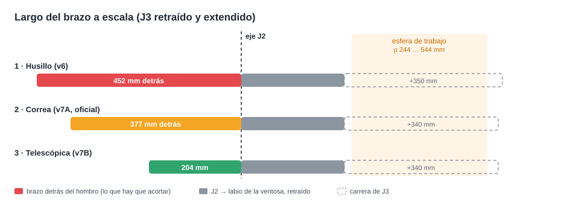
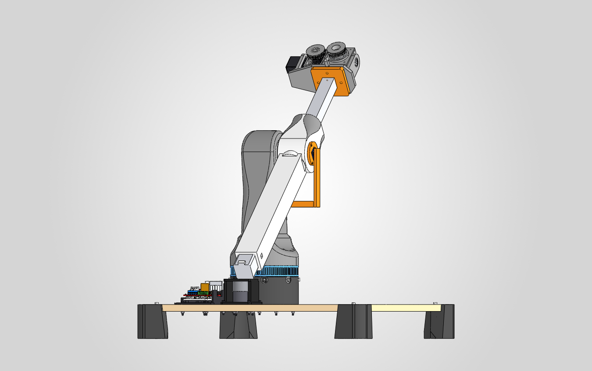
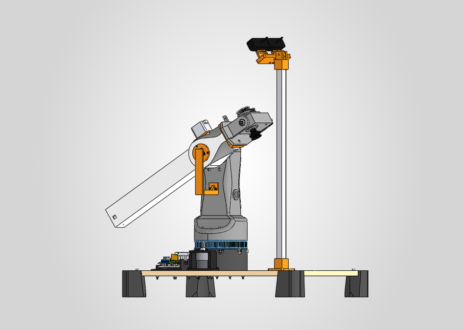
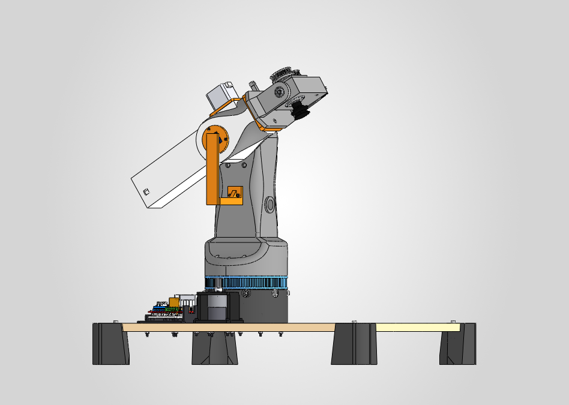
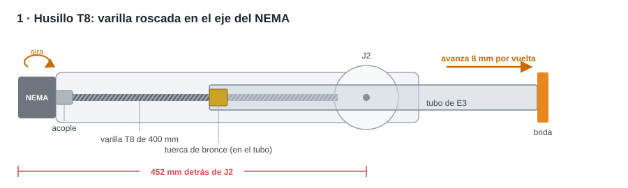
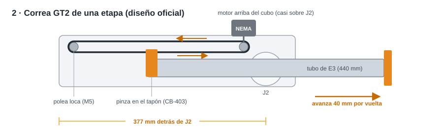
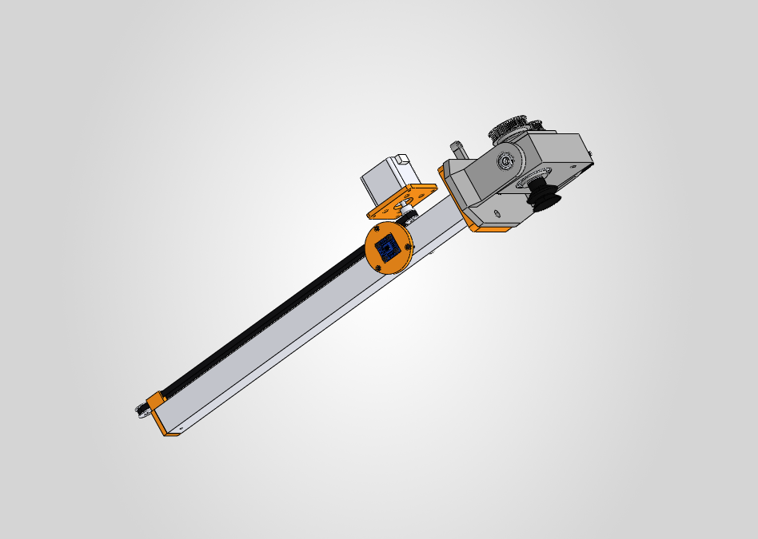
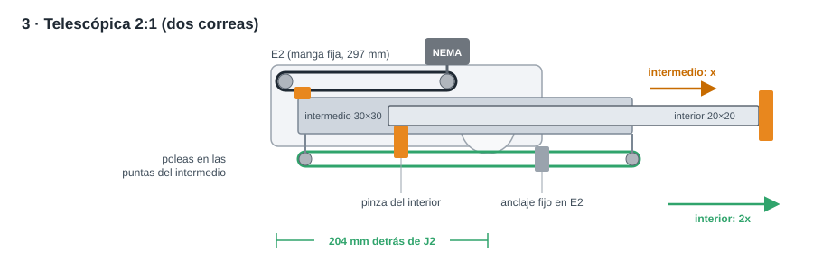
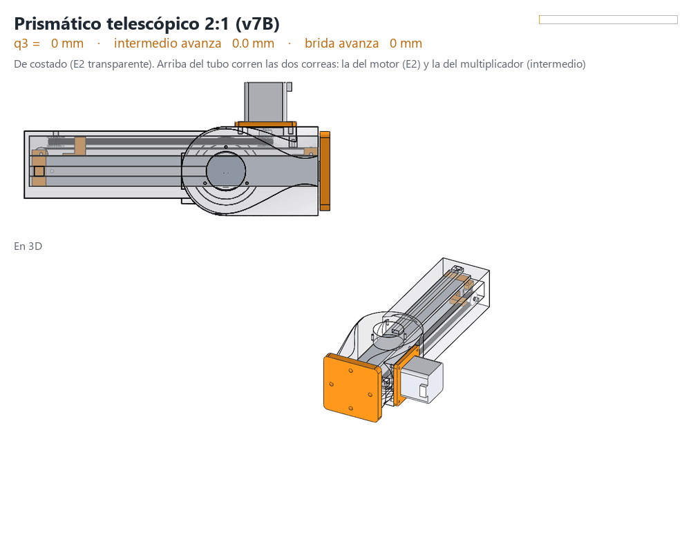

# Mecanismos para el prismático J3

Las tres formas que se estudiaron para mover el tubo de E3, con los números del CAD.

> **En corto.** La **correa (2)** es la que está en el CAD y la recomendada: simple, rápida y con piezas que ya hay.
> El **husillo (1)** da más fuerza y deja el motor como contrapeso, pero es el más largo y lento.
> La **telescópica (3)** es la más corta, pero también la más difícil de armar.

En las tres, J3 es un tubo de aluminio que desliza en el canal de E2, lo mueve un NEMA 17 con el A4988 de la RAMPS, y la ventosa llega de 227,8 a 567,8 mm del eje J2.

---

## De un vistazo

| | **1 · Husillo** (v6) | **2 · Correa** (v7A) | **3 · Telescópica** (v7B) ⭐ |
|:--|:--:|:--:|:--:|
| |  |  |  |
| **Brazo detrás de J2** | 452 mm | 377 mm | **204 mm** |
| **Largo total retraído** | 679 mm | 605 mm | **432 mm** |
| **Carrera** | **350 mm** | 340 mm | 340 mm |
| **Avance por vuelta** | 8 mm | 40 mm | 80 mm |
| **Velocidad** (300 rpm) | 40 mm/s | 200 mm/s | **400 mm/s** |
| **Resolución** (1/16 de paso) | **400 pasos/mm** | 80 pasos/mm | 40 pasos/mm |
| **Torque en el motor** (J3 extendido, J2 a 45°) | **≈ 0,7 kg·cm** | 1,2 kg·cm | 2,3 kg·cm |
| **Pico de torque en J2** | **25 kg·cm** | 39 kg·cm | 44 kg·cm |
| **Piezas impresas nuevas** | – | 3 | 8 |
| **Dificultad** | ●●○ | ●○○ | ●●● |

Lo mejor de cada fila va en **negrita**. Ninguna de las tres es autobloqueante: hay que dejar el driver del NEMA habilitado para que el brazo inclinado no se deslice.

---

## 1 · Husillo T8

*La varilla roscada acoplada al eje del NEMA, con la tuerca en el tubo. Es la de la v6.*

**Cómo funciona**

1. El NEMA va en la **punta de la cola** de E2, con el eje hacia adelante.
2. Un **acople flexible** une el eje con la **varilla T8 de 400 mm**, de 8 mm de avance.
3. La **tuerca de bronce** está fija al fondo del tubo. Al girar la varilla, la tuerca avanza y empuja el tubo. El tubo no gira porque es cuadrado.

| ✔ A favor | ✘ En contra |
|:--|:--|
| Mucha fuerza y mucha resolución | El más largo: 452 mm detrás del hombro |
| El motor en la cola hace de **contrapeso**: el hombro pide solo 25 kg·cm | El más lento: ≈ 9 s para toda la carrera |
| La varilla T8 ya está comprada (BOM T05) | La varilla de 400 mm vibra si va rápido: necesita un rodamiento en la punta |

> El motor no se puede acercar al hombro: detrás del tubo tiene que entrar una varilla del largo de la carrera.

---

## 2 · Correa GT2 de una etapa (oficial hasta la v7.11, ahora alternativa)

*Un lazo de correa arrastra el tubo. El motor va arriba del cubo del hombro.*

| En el CAD (E2, base y torre ocultos) |
|:--:|
|  |

**Cómo funciona**

1. El NEMA va **vertical sobre el cubo de E2** (placa CB-306), con una polea GT2 de 20 dientes.
2. En la punta de la cola hay una **polea loca** con un tornillo M5.
3. La correa va de una polea a la otra por encima del tubo. Sus **dos extremos** se sujetan en la **pinza del tapón trasero** del tubo (CB-403).
4. Al girar el motor, la correa tira del tubo hacia adelante o hacia atrás. Con J3 extendido quedan 98 mm de tubo guiados dentro de E2.

| ✔ A favor | ✘ En contra |
|:--|:--|
| Simple: una correa, dos poleas y una pinza impresa | La cola sigue siendo larga (377 mm) |
| Rápida (200 mm/s) y precisa (0,0125 mm por micropaso) | Sin el contrapeso del motor, el hombro pide 39 kg·cm |
| El motor queda cerca de J2: menos inercia | Hay que tensar la correa y vigilar que no se estire |

> Un contrapeso de 0,3 kg en la punta de la cola baja el pico del hombro unos 11 kg·cm.

---

## 3 · Telescópica 2:1 ⭐ diseño oficial desde la v7.12

*Tres tramos, uno dentro de otro, como el mástil de un autoelevador.*

**Así se mueve** (CAD, ensamblaje `CB-450B_Prismatico_Telescopico_Solo`, de 0 a 340 mm y vuelta):

> **Para verlo moverse en SolidWorks:** abrí `cad/solidworks/11_v7B_Prismatico_Telescopico/CB-450B_Prismatico_Telescopico_Solo.SLDASM`, pasá a la pestaña **Movimiento_telescopico** (abajo, al lado de *Modelo*) y apretá **Reproducir**. En 5 s el tramo interior (con la brida) sale 340 mm y el intermedio 170 mm, arrancando y frenando suave, y vuelve (ida y vuelta). Lo mueven dos motores lineales del estudio, uno por tramo. E2 está transparente para ver los tubos y las correas, y no hay choques en todo el recorrido. En la pestaña *Modelo* también se puede arrastrar cada tramo dentro de su carrera, pero ahí no se mantiene el 2:1.

**Lista de componentes para armarlo** (comprar, imprimir y herramientas): [telescopica_lista_componentes.md](telescopica_lista_componentes.md).

| Tramo | Pieza | Recorrido |
|:--|:--|:--:|
| Manga fija | E2: canal 31 × 31 de 297 mm | – |
| Intermedio | tubo 30 × 30 × 2 de 275 mm | 0 – 170 mm |
| Interior (E3) | tubo 20 × 20 × 1,5 de 263 mm + brida | 0 – 340 mm |

**Cómo funciona**

1. **Primera correa**: el NEMA mueve el **tramo intermedio**, igual que en la opción 2.
2. **Segunda correa**: el intermedio lleva una polea loca en cada punta. La correa sale de un **anclaje fijo en E2**, da la vuelta a la polea delantera, se sujeta al **tubo interior**, sigue hasta la polea trasera y vuelve al anclaje.
3. Cuando el intermedio avanza **x**, el interior avanza **2x**. Por eso alcanza con la mitad de largo detrás del hombro.

| ✔ A favor | ✘ En contra |
|:--|:--|
| La más corta: 204 mm detrás del hombro (−55 %) | 8 piezas nuevas, 2 correas y 4 poleas |
| E2 mide 297 mm y entra mejor en la impresora | Dos holguras en serie: la punta baila más |
| La más rápida (400 mm/s) | El motor hace el doble de fuerza; el hombro pide 44 kg·cm |
| | La segunda correa corre en solo 3 mm libres entre los tubos |

---

## ¿Cuál elegir?

| Si lo más importante es… | Elegí |
|:--|:--|
| Armarlo rápido y sin sorpresas | **2 · Correa** |
| Fuerza, precisión y aliviar el hombro | **1 · Husillo** |
| Que el brazo sea lo más corto posible (por ejemplo, si la cola choca al girar J1) | **3 · Telescópica** |

**Dónde está cada una en el CAD**

- **Telescópica** ⭐ (diseño oficial desde la v7.12): `cad/solidworks/CB-000_CitriBot_Ensamblaje_General.SLDASM` y la carpeta `11_v7B_Prismatico_Telescopico/`.
- **Correa**: `cad/solidworks/CB-000A_CitriBot_v7A_Correa.SLDASM` (alternativa).
- **Husillo**: commit `a29666f` (CAD v6).

Más detalle, lista de materiales y montaje de las dos con correa: [v7_prismatico.md](v7_prismatico.md).
