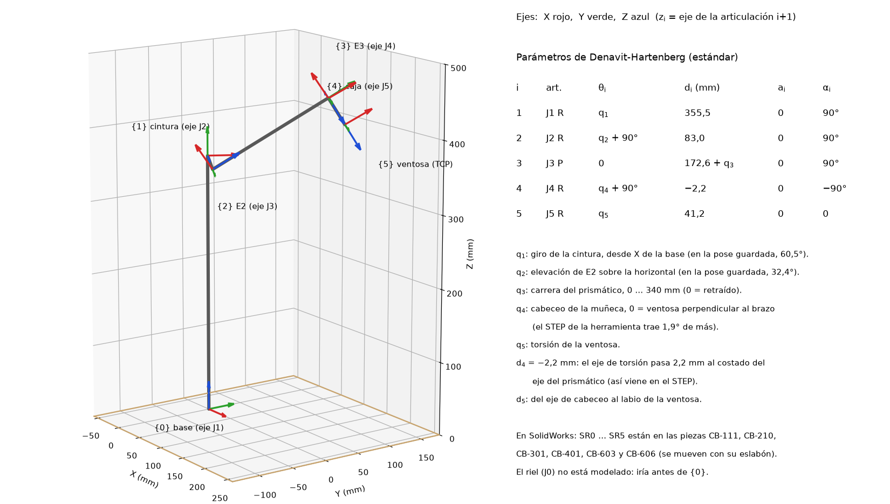

# Sistemas de referencia del brazo (Denavit-Hartenberg)

En el CAD hay un sistema de coordenadas por articulación, con la convención de Denavit-Hartenberg estándar: **zi es el eje de la articulación i+1** y xi va por la normal común entre zi−1 y zi. Cada sistema está dentro de la pieza del eslabón al que pertenece, así que se mueve con él cuando se mueven las articulaciones.

## Dónde están en SolidWorks

| Sistema | Pieza (eslabón) | z | Origen |
|---|---|---|---|
| `SR0_base_eje_J1` | CB-121 placa fija de J1 (base, fija) | eje J1, hacia arriba | sobre el eje J1, en la cara de arriba del tablero (origen de CB-000) |
| `SR1_cintura_eje_J2` | CB-210 torre (gira con J1) | eje J2 | cruce de J1 y J2 (z = 355,5) |
| `SR2_E2_eje_J3` | CB-301 E2 (gira con J2) | eje del prismático, hacia la herramienta | cruce de J2 y el prismático (83 mm al costado de J1) |
| `SR3_E3_eje_J4` | CB-401 tubo de E3 (desliza con J3) | eje de cabeceo de la muñeca | cruce del prismático y el eje de cabeceo |
| `SR4_caja_eje_J5` | CB-603 caja de torsión (cabecea con J4) | eje de torsión, hacia la ventosa | cruce del eje de cabeceo y el de torsión |
| `SR5_ventosa_TCP` | CB-606 eje hueco (gira con J5) | igual que z4 | labio de la ventosa (punto de trabajo) |

Para verlos: **Ver → Ocultar/mostrar → Sistemas de coordenadas**. En cada pieza aparecen en el árbol de operaciones. Al guardar una pieza como STL, en Opciones se puede elegir uno de estos sistemas como **sistema de coordenadas de salida**: así el STL queda con el origen en la articulación, que es lo que piden los bloques *File Solid* de Simscape.

## Parámetros DH

| i | Articulación | θi | di (mm) | ai (mm) | αi |
|---|---|---|---|---|---|
| 1 | J1 cintura (R) | q1 | 355,5 | 0 | 90° |
| 2 | J2 hombro (R) | q2 + 90° | 83,0 | 0 | 90° |
| 3 | J3 prismático (P) | 0 | 172,6 + q3 | 0 | 90° |
| 4 | J4 cabeceo (R) | q4 + 90° | −2,2 | 0 | −90° |
| 5 | J5 torsión (R) | q5 | 41,2 | 0 | 0 |

- q1: giro de la cintura medido desde el eje X de la base. Cuando se midió valía 60,5°.
- q2: elevación de E2 sobre la horizontal. Cuando se midió valía 32,4°.
- q3: carrera del prismático, 0 … 340 mm (0 = retraído). 172,6 mm = 105 (eje J2 → cara de la brida) + 67,6 (brida → eje de cabeceo).
- q4: cabeceo de la muñeca, 0 = ventosa perpendicular al brazo. El STEP de la herramienta trae 1,9° de más (en el CAD θ4 = 91,9°).
- q5: torsión de la ventosa.
- d4 = −2,2 mm: el eje de torsión pasa 2,2 mm al costado del eje del prismático (así viene en el STEP de la herramienta).
- d5 = 41,2 mm: del eje de cabeceo al labio de la ventosa.
- Los valores salen de la geometría del CAD (`Marcos.cs`). Las normales comunes miden menos de 0,1 mm, así que todos los ejes se cruzan como pide la convención.
- El riel (J0) todavía no está modelado. Cuando lo esté, es una articulación prismática más, antes de {0}.

## Alcance con estos números

Con la ventosa alineada con el brazo (cabeceo −90°), el labio queda a ρ = 105 + q3 + 67,6 + 41,2 = **213,8 … 553,8 mm** del eje J2. La esfera pide 254,0 … 554,0 mm (`docs/espacio_de_trabajo.md`): **el lado lejano queda justo en el límite, 0,2 mm corto**. Antes se documentaba un labio a 65,5 mm del eje de cabeceo, que estaba mal.

## Para simular en MATLAB / Simulink

- Para exportar conviene usar el **brazo solo**, `cad/solidworks/13_Brazo_Solo/CB-001_Brazo_Solo.SLDASM`: sin base de madera, electrónica, cámaras ni motores, con las mismas articulaciones y los mismos sistemas SR0 … SR5.

- **Simscape Multibody Link** (complemento de SolidWorks) exporta el ensamblaje y arma las articulaciones a partir de las **relaciones de posición**. En CB-000 J1, J2 y J3 ya las tienen. La herramienta (J4 y J5) todavía es un bloque rígido: para simular la muñeca hay que articularla con relaciones (concéntrica en el eje de cabeceo y en el eje hueco).
- Para armar el modelo a mano con bloques *File Solid* + *Revolute/Prismatic Joint*, exportar cada eslabón como STL con su sistema SR*i* de salida y usar la tabla DH de arriba para los *Rigid Transform*.
