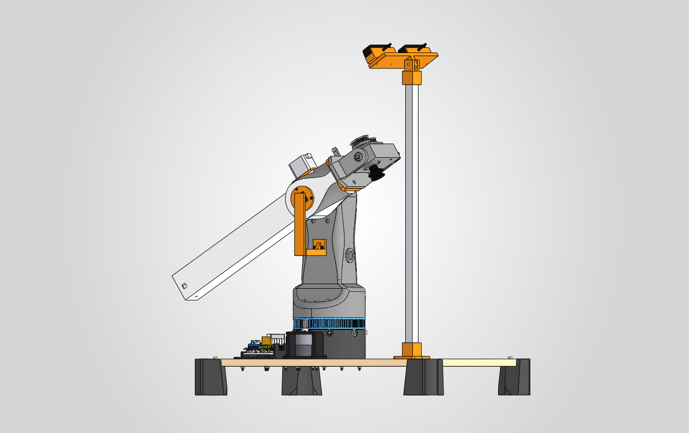
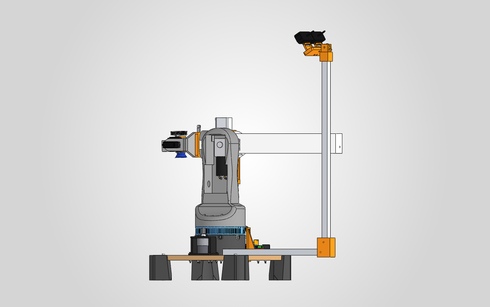
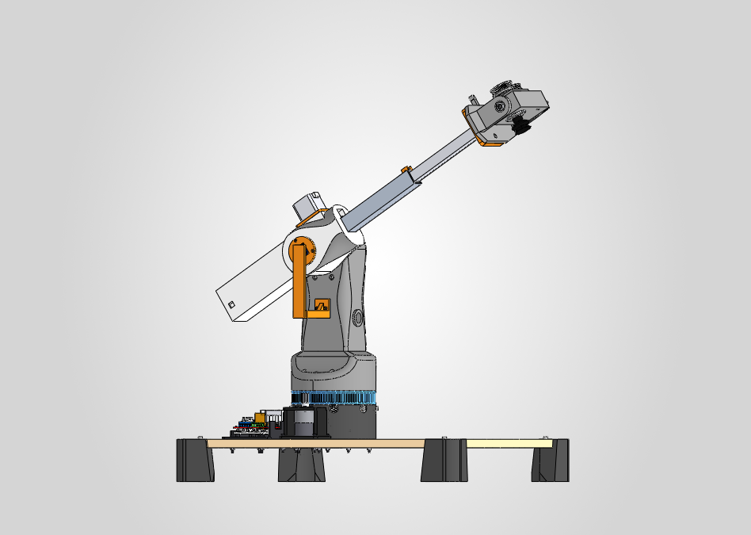
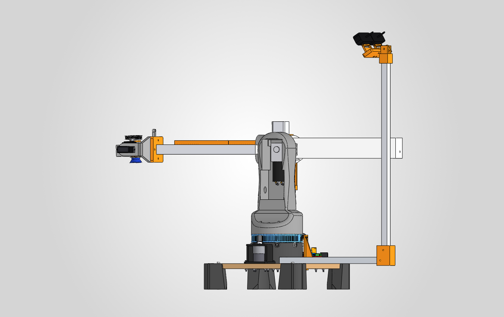
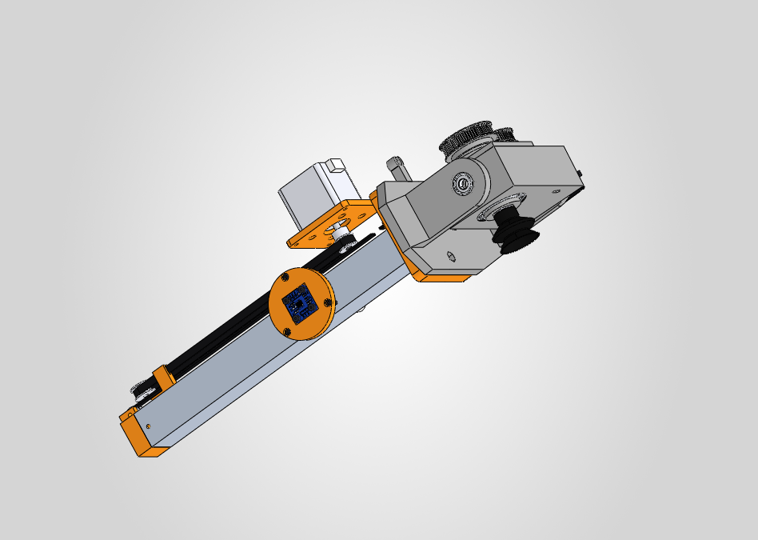
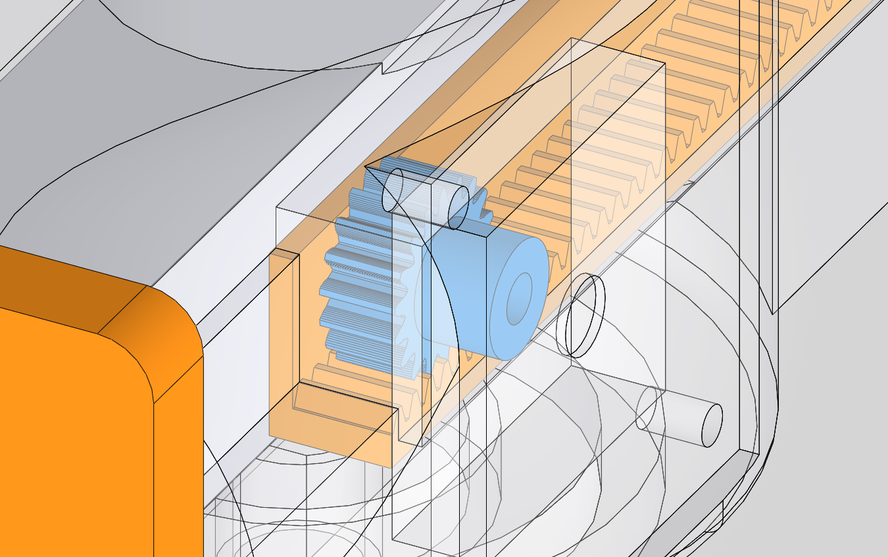
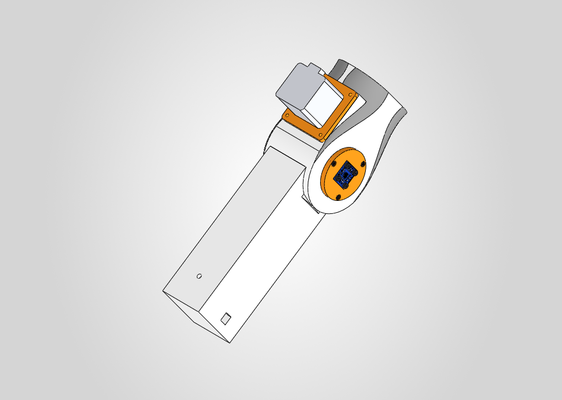
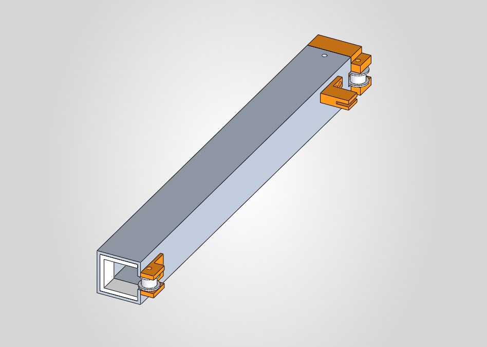

# Prismático: telescópico (oficial) y cremallera

Los dos diseños finales del prismático J3 (desde la v7.15 no hay otros en el repo; la variante A, con correa, y la v6, con husillo, están en el historial de git). En los dos:

- **El hombro no cambia**: motorreductor 5840 acoplado directo a E2, AS5600 en la tapa de E2 (CB-303) e imán en el soporte fijo de la torre (CB-232). El AS5600 mide el ángulo real de J2. Desde la v7.15 la tapa lleva también el **final de carrera de J2** (lo aprieta el brazo del imán en +45°).
- **La cintura y el eje J1 no cambian** (torre CB-210, plato 1M1B, motor 37D).
- La brida de la herramienta queda en el mismo lugar (cara exterior a 105 mm de J2 con J3 retraído) y la carrera es de 340 mm.
- El NEMA 17 del prismático va **arriba del cubo de E2**, casi sobre el eje J2, en la placa CB-306.

| Diseño | Ensamblaje | Cómo se mueve E3 |
|---|---|---|
| **B: telescópico 2:1** (oficial desde la v7.12) | `cad/solidworks/CB-000_CitriBot_Ensamblaje_General.SLDASM`, piezas en `11_v7B_Prismatico_Telescopico/` | correa GT2 al tramo intermedio + multiplicador 2:1 al interior |
| **C: cremallera y piñón** (v7.14) | `cad/solidworks/CB-000C_CitriBot_v7C_Cremallera.SLDASM`, piezas en `14_Prismatico_Alternativas/` | piñón m1 de 18 dientes en el NEMA y cremallera arriba de un solo tubo |

La BOM principal ([bom/BOM.md](../bom/BOM.md)) y el firmware (40 pasos/mm) son los de B. Scripts: `V7.cs` y `Telescopico.cs` (B), `Alternativas.cs` (C).

| | B (telescópico) | C (cremallera) |
|---|---|---|
| J3 retraído |  |  |
| J3 extendido (340 mm) |  |  |
| Mecanismo |  |  |

## 1. Comparación

| | **B: telescópico** | **C: cremallera** |
|---|---|---|
| Brazo detrás del eje J2 | **204 mm** | 377 mm |
| Largo de E2 impreso | 297 mm (305 con el alojamiento del final de J3) | 470 mm |
| Largo total retraído (cola → labio de la SAB40) | 432 mm | 605 mm |
| Largo total extendido | 772 mm | 945 mm |
| Carrera de J3 | 340 mm (170 + 170) | 340 mm |
| Ventosa SAB40 (ρ desde J2) | 227,8 – 567,8 mm | 227,8 – 567,8 mm |
| Margen sobre la esfera (254 – 554 mm) | 26 / 14 mm | 26 / 14 mm |
| Transmisión de J3 | correa GT2 + multiplicador 2:1 (80 mm/vuelta en la brida) | piñón m1 18T (56,5 mm/vuelta) |
| Resolución (A4988 a 1/16) | 40 pasos/mm | 56,6 pasos/mm |
| Fuerza en J3 (extendido, J2 a 45°) | ≈ 36 N → 2,3 kg·cm en el motor | ≈ 18 N → 1,6 kg·cm en el motor |
| Pico de torque en J2 | **44 kg·cm** | ≈ 39 kg·cm (+ 46 g de cremallera) |
| Piezas impresas del prismático | 8 | 5 (E2-C, 2 cremalleras, piñón, tapón) + brida |
| Cámaras | mástil en el tablero, J1 de −70° a +100° | mástil 265 mm detrás del tablero, J1 de −160° a +145° con J3 extendido (toda la vuelta retraído) |
| Ajustes | tensar 2 correas; 2 holguras en serie | sin correas; alinear los 2 tramos de cremallera |

- El torque del hombro es alto porque el NEMA no está en la punta de la cola haciendo de contrapeso. Ver §6.
- Las fuerzas de J3 suponen roce 0,25 del aluminio en la guía impresa, igual que `control/torques.py`. Con patines de PTFE bajan a la mitad.
- Ni la correa ni la cremallera son autoblocantes: dejar el driver habilitado para que el brazo inclinado no deslice.

## 2. C: cremallera y piñón

- **E3** es un tubo de aluminio 30 × 30 × 2 de **440 mm** que desliza en el canal 31 × 31 de E2.
- **E2-C** (CB-301C) tiene la cola a 377 mm detrás de J2, como la variante A, con una **ranura arriba del canal** para que la cremallera salga por el frente cuando el tubo se estira.
- **Accionamiento**: NEMA 17 vertical sobre el cubo (placa CB-306) con un **piñón m1 de 18 dientes** (Ø18 primitivo) en el eje. La **cremallera m1** va en 2 tramos de 58 dientes (182,2 mm, entran en la Ender) atornillados arriba del tubo; el largo de cada tramo es un número entero de pasos, así que el diente sigue sin saltos.
- **Tapón trasero** (CB-403): tapa el tubo y aprieta el final de carrera de J3 (escuadra CB-307 en el fondo del canal, contra la pared trasera de E2). Queda adentro del canal y no se ve desde afuera.
- El mecanismo solo, con un estudio de movimiento que lo hace salir y entrar: `CB-450C_Prismatico_Cremallera_Solo`.
- **Ojo**: el tubo tiene 0,5 mm de juego en el canal y puede alejar la cremallera del piñón. Si salta un diente, agregar un patín de PTFE del lado +z del tubo.

## 3. B: telescópica 2:1

| Tramo intermedio CB-410B |
|---|
|  |

Tres piezas deslizan una dentro de otra:

| Tramo | Pieza | Recorrido respecto de E2 |
|---|---|---|
| Manga (fija) | E2, CB-301B: canal 31 × 31 de 297 mm | – |
| Intermedio | tubo 30 × 30 × 2 de **275 mm** (CB-411B) | 0 – 170 mm |
| Interior (E3) | tubo 20 × 20 × 1,5 de **263 mm** (CB-421B) + brida CB-432B | 0 – 340 mm |

**Cómo funciona:**

1. **Etapa 1.** El NEMA mueve el **intermedio** con una correa GT2 en lazo. El lazo va de la polea del motor a una polea loca en la cola de E2, y la pinza CB-415B une el intermedio con la correa.
2. **Multiplicador 2:1.** El intermedio lleva una polea loca 16T en cada punta: CB-412B atrás y CB-413B adelante. Una segunda correa:
   - sale del **anclaje fijo de E2**, 72 mm delante de J2;
   - da la vuelta a la polea delantera;
   - corre por dentro del intermedio, en los 3 mm libres sobre el tubo interior, y se sujeta al **tubo interior** (pinza CB-422B);
   - sigue hasta la polea trasera, da la vuelta y vuelve al anclaje.

   Cuando el intermedio avanza x, el interior avanza 2x respecto de E2. Es el mismo mecanismo de los mástiles de autoelevadora, con correa en los dos sentidos.
3. **Guías:** con J3 extendido quedan 95 mm del intermedio dentro de E2 y 93 mm del interior dentro del intermedio. El interior se guía con el buje delantero CB-414B (en U, abierto arriba para la correa) y con los patines del buje trasero CB-422B.

En el CAD, el intermedio (CB-410B) y el interior (CB-400B) tienen relaciones de límite separadas: 0–170 y 0–340 mm. Para mover el brazo a mano en SolidWorks, llevá el intermedio a la mitad de q3. Desde la v7.8 la correa del multiplicador (CB-442B) va dentro de CB-410B y se mueve con el intermedio. Para ver solo el mecanismo, con un estudio de movimiento que lo hace salir y entrar, está `CB-450B_Prismatico_Telescopico_Solo` (ver [prismatico_alternativas.md](prismatico_alternativas.md)).

## 4. Lista de materiales

Solo cambia el eslabón E2 con el prismático (y, en C, el brazo del mástil de las cámaras). El resto del robot (base, cintura, hombro, herramienta y electrónica) queda igual que en [bom/BOM.md](../bom/BOM.md).

### 4.1 C: cremallera

**Comprado**

| Componente | Especificación | Cant. | CAD |
|---|---|---|---|
| Motor paso a paso NEMA 17 | 40 mm, 0,42 N·m, 1,7 A, eje Ø5 (17HS4401) | 1 | CB-505 |
| Piñón módulo 1 | 18 dientes, agujero 5 mm, con prisionero (o impreso, CB-432C) | 1 | CB-432C |
| Tubo cuadrado de aluminio | 30 × 30 × 2 mm, **440 mm** | 1 | CB-401 |
| Pasador de acero | Ø3 × 30 mm | 2 | – |
| Remache pop o tornillo M3 avellanado | cremallera → tubo, 3 por tramo | 6 | – |
| Inserto térmico M3 | para PETG, Ø exterior ≈ 4,6 mm, largo 5–6 mm | 4 | – |
| Tornillo M3 × 6 Allen | motor → placa CB-306 | 4 | – |
| Tornillo M3 × 10 | placa CB-306 → insertos de E2 | 4 | – |
| Tornillo M5 + tuerca M5 autoblocante | sujeta la escuadra CB-307 en el agujero de la cola (era el eje de la polea loca de A) | 1 | – |
| Cinta de PTFE adhesiva | canal 31 × 31 | 0,5 m | – |
| Final de carrera + 2 × M2 × 10 | home de J3 (tubo retraído), en la escuadra CB-307 | 1 | CB-516 |
| Tubo 20 × 20 × 1,5 de 367 mm + 2 × M5 × 40 + 2 × M4 × 50 con tuercas | brazo del mástil de las cámaras y codo | 1 | CB-163C, CB-165C |

**Impreso (PETG)**

| Pieza | Relleno | Notas |
|---|---|---|
| CB-301C Eslabón E2 | cubo: ≥ 6 perímetros y 50 %; cola: 3 perímetros y 15 % | 470 mm: 2 tramos (cubo hasta x ≈ −100 + cola) |
| CB-306 Placa soporte del NEMA 17 | 100 % | 62 × 62 × 5 |
| CB-431C Cremallera (×2) | 100 % | de costado |
| CB-432C Piñón | 100 % | si no se compra |
| CB-403 Tapón trasero | 100 % | |
| CB-402 Brida de E3 | 100 % en el tapón | |
| CB-307 Escuadra del final de J3 | ≥ 4 perímetros | |
| CB-165C Codo del mástil | 40 % | |

### 4.2 B: telescópico

**Comprado**

| Componente | Especificación | Cant. | CAD | Respecto de la v6 |
|---|---|---|---|---|
| Motor paso a paso NEMA 17 | 40 mm (17HS4401) a ≤ 150 rpm; mejor 48 mm, 0,55 N·m (17HS19), mismo montaje | 1 | CB-505 | igual (M03); ver §1, el motor trabaja más que en C |
| Polea GT2 | 20 dientes, agujero 5 mm, correa de 6 mm | 1 | HW_Polea_GT2_20T_D5 | nueva |
| Polea loca GT2 dentada | 20 dientes, agujero 5 mm, con rodamientos | 1 | HW_Polea_Loca_GT2_20T_D5 | nueva |
| Polea loca GT2 dentada | **16 dientes, agujero 3 mm**, con rodamientos | 2 | HW_Polea_Loca_GT2_16T_D3 | nueva |
| Correa GT2 abierta | 6 mm, **1,5 m** (etapa 1 ≈ 470 mm + multiplicador ≈ 570 mm + extremos) | 1 | CB-441B, CB-442B | nueva |
| Tubo cuadrado de aluminio | 30 × 30 × 2 mm, **275 mm** | 1 | CB-411B | reemplaza el de 460 mm (X05) |
| Tubo cuadrado de aluminio | **20 × 20 × 1,5 mm, 263 mm** | 1 | CB-421B | nuevo |
| Pasador de acero | Ø5 × 20 mm + clip E de 5 mm + arandela M5 | 1 | – | eje de la polea loca de la etapa 1 |
| Pasador de acero | Ø3 × 30 / Ø3 × 25 / Ø3 × 20 mm | 1 + 1 + 1 | – | tapón del intermedio / buje del interior / brida |
| Tornillo M3 × 25 + tuerca M3 autoblocante | eje de la polea 16T trasera | 1 | – | |
| Tornillo M3 × 20 + tuerca M3 autoblocante | eje de la polea 16T delantera | 1 | – | |
| Tornillo M3 × 4 | soporte de la polea delantera → intermedio (roscado en la pared) | 2 | – | |
| Tornillo M3 × 5 | pinza de la etapa 1 → intermedio (roscado en la pared) | 2 | – | |
| Tornillo M3 × 10 + placa de apriete impresa | anclaje de la correa 2:1 en E2 | 1 | – | placa no modelada |
| Tornillo M2 × 6 + placa dentada impresa | correa 2:1 → tubo interior | 2 | – | placa no modelada |
| Inserto térmico M3 | para PETG | 4 | – | |
| Tornillo M3 × 6 Allen | motor → placa CB-306 | 4 | – | |
| Tornillo M3 × 10 | placa CB-306 → insertos de E2 | 4 | – | |
| Macho M3 + broca de 2,5 mm | roscar los 4 agujeros de la cara superior del intermedio | 1 | – | herramienta |
| Precinto | extremos de la correa de la etapa 1 | 2 | – | |
| Cinta de PTFE adhesiva | canal de E2 y buje delantero | 0,5 m | – | |
| Final de carrera | home de J3: alojamiento en la pared trasera de CB-301B, 2 × M2 × 12 | 1 | CB-516 | ya en S04 |

**Impreso (PETG)**

| Pieza | Relleno | Notas |
|---|---|---|
| CB-301B Eslabón E2 | cubo: ≥ 6 perímetros y 50 %; manga: 4 perímetros y 25 % | 297 mm: 2 tramos, o 1 en diagonal si entra en la cama |
| CB-306 Placa soporte del NEMA 17 | 100 % | igual que en C |
| CB-412B Tapón trasero del intermedio con polea | 100 % | |
| CB-413B Soporte de la polea delantera | 100 % | |
| CB-414B Buje delantero del intermedio | 100 % | mejor en PTFE o UHMW mecanizado |
| CB-415B Pinza de la correa de la etapa 1 | 100 % | |
| CB-422B Buje trasero del interior con pinza 2:1 | 100 % | |
| CB-432B Brida de E3 para tubo 20 × 20 | 100 % en el tapón | reemplaza a CB-402 |

**Sale de la BOM de la v6:** husillo T8 + tuerca (T05), acople 5 × 8 (T06), portatuerca CB-403 (P12), brida CB-402 (P09), los 4 M3 × 10 de la tuerca y el tubo de 460 mm.

> Fijaciones al ras: el tubo de 30 × 30 desliza en el canal con 0,5 mm de juego, y el de 20 × 20 pasa por el buje delantero con 0,2 mm. Una cabeza de tornillo en los costados roza. Por eso la brida y los tapones van con **pasador de acero al ras + epoxi**. La v6 tenía el mismo problema con los M3 × 35 pasantes (H24).

## 5. Montaje

El hombro (5840, buje CB-305, AS5600, tapa CB-303 e imán CB-232) se arma igual que en la v6: pasos 6, 9 y 10 de [cad/solidworks/README.md](../cad/solidworks/README.md#8-secuencia-de-montaje-sugerida).

### 5.1 C: cremallera

1. **E2.** Pegá los 2 tramos de CB-301C. Colocá los **4 insertos M3** en la base del motor (soldador a ≈ 220 °C). Pegá la cinta de PTFE en el canal.
2. **Motor.** Atornillá el NEMA 17 a la placa CB-306 con 4 × M3 × 6 desde abajo: las cabezas quedan en el cajeado. El conector del motor apunta hacia la cola.
3. **Piñón.** Entralo por el frente del canal, subilo a la ranura y llevalo debajo del agujero del motor, con el cubo hacia arriba.
4. **Motor a E2.** Bajá el motor con la placa, pasando el eje por el piñón, y atornillá la placa con 4 × M3 × 10. Dejá la cara de abajo de los dientes a **28 mm de la cara del motor** (y = 19 en E2) y apretá el prisionero sobre el plano del eje.
5. **Final de carrera de J3.** Escuadra CB-307 sobre el piso del canal, contra la pared trasera, sujeta con el M5 vertical de la cola; switch con 2 × M2 × 10 y cables por el paso Ø6 de la pared trasera.
6. **Tubo.** Cortalo a 440 mm. Perforá Ø3 a 10 mm de cada punta, de arriba hacia abajo. Pegá la brida CB-402 y el tapón CB-403 con epoxi y clavá los pasadores Ø3 × 30 al ras.
7. **Cremallera.** Apoyá los 2 tramos arriba del tubo, seguidos y a tope (el primero empieza 15 mm delante de la punta trasera), alineados contra una regla. Marcá y perforá los 6 agujeros y fijalos con remaches o M3 avellanados. Pasá un dedo por la unión: el diente no tiene que tener escalón.
8. Meté el tubo por el frente de E2 hasta el fondo (home): la cremallera pasa por la ranura y engrana con el piñón. Girá el piñón a mano: el tubo tiene que ir y volver sin saltos en los 340 mm.
9. **Herramienta.** Horquilla CB-601 a la brida con 4 × M5 × 25 + tuerca.
10. **Firmware:** **56,6 pasos/mm** a 1/16 de micropaso (3200 / 56,55). Probar primero a 50 mm/s.
11. **Cámaras:** brazo CB-163C sobre el tablero (2 × M5 pasantes en x −80 y −140, y = 115 del marco del árbol), codo CB-165C en la punta y el mástil de siempre en el codo (ver [cad/solidworks/README.md §6.19](../cad/solidworks/README.md)).

### 5.2 B: telescópico

1. **E2.** Pegá los tramos de CB-301B. Colocá los 4 insertos M3 de la base del motor y pegá la cinta de PTFE en el canal. Presioná el **pasador Ø5** de la polea loca en el techo de la manga, de arriba hacia abajo.
2. **Motor y polea 20T:** atornillá el NEMA a la placa CB-306 (4 × M3 × 6), entrá la polea por el frente del canal hasta debajo del agujero del motor, bajá el motor con la placa pasando el eje por la polea y atornillá la placa (4 × M3 × 10). Cara inferior de la polea a **24,5 mm** de la cara del motor; prisioneros sobre el plano del eje.
3. **Polea loca 20T.** Metela en el pasador desde la ranura, con una arandela arriba, y trabala abajo con el clip E.
4. **Tubo intermedio.** Cortalo a 275 mm.
   - Abrí en la cara superior la **ventana de 14,5 × 9,4 mm** de la punta delantera y la **muesca de 3 × 9,4 mm** de la punta trasera (amoladora o lima). Son para las poleas 16T.
   - Perforá Ø2,5 y roscá M3 los 4 agujeros de la cara superior. Los dos delanteros están a 23 y 17 mm de la punta delantera; los dos traseros, a 20 y 25 mm de la punta trasera, corridos 7,2 mm del centro.
   - Perforá Ø3 de lado a lado a 6 mm de la punta trasera.
5. **Tubo interior.** Cortalo a 263 mm y perforá Ø3 de lado a lado a 10 mm de cada punta.
6. **Interior.**
   - Pegá la brida CB-432B en la punta delantera y el buje CB-422B en la trasera, cada uno con epoxi y un pasador al ras.
   - Atornillá la **placa dentada** del tramo inferior de la correa 2:1 sobre el tubo, dentro del canal del buje trasero (2 × M2 × 6).
7. **Intermedio.**
   - Pegá el buje delantero CB-414B en la punta delantera, con la abertura hacia arriba.
   - Atornillá el soporte CB-413B (2 × M3 × 4) y la pinza CB-415B (2 × M3 × 5). Los tornillos no pueden asomar por dentro del tubo: por ahí pasa la correa.
   - Montá la polea 16T delantera en el soporte (M3 × 20 + tuerca autoblocante).
8. **Telescopio.**
   - Pasá la correa 2:1 por la ventana delantera, alrededor de la polea delantera y hacia atrás por adentro del intermedio.
   - Metés el interior **por atrás**: los patines del buje trasero (25,6 mm) no pasan por el buje delantero (20,4 mm). El tramo inferior de la correa queda entre el interior y la cara superior del intermedio. Sujetalo a la placa dentada del interior.
   - Montá la polea 16T trasera en el tapón CB-412B (M3 × 25 + tuerca autoblocante) y pasá la correa alrededor de ella.
   - Pegá el tapón en la punta trasera del intermedio, con su pasador Ø3 × 30.
9. Dejá los dos extremos libres de la correa 2:1 sobre el intermedio, apuntando al anclaje.
10. **Telescopio a E2.** Metelo por el frente de E2 hasta el fondo, con el interior también retraído.
11. **Cerrar la correa 2:1.** Los dos extremos van al **anclaje de E2**, a 72 mm delante de J2 (placa de apriete + M3 × 10 desde abajo). Tensala con el intermedio y el interior retraídos.
12. **Correa de la etapa 1.** Rodeá la polea del motor y la polea loca y cerrala en la pinza CB-415B: un extremo en la ranura, tensala a mano, el otro con los dientes enfrentados y 2 precintos.
13. **Prueba a mano.** Empujá el intermedio: el interior tiene que salir el doble y volver sin trabarse. Si hay juego vertical, agregá PTFE en el buje delantero.
14. **Final de carrera:** meté el switch desde atrás en el alojamiento de la pared trasera de CB-301B, con la palanca hacia adentro, y atornillalo con 2 × M2 × 12 de arriba hacia abajo. Con el telescopio retraído a mano tiene que hacer clic contra el tapón CB-412B antes del tope. **Herramienta:** horquilla CB-601 a la brida CB-432B con 4 × M5 × 25 + tuerca.
15. **Firmware:** **40 pasos/mm de q3** a 1/16 de micropaso. Con el 17HS4401, limitar el motor a ≈ 150 rpm (≈ 200 mm/s en la brida).

## 6. Hombro: ¿direct drive?

Hoy el hombro ya es direct drive en un sentido: el eje del 5840 entra directo en E2, sin correas ni engranajes extra. **Eso conviene mantenerlo.** Un direct drive "real", con un motor sin reductor, no es factible:

| Opción | Torque | Problema |
|---|---|---|
| NEMA 17 sin reductor | 0,4 – 0,55 N·m | J2 pide ≈ 3,5 – 4 N·m solo para sostener el brazo extendido (C: 35 kg·cm, B: 40 kg·cm): 8 a 10 veces más |
| NEMA 23 de 76 mm | ≈ 1,9 N·m | la mitad de lo necesario |
| NEMA 34 | 4,5 N·m o más | ≈ 2,5 kg, driver de 4–6 A (no sirve el A4988) y no entra en la torre |
| Motor brushless de gimbal | 0,1 – 0,5 N·m | muy poco torque |
| Cualquier paso a paso sin reductor | – | bajo carga el rotor se corre hasta 1 paso (1,8°): **18 mm de error** en la ventosa a 570 mm |

**Recomendación: seguir con el 5840 acoplado directo**, como en la v6. Es autoblocante: sostiene el brazo sin corriente. El AS5600 sigue igual, midiendo el ángulo real de E2 incluido el juego del sinfín. No toca la torre ni el eje J1.

- **Margen:** C pide ≈ 39 kg·cm de pico y B 44. El vendedor da ≈ 70 kg·cm sin aclarar si es nominal o de bloqueo, lo que deja × 1,8 y × 1,6.
- **Medirlo antes de imprimir:** colgá **1 kg a 40 cm** del eje del 5840 (40 kg·cm) y verificá que lo levanta a 12 V sin acercarse a la corriente de bloqueo (6,5 A).
- **Si no alcanza, en este orden:**
  1. Un contrapeso de 0,3–0,4 kg en la pared trasera de E2 baja ≈ 7 kg·cm en B, o un resorte entre la torre y E2.
  2. Un 5840 más lento, con la misma caja y los mismos agujeros. Confirmar en la tabla del vendedor que sube el torque nominal.
  3. NEMA 17 + reductor cicloidal: obliga a tocar la torre, así que queda como última opción.

## 7. Verificación en el CAD

- **v7.12 (B):** `Verificar.cs` e `IntfCuerpos.cs`: 0 errores en CB-000 (10 relaciones) y CB-450B; sin choques en la pose de referencia ni en el barrido de J1 −70°, −67°, 0° y +100° con J2 a −45°, 0° y +45° y J3 en 0 y 340 mm.
- **v7.14–v7.15 (C):** CB-000C con 7 relaciones sin errores. CB-450C: el piñón gira con el tubo (relación cremallera-piñón, estudio `Movimiento_cremallera`), sin choques en 0, 170 y 340 mm salvo 0,01–0,05 mm³ entre dientes (la evolvente está dibujada con una poligonal). Barrido de J1 cada 15° con J2 −45°, 0° y +45°: con q3 = 0 la vuelta entera sin choques; con q3 = 340 la herramienta toca el mástil solo de +150° a −165°.
- **Final de carrera de J2 (v7.15, los dos):** la palanca toca el brazo del imán desde ≈ +40° y opera en +45°; el cuerpo del switch y la oreja no tocan nada entre −45° y +47°.
- Durante la verificación de la v7 se corrigieron: la placa CB-306 (los tornillos del motor no tenían acceso), el rebaje del cubo (pisaba la placa) y la muesca trasera del tubo intermedio de B (la polea 16T rozaba).

## 8. Pendientes

- Medir el torque real del 5840 (§6): con B pide 44 kg·cm de pico.
- B: imprimir primero el telescopio (intermedio + interior + buje) y probar el juego antes de imprimir E2.
- C: imprimir primero un tramo de cremallera y el piñón y probar el engrane sobre el tubo antes de imprimir E2-C.
- Modelar las placas de apriete de las correas de B.
- `control/torques.py` modela la variante A (mismo tubo y misma cola que C: ≈ 39 kg·cm); para B vale el 44 de §1.
- `CB-001` (brazo solo) tiene el telescópico; su exportación a Simscape está en `simulink/brazo_telescopico`.
