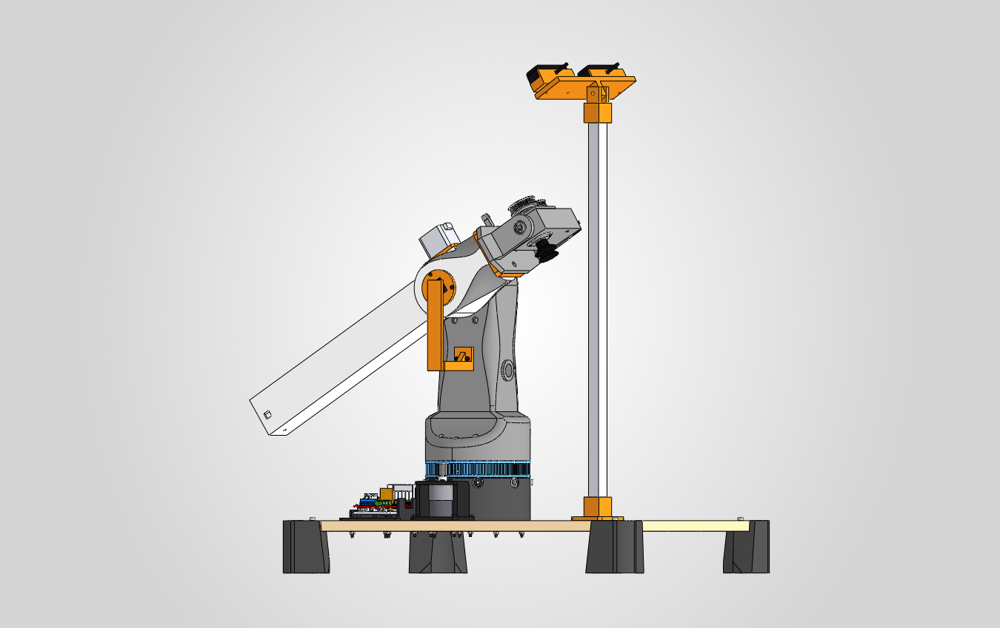
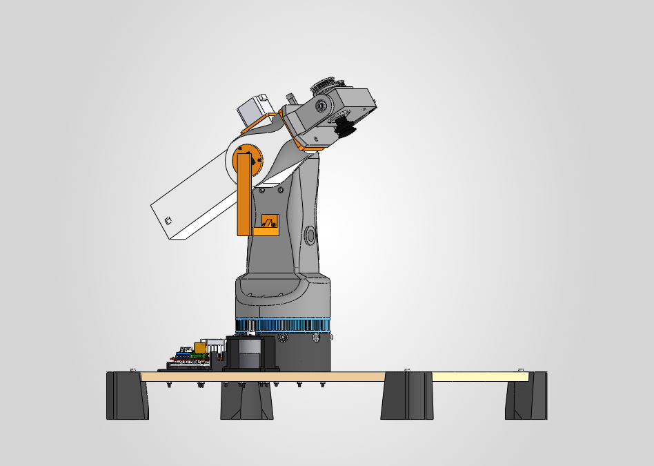
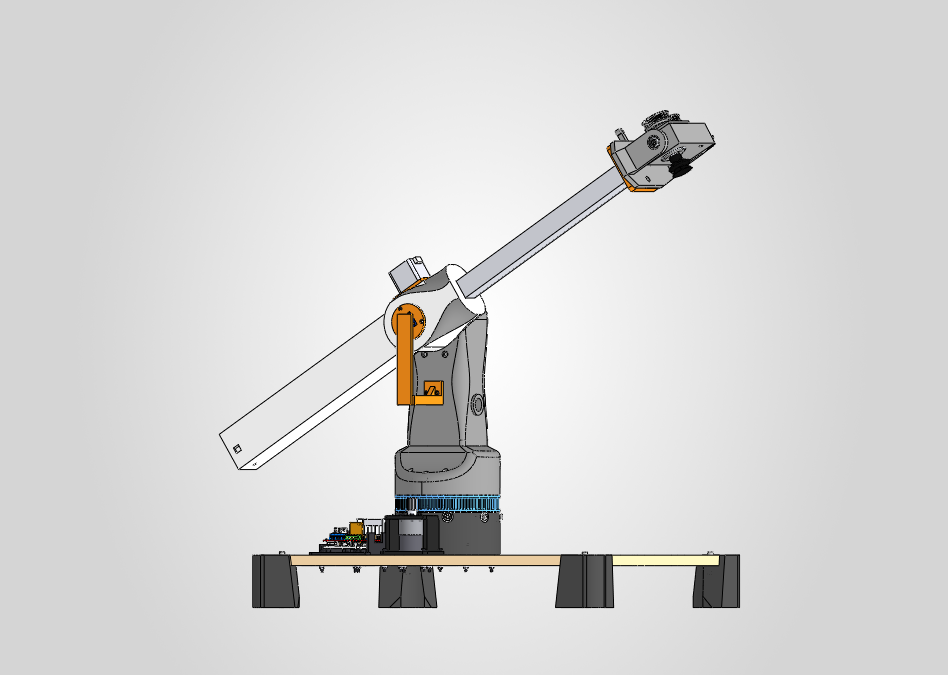
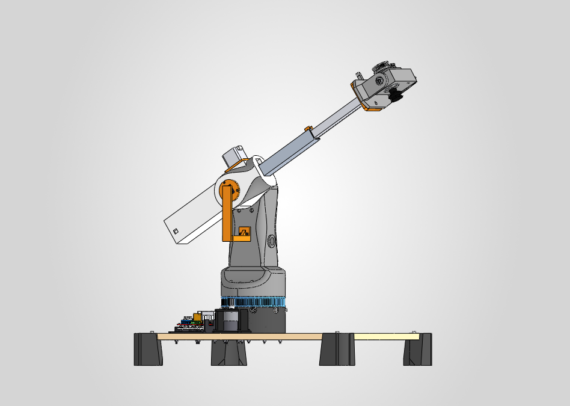
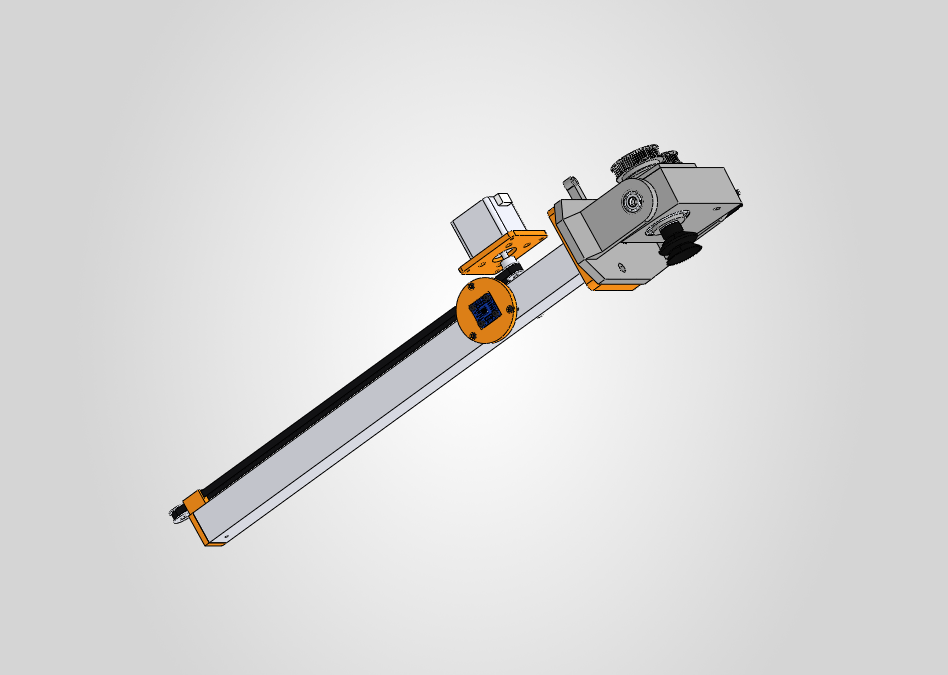
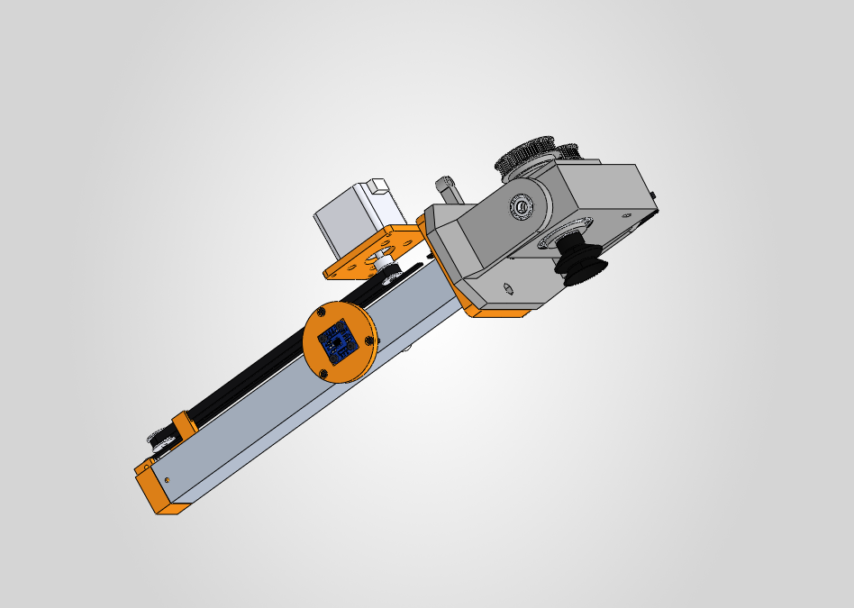
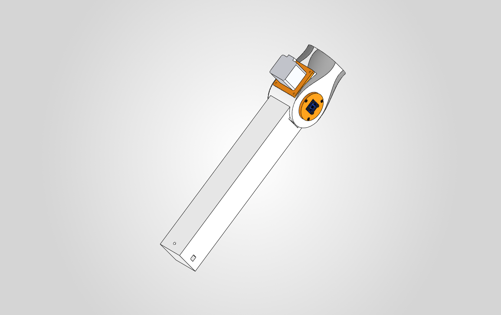
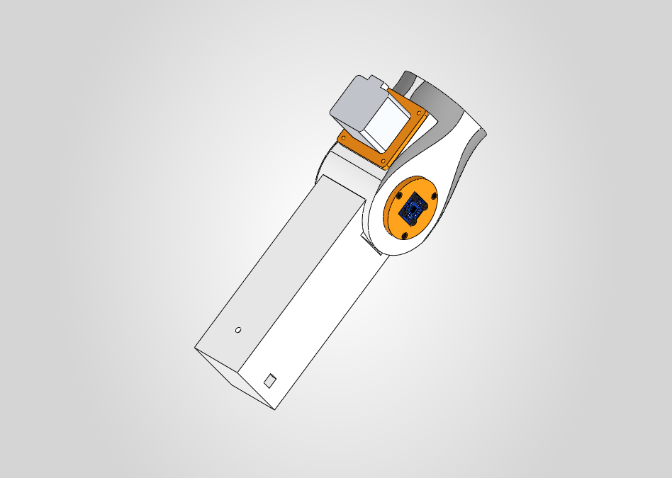
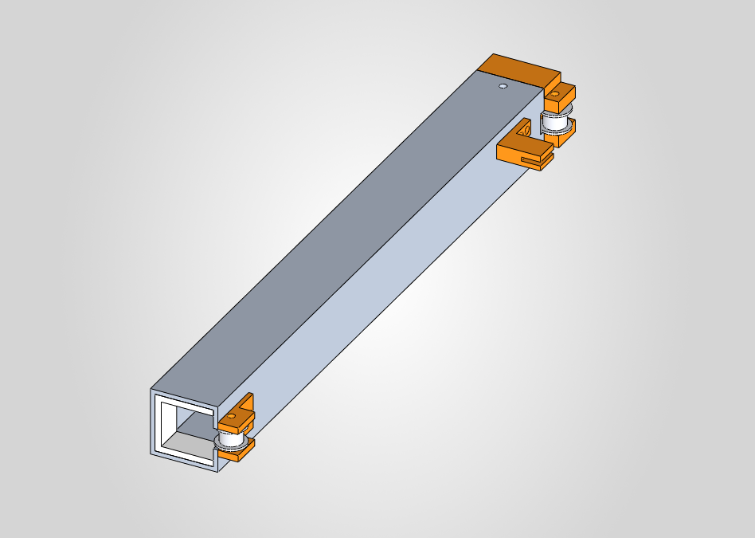

# Prismático v7: variante A (correa) y variante B (telescópica)

Dos maneras de acortar el prismático J3 de la v6. En las dos:

- **El hombro no cambia**: motorreductor 5840 acoplado directo a E2, AS5600 en la tapa de E2 (CB-303) e imán en el soporte fijo de la torre (CB-232). El AS5600 sigue midiendo el ángulo real de J2.
- **La cintura y el eje J1 no cambian** (torre CB-210, plato 1M1B, motor 37D).
- La brida de la herramienta queda donde estaba en la v6, así que la herramienta tampoco se toca.
- El NEMA 17 del prismático pasa de la punta de la cola a **arriba del cubo de E2**, casi sobre el eje J2 (22 mm por delante en A, 40 mm en B). Ahí no lo alcanza el soporte del imán, que pasa por debajo de E2, ni la torre.
- J3 se mueve con **correa GT2** en lugar del husillo T8.

> **Decisión (2026-10-27): la variante A es el diseño oficial.** Está en el ensamblaje principal `cad/solidworks/CB-000_CitriBot_Ensamblaje_General.SLDASM`, con los nombres de siempre: CB-300, CB-301 (E2), CB-400, CB-401 (tubo), CB-403 (tapón con pinza), CB-514 (correa) y CB-306 (placa del motor). La variante B queda como alternativa en `cad/solidworks/CB-000B_CitriBot_v7B_Telescopico.SLDASM` y `11_v7B_Prismatico_Telescopico/`. Scripts: `08_Scripts_API_SolidWorks/V7.cs` (genera las dos) y `Promote.cs` (pasó la A a los nombres oficiales).

| | v7A (correa) | v7B (telescópica) |
|---|---|---|
| J3 retraído |  |  |
| J3 extendido (340 mm) |  |  |
| Mecanismo (E2, base y torre ocultos) |  |  |

## 1. Comparación

| | v6 | **A: correa** | **B: telescópica** |
|---|---|---|---|
| Brazo detrás del eje J2 | 452 mm | **377 mm** (−17 %) | **204 mm** (−55 %) |
| Largo de E2 impreso | 504,5 mm | 470 mm | 297 mm |
| Largo total retraído (cola → labio de la SAB40) | 679 mm | 605 mm | 432 mm |
| Largo total extendido | 1029 mm | 945 mm | 772 mm |
| Carrera de J3 | 350 mm | 340 mm | 340 mm (170 + 170) |
| Ventosa SAB40 (ρ desde J2) | 227,8 – 577,8 mm | 227,8 – 567,8 mm | 227,8 – 567,8 mm |
| Margen sobre la esfera (254 – 554 mm) | 26 / 24 mm | 26 / 14 mm | 26 / 14 mm |
| Transmisión de J3 | husillo T8, avance 8 mm | correa GT2, polea 20T (40 mm/vuelta) | correa GT2 + multiplicador 2:1 (80 mm/vuelta en la brida) |
| Resolución (A4988 a 1/16) | 400 pasos/mm | 80 pasos/mm | 40 pasos/mm |
| Fuerza en J3 (extendido, J2 a 45°) | 17 N | ≈ 18 N → 1,2 kg·cm en el motor | ≈ 36 N → 2,3 kg·cm en el motor |
| Masa que gira con J2 | 2,22 kg | 2,10 kg | 1,95 kg |
| Pico de torque en J2 | 25 kg·cm | **39 kg·cm** | **44 kg·cm** |
| Piezas impresas nuevas | – | 3 | 8 |

- El torque del hombro sube porque el NEMA ya no está en la punta de la cola haciendo de contrapeso. Ver §6.
- Las fuerzas de J3 suponen roce 0,25 del aluminio en la guía impresa, igual que `control/torques.py`. Con patines de PTFE bajan a la mitad.
- La correa, igual que el husillo de avance 8 mm, **no es autoblocante**: dejar el driver habilitado para que el brazo inclinado no deslice.

## 2. Variante A: una etapa con correa

- **E3** es un tubo de aluminio 30 × 30 × 2 de **440 mm** (antes 460). Desliza en el mismo canal 31 × 31 de E2.
- **E2** (CB-301) es el de la v6 con la cola cortada a 377 mm detrás de J2. Arriba del canal tiene una **ranura de 22 × 15,5 mm** donde corre el lazo de la correa. El techo de la cola sube de 27,5 a 36 mm.
- **Accionamiento**: NEMA 17 vertical sobre el cubo (placa CB-306), polea GT2 20T en el eje y polea loca 20T en la punta de la cola (tornillo M5 vertical). El lazo va de una polea a la otra por encima del tubo.
- **Tapón trasero con pinza** (CB-403): tapa el tubo y sujeta los dos extremos de la correa. Al girar el motor, la correa arrastra el tubo.
- Con J3 extendido quedan **98 mm de tubo dentro de E2** (108 en la v6). La pinza queda a 6 mm de la polea del motor.

## 3. Variante B: telescópica 2:1

| Tramo intermedio CB-410B |
|---|
|  |

Tres piezas deslizan una dentro de otra:

| Tramo | Pieza | Recorrido respecto de E2 |
|---|---|---|
| Manga (fija) | E2, CB-301B: canal 31 × 31 de 297 mm | – |
| Intermedio | tubo 30 × 30 × 2 de **275 mm** (CB-411B) | 0 – 170 mm |
| Interior (E3) | tubo 20 × 20 × 1,5 de **263 mm** (CB-421B) + brida CB-432B | 0 – 340 mm |

**Cómo funciona:**

1. **Etapa 1.** El NEMA mueve el **intermedio** con una correa GT2 en lazo, igual que en A. El lazo va de la polea del motor a una polea loca en la cola de E2, y la pinza CB-415B une el intermedio con la correa.
2. **Multiplicador 2:1.** El intermedio lleva una polea loca 16T en cada punta: CB-412B atrás y CB-413B adelante. Una segunda correa:
   - sale del **anclaje fijo de E2**, 72 mm delante de J2;
   - da la vuelta a la polea delantera;
   - corre por dentro del intermedio, en los 3 mm libres sobre el tubo interior, y se sujeta al **tubo interior** (pinza CB-422B);
   - sigue hasta la polea trasera, da la vuelta y vuelve al anclaje.

   Cuando el intermedio avanza x, el interior avanza 2x respecto de E2. Es el mismo mecanismo de los mástiles de autoelevadora, con correa en los dos sentidos.
3. **Guías:** con J3 extendido quedan 95 mm del intermedio dentro de E2 y 93 mm del interior dentro del intermedio. El interior se guía con el buje delantero CB-414B (en U, abierto arriba para la correa) y con los patines del buje trasero CB-422B.

En el CAD, el intermedio (CB-410B) y el interior (CB-400B) tienen relaciones de límite separadas: 0–170 y 0–340 mm. La correa del multiplicador está dibujada en home y no acompaña el movimiento. Para mover el brazo a mano en SolidWorks, llevá el intermedio a la mitad de q3.

## 4. Lista de materiales

Solo cambia el eslabón E2 con el prismático. El resto del robot (base, cintura, hombro, herramienta y electrónica) queda igual que en [bom/BOM.md](../bom/BOM.md).

### 4.1 Variante A

**Comprado**

| Componente | Especificación | Cant. | CAD | Respecto de la v6 |
|---|---|---|---|---|
| Motor paso a paso NEMA 17 | 40 mm, 0,42 N·m, 1,7 A, eje Ø5 (17HS4401) | 1 | CB-505 | igual (M03) |
| Polea GT2 | 20 dientes, agujero 5 mm, correa de 6 mm, 2 prisioneros | 1 | HW_Polea_GT2_20T_D5 | nueva |
| Polea loca GT2 dentada | 20 dientes, agujero 5 mm, con rodamientos | 1 | HW_Polea_Loca_GT2_20T_D5 | nueva |
| Correa GT2 abierta | 6 mm de ancho, 1 m (lazo de 810 mm + extremos en la pinza) | 1 | CB-514 | nueva (puede salir del kit T04) |
| Tubo cuadrado de aluminio | 30 × 30 × 2 mm, **440 mm** | 1 | CB-401 | antes 460 mm (X05) |
| Pasador de acero | Ø3 × 30 mm | 2 | – | reemplaza los 2 M3 × 35 pasantes (H24) |
| Inserto térmico M3 | para PETG, Ø exterior ≈ 4,6 mm, largo 5–6 mm | 4 | – | nuevo |
| Tornillo M3 × 6 Allen | motor → placa CB-306 | 4 | – | antes motor → E2 (H01) |
| Tornillo M3 × 10 | placa CB-306 → insertos de E2 | 4 | – | nuevo |
| Tornillo M5 × 70 + tuerca M5 autoblocante + 2 arandelas M5 | eje vertical de la polea loca | 1 | – | nuevo |
| Precinto | extremos de la correa en la pinza | 2 | – | nuevo |
| Cinta de PTFE adhesiva | canal 31 × 31 | 0,5 m | – | recomendada en la v6 |
| Final de carrera | home de J3 (tubo retraído) | 1 | – | ya en S04 |

**Impreso (PETG)**

| Pieza | Relleno | Notas |
|---|---|---|
| CB-301 Eslabón E2 | cubo: ≥ 6 perímetros y 50 %; cola: 3 perímetros y 15 % | 470 mm: 2 tramos (cubo hasta x ≈ −100 + cola), unión a media madera con tornillos |
| CB-306 Placa soporte del NEMA 17 | 100 % | 62 × 62 × 5 |
| CB-403 Tapón trasero con pinza | 100 % | |
| CB-402 Brida de E3 | 100 % en el tapón | igual que la v6 |

**Sale de la BOM de la v6:** husillo T8 + tuerca (T05), acople 5 × 8 (T06), portatuerca CB-403 (P12) y los 4 M3 × 10 de la tuerca.

### 4.2 Variante B

**Comprado**

| Componente | Especificación | Cant. | CAD | Respecto de la v6 |
|---|---|---|---|---|
| Motor paso a paso NEMA 17 | 40 mm (17HS4401) a ≤ 150 rpm; mejor 48 mm, 0,55 N·m (17HS19), mismo montaje | 1 | CB-505 | igual (M03); ver §1, el motor trabaja más que en A |
| Polea GT2 | 20 dientes, agujero 5 mm, correa de 6 mm | 1 | HW_Polea_GT2_20T_D5 | nueva |
| Polea loca GT2 dentada | 20 dientes, agujero 5 mm, con rodamientos | 1 | HW_Polea_Loca_GT2_20T_D5 | nueva |
| Polea loca GT2 dentada | **16 dientes, agujero 3 mm**, con rodamientos | 2 | HW_Polea_Loca_GT2_16T_D3 | nueva |
| Correa GT2 abierta | 6 mm, **1,5 m** (etapa 1 ≈ 470 mm + multiplicador ≈ 570 mm + extremos) | 1 | CB-441B, CB-442B | nueva |
| Tubo cuadrado de aluminio | 30 × 30 × 2 mm, **275 mm** | 1 | CB-411B | reemplaza el de 460 mm (X05) |
| Tubo cuadrado de aluminio | **20 × 20 × 1,5 mm, 263 mm** | 1 | CB-421B | nuevo |
| Pasador de acero | Ø5 × 20 mm + clip E de 5 mm + arandela M5 | 1 | – | eje de la polea loca de la etapa 1 |
| Pasador de acero | Ø3 × 30 / Ø3 × 25 / Ø3 × 20 mm | 1 + 1 + 1 | – | tapón del intermedio / buje del interior / brida |
| Tornillo M3 × 25 + tuerca M3 autoblocante | eje de la polea 16T trasera | 1 | – | |
| Tornillo M3 × 20 + tuerca M3 autoblocante | eje de la polea 16T delantera | 1 | – | |
| Tornillo M3 × 4 | soporte de la polea delantera → intermedio (roscado en la pared) | 2 | – | |
| Tornillo M3 × 5 | pinza de la etapa 1 → intermedio (roscado en la pared) | 2 | – | |
| Tornillo M3 × 10 + placa de apriete impresa | anclaje de la correa 2:1 en E2 | 1 | – | placa no modelada |
| Tornillo M2 × 6 + placa dentada impresa | correa 2:1 → tubo interior | 2 | – | placa no modelada |
| Inserto térmico M3 | para PETG | 4 | – | |
| Tornillo M3 × 6 Allen | motor → placa CB-306 | 4 | – | |
| Tornillo M3 × 10 | placa CB-306 → insertos de E2 | 4 | – | |
| Macho M3 + broca de 2,5 mm | roscar los 4 agujeros de la cara superior del intermedio | 1 | – | herramienta |
| Precinto | extremos de la correa de la etapa 1 | 2 | – | |
| Cinta de PTFE adhesiva | canal de E2 y buje delantero | 0,5 m | – | |
| Final de carrera | home de J3 | 1 | – | ya en S04 |

**Impreso (PETG)**

| Pieza | Relleno | Notas |
|---|---|---|
| CB-301B Eslabón E2 | cubo: ≥ 6 perímetros y 50 %; manga: 4 perímetros y 25 % | 297 mm: 2 tramos, o 1 en diagonal si entra en la cama |
| CB-306 Placa soporte del NEMA 17 | 100 % | igual que en A |
| CB-412B Tapón trasero del intermedio con polea | 100 % | |
| CB-413B Soporte de la polea delantera | 100 % | |
| CB-414B Buje delantero del intermedio | 100 % | mejor en PTFE o UHMW mecanizado |
| CB-415B Pinza de la correa de la etapa 1 | 100 % | |
| CB-422B Buje trasero del interior con pinza 2:1 | 100 % | |
| CB-432B Brida de E3 para tubo 20 × 20 | 100 % en el tapón | reemplaza a CB-402 |

**Sale de la BOM de la v6:** husillo T8 + tuerca (T05), acople 5 × 8 (T06), portatuerca CB-403 (P12), brida CB-402 (P09), los 4 M3 × 10 de la tuerca y el tubo de 460 mm.

> Fijaciones al ras: el tubo de 30 × 30 desliza en el canal con 0,5 mm de juego, y el de 20 × 20 pasa por el buje delantero con 0,2 mm. Una cabeza de tornillo en los costados roza. Por eso la brida y los tapones van con **pasador de acero al ras + epoxi**. La v6 tenía el mismo problema con los M3 × 35 pasantes (H24).

## 5. Montaje

El hombro (5840, buje CB-305, AS5600, tapa CB-303 e imán CB-232) se arma igual que en la v6: pasos 6, 9 y 10 de [cad/solidworks/README.md](../cad/solidworks/README.md#8-secuencia-de-montaje-sugerida).

### 5.1 Variante A

1. **E2.** Pegá los 2 tramos de CB-301. Colocá los **4 insertos M3** en la base del motor (soldador a ≈ 220 °C). Pegá la cinta de PTFE en el canal.
2. **Motor.** Atornillá el NEMA 17 a la placa CB-306 con 4 × M3 × 6 desde abajo: las cabezas quedan en el cajeado. El conector del motor apunta hacia la cola.
3. **Polea del motor.** Entrá la polea GT2 20T por el frente del canal, subila a la ranura y llevala debajo del agujero del motor, con el cubo hacia arriba.
4. **Motor a E2.** Bajá el motor con la placa, pasando el eje por la polea, y atornillá la placa con 4 × M3 × 10. Dejá la cara inferior de la polea a **26 mm de la cara del motor** y apretá los prisioneros sobre el plano del eje desde la ranura.
5. **Polea loca.** Metela en la ranura, en la punta de la cola. Pasá el M5 × 70 de arriba hacia abajo, con una arandela de cada lado de la polea, y cerrá con la tuerca autoblocante abajo.
6. **Tubo.** Cortalo a 440 mm. Perforá Ø3 a 10 mm de cada punta, de arriba hacia abajo. Pegá la brida CB-402 y el tapón CB-403 con epoxi y clavá los pasadores Ø3 × 30 al ras.
7. Meté el tubo por el frente de E2 hasta el fondo (home).
8. **Correa.** Pasala por la ranura alrededor de las dos poleas. Metés un extremo en la ranura de la pinza, la tensás a mano y metés el otro extremo con los dientes enfrentados. Asegurá con 2 precintos. Tiene que quedar tensa como una cuerda de guitarra grave, sin dientes saltados.
9. **Final de carrera** en la pared trasera de E2, tocado por el tapón con J3 retraído.
10. **Herramienta.** Horquilla CB-601 a la brida con 4 × M5 × 25 + tuerca.
11. **Firmware:** 80 pasos/mm a 1/16 de micropaso. Probar primero a 50 mm/s.

### 5.2 Variante B

1. **E2.** Pegá los tramos de CB-301B. Colocá los 4 insertos M3 de la base del motor y pegá la cinta de PTFE en el canal. Presioná el **pasador Ø5** de la polea loca en el techo de la manga, de arriba hacia abajo.
2. **Motor y polea 20T:** igual que los pasos 2 a 4 de A, con la cara inferior de la polea a **24,5 mm** de la cara del motor.
3. **Polea loca 20T.** Metela en el pasador desde la ranura, con una arandela arriba, y trabala abajo con el clip E.
4. **Tubo intermedio.** Cortalo a 275 mm.
   - Abrí en la cara superior la **ventana de 14,5 × 9,4 mm** de la punta delantera y la **muesca de 3 × 9,4 mm** de la punta trasera (amoladora o lima). Son para las poleas 16T.
   - Perforá Ø2,5 y roscá M3 los 4 agujeros de la cara superior. Los dos delanteros están a 23 y 17 mm de la punta delantera; los dos traseros, a 20 y 25 mm de la punta trasera, corridos 7,2 mm del centro.
   - Perforá Ø3 de lado a lado a 6 mm de la punta trasera.
5. **Tubo interior.** Cortalo a 263 mm y perforá Ø3 de lado a lado a 10 mm de cada punta.
6. **Interior.**
   - Pegá la brida CB-432B en la punta delantera y el buje CB-422B en la trasera, cada uno con epoxi y un pasador al ras.
   - Atornillá la **placa dentada** del tramo inferior de la correa 2:1 sobre el tubo, dentro del canal del buje trasero (2 × M2 × 6).
7. **Intermedio.**
   - Pegá el buje delantero CB-414B en la punta delantera, con la abertura hacia arriba.
   - Atornillá el soporte CB-413B (2 × M3 × 4) y la pinza CB-415B (2 × M3 × 5). Los tornillos no pueden asomar por dentro del tubo: por ahí pasa la correa.
   - Montá la polea 16T delantera en el soporte (M3 × 20 + tuerca autoblocante).
8. **Telescopio.**
   - Pasá la correa 2:1 por la ventana delantera, alrededor de la polea delantera y hacia atrás por adentro del intermedio.
   - Metés el interior **por atrás**: los patines del buje trasero (25,6 mm) no pasan por el buje delantero (20,4 mm). El tramo inferior de la correa queda entre el interior y la cara superior del intermedio. Sujetalo a la placa dentada del interior.
   - Montá la polea 16T trasera en el tapón CB-412B (M3 × 25 + tuerca autoblocante) y pasá la correa alrededor de ella.
   - Pegá el tapón en la punta trasera del intermedio, con su pasador Ø3 × 30.
9. Dejá los dos extremos libres de la correa 2:1 sobre el intermedio, apuntando al anclaje.
10. **Telescopio a E2.** Metelo por el frente de E2 hasta el fondo, con el interior también retraído.
11. **Cerrar la correa 2:1.** Los dos extremos van al **anclaje de E2**, a 72 mm delante de J2 (placa de apriete + M3 × 10 desde abajo). Tensala con el intermedio y el interior retraídos.
12. **Correa de la etapa 1.** Rodeá la polea del motor y la polea loca y cerrala en la pinza CB-415B, igual que en A.
13. **Prueba a mano.** Empujá el intermedio: el interior tiene que salir el doble y volver sin trabarse. Si hay juego vertical, agregá PTFE en el buje delantero.
14. **Final de carrera y herramienta:** como en A.
15. **Firmware:** **40 pasos/mm de q3** a 1/16 de micropaso. Con el 17HS4401, limitar el motor a ≈ 150 rpm (≈ 200 mm/s en la brida).

## 6. Hombro: ¿direct drive?

Hoy el hombro ya es direct drive en un sentido: el eje del 5840 entra directo en E2, sin correas ni engranajes extra. **Eso conviene mantenerlo.** Un direct drive "real", con un motor sin reductor, no es factible:

| Opción | Torque | Problema |
|---|---|---|
| NEMA 17 sin reductor | 0,4 – 0,55 N·m | J2 pide ≈ 3,5 – 4 N·m solo para sostener el brazo extendido (A: 35 kg·cm, B: 40 kg·cm): 8 a 10 veces más |
| NEMA 23 de 76 mm | ≈ 1,9 N·m | la mitad de lo necesario |
| NEMA 34 | 4,5 N·m o más | ≈ 2,5 kg, driver de 4–6 A (no sirve el A4988) y no entra en la torre |
| Motor brushless de gimbal | 0,1 – 0,5 N·m | muy poco torque |
| Cualquier paso a paso sin reductor | – | bajo carga el rotor se corre hasta 1 paso (1,8°): **18 mm de error** en la ventosa a 570 mm |

**Recomendación: seguir con el 5840 acoplado directo**, como en la v6. Es autoblocante: sostiene el brazo sin corriente. El AS5600 sigue igual, midiendo el ángulo real de E2 incluido el juego del sinfín. No toca la torre ni el eje J1.

- **Margen:** A pide 39 kg·cm de pico y B 44. El vendedor da ≈ 70 kg·cm sin aclarar si es nominal o de bloqueo, lo que deja × 1,8 y × 1,6.
- **Medirlo antes de imprimir:** colgá **1 kg a 40 cm** del eje del 5840 (40 kg·cm) y verificá que lo levanta a 12 V sin acercarse a la corriente de bloqueo (6,5 A).
- **Si no alcanza, en este orden:**
  1. Un contrapeso de 0,3–0,4 kg en la pared trasera de E2 baja ≈ 7 kg·cm en B, o un resorte entre la torre y E2.
  2. Un 5840 más lento, con la misma caja y los mismos agujeros. Confirmar en la tabla del vendedor que sube el torque nominal.
  3. NEMA 17 + reductor cicloidal: obliga a tocar la torre, así que queda como última opción.

## 7. Verificación en el CAD

- **Relaciones de posición:** 0 errores en CB-000 (variante A, 7) y CB-000B (10). Las de J1 y J2 son las de la v6.
- **Piezas:** un sólido cada una.
- **Interferencias dentro de cada subensamblaje** (CB-300, CB-400, CB-300B, CB-400B, CB-410B): ninguna nueva. Quedan solo las de la v6: tornillos autorroscantes de la tapa del AS5600 y el buje CB-305 a presión.
- **Barrido de J2** (`Sweep7.cs`): brazo apuntando al árbol (borde del tablero a 194,8 mm), J2 de −45° a +45° cada 15°.

| Variante | J3 retraído | J3 extendido (340 mm) |
|---|---|---|
| A | libre en todo el rango | libre en todo el rango |
| B | libre en todo el rango | sin choques con la base ni la torre (\*) |

(\*) Con B extendido, SolidWorks marca la correa del multiplicador contra el intermedio. Es porque la correa está dibujada fija en home. No es un choque real.

Durante la verificación se corrigieron tres cosas:

- **Placa soporte CB-306 del NEMA.** Los tornillos del motor no tenían acceso desde dentro del cubo.
- **Rebaje del cubo en A.** El cubo del Rx llega a y = 46,7 y pisaba la placa.
- **Muesca trasera en el tubo intermedio de B.** La polea 16T trasera rozaba la pared superior.

## 8. Pendientes

- Medir el torque real del 5840 (§6) antes de elegir entre A y B.
- B: imprimir primero el telescopio (intermedio + interior + buje) y probar el juego antes de imprimir E2.
- Modelar las placas de apriete de las correas y el final de carrera.
- Actualizar `bom/BOM_CitriBot.csv` cuando elijan una variante (§4 dice qué sale y qué entra).
- `control/torques.py` y `docs/espacio_de_trabajo.md` siguen con los números de la v6.
